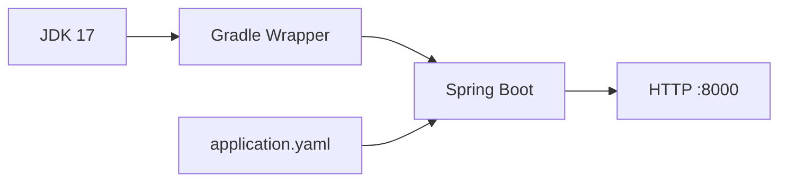

# 01 — Ligar o motor

[Roteiro](../README.md) · [Como estudar](como-estudar.md) · [Contrato](00-modelo-dados.md)

## Missão

Criar um projeto Java 17 que inicia o Spring Boot na porta 8000, sem banco de dados.

Conclua a preparação do ambiente e leia o contrato antes de começar.

**Checkpoint de apoio:** `01-projeto-spring-boot-impl`. Os blocos abaixo contêm arquivos completos desta etapa; não adicione as dependências dos próximos módulos antecipadamente.



## 1. Gere o esqueleto uma única vez

No [Spring Initializr](https://start.spring.io), escolha Gradle **Groovy**, Java,
Spring Boot **4.1.1**, JAR e Java **17**. Use os valores abaixo:

| Campo | Valor |
| --- | --- |
| Group | `br.com.etecalbertoferes` |
| Artifact / Name | `CaixaDeSugestoes` |
| Package name | `br.com.etecalbertoferes.CaixaDeSugestoes` |
| Dependencies | Somente Spring Web |

Se o gerador não oferecer a versão da trilha, gere um projeto Java 17 com Web e
substitua o `build.gradle` pelo arquivo abaixo antes de sincronizar. Não selecione
JPA, Validation, banco ou Lombok neste módulo.

Extraia em `C:\dev\projetos\CaixaDeSugestoes` no Windows. Abra na IDE a pasta que
contém `build.gradle`, não a pasta acima. Mantenha os arquivos `gradlew`,
`gradlew.bat` e `gradle/wrapper/gradle-wrapper.jar` gerados: o JAR do Wrapper é
binário, não se cria copiando texto. Não é necessário instalar Gradle globalmente.

Apague `src/main/resources/application.properties` se o gerador o criou; usaremos
somente `application.yaml`. Os comandos seguintes são executados na raiz do projeto.

## 2. Fixe as versões e as dependências

### `build.gradle`

Substitua o conteúdo inteiro deste arquivo. O starter webmvc fornece HTTP; o starter de teste inclui JUnit, AssertJ, Mockito e MockMvc.

<!-- arquivo: build.gradle -->
```groovy
plugins {
    id 'java'
    id 'org.springframework.boot' version '4.1.1'
    id 'io.spring.dependency-management' version '1.1.7'
}
group = 'br.com.etecalbertoferes'
version = '0.0.1-SNAPSHOT'
java { toolchain { languageVersion = JavaLanguageVersion.of(17) } }
repositories { mavenCentral() }
dependencies {
    implementation 'org.springframework.boot:spring-boot-starter-webmvc'
    testImplementation 'org.springframework.boot:spring-boot-starter-webmvc-test'
    testRuntimeOnly 'org.junit.platform:junit-platform-launcher'
}
tasks.named('test') { useJUnitPlatform() }
```

### `settings.gradle`

Substitua o conteúdo inteiro deste arquivo. O nome determina o nome do JAR gerado.

<!-- arquivo: settings.gradle -->
```groovy
rootProject.name = 'CaixaDeSugestoes'
```

Atualize o Wrapper gerado para a versão da trilha. No PowerShell:

```powershell
.\gradlew.bat wrapper --gradle-version 9.7.1
.\gradlew.bat --version
```

No Linux/macOS, os comandos equivalentes são `./gradlew wrapper --gradle-version
9.7.1` e `./gradlew --version`. Se necessário, `chmod +x gradlew`.
Execute novamente a tarefa `wrapper` com os mesmos argumentos após o primeiro
upgrade para atualizar também os scripts e o JAR. Confira o arquivo abaixo;
uma entrada `distributionSha256Sum` de outra versão deve ser atualizada com o
checksum oficial correspondente, ou removida se não faz parte da configuração
adotada pelo professor. Não mantenha o checksum da distribuição anterior.

### `gradle/wrapper/gradle-wrapper.properties`

Substitua o conteúdo inteiro deste arquivo. Esta é a configuração de referência para o Wrapper 9.7.1.

<!-- arquivo: gradle/wrapper/gradle-wrapper.properties -->
```properties
distributionBase=GRADLE_USER_HOME
distributionPath=wrapper/dists
distributionUrl=https\://services.gradle.org/distributions/gradle-9.7.1-bin.zip
networkTimeout=10000
retries=0
retryBackOffMs=500
validateDistributionUrl=true
zipStoreBase=GRADLE_USER_HOME
zipStorePath=wrapper/dists
```

## 3. Crie a entrada e a configuração

Todos os pacotes novos ficarão abaixo de `br.com.etecalbertoferes.CaixaDeSugestoes`, para que o component scan os encontre. Respeite maiúsculas e minúsculas.

### `src/main/java/br/com/etecalbertoferes/CaixaDeSugestoes/CaixaDeSugestoesApplication.java`

Substitua o conteúdo inteiro deste arquivo. `@SpringBootApplication` habilita configuração automática e busca de componentes.

<!-- arquivo: src/main/java/br/com/etecalbertoferes/CaixaDeSugestoes/CaixaDeSugestoesApplication.java -->
```java
package br.com.etecalbertoferes.CaixaDeSugestoes;

import org.springframework.boot.SpringApplication;
import org.springframework.boot.autoconfigure.SpringBootApplication;

@SpringBootApplication
public class CaixaDeSugestoesApplication {
    public static void main(String[] args) {
        SpringApplication.run(CaixaDeSugestoesApplication.class, args);
    }
}
```

### `src/main/resources/application.yaml`

Crie este arquivo. YAML usa espaços para representar níveis, nunca tabs.

<!-- arquivo: src/main/resources/application.yaml -->
```yaml
server:
  port: 8000
spring:
  application:
    name: CaixaDeSugestoes
```

## 4. Confira o contexto de teste

Exclua o arquivo de teste de contexto gerado pelo Initializr (por exemplo, `CaixaDeSugestoesApplicationTests.java`) e crie somente `ContextTest.java` abaixo. Não mantenha os dois testes: a contagem da trilha parte de um único teste de contexto. Nesta etapa ele não precisa de banco.

### `src/test/java/br/com/etecalbertoferes/CaixaDeSugestoes/ContextTest.java`

Crie este arquivo. O teste inicia o contexto Spring sem abrir um servidor HTTP real.

<!-- arquivo: src/test/java/br/com/etecalbertoferes/CaixaDeSugestoes/ContextTest.java -->
```java
package br.com.etecalbertoferes.CaixaDeSugestoes;

import org.junit.jupiter.api.Test;
import org.springframework.boot.test.context.SpringBootTest;

@SpringBootTest
class ContextTest {
    @Test void loads() {}
}
```

## 5. Proteja os arquivos locais e execute

Mantenha o `.gitignore` gerado e acrescente as regras abaixo, se faltarem:

```gitignore
.gradle/
build/
.idea/
*.iml
.env
.env.*
!.env.example
```

No PowerShell:

```powershell
.\gradlew.bat test
.\gradlew.bat bootRun
```

Em outro terminal, `curl.exe -i http://localhost:8000/api/suggestions` ainda
retorna **404**: nenhum controller foi criado. Pare a aplicação com `Ctrl+C`
antes de iniciar outra cópia. No Linux/macOS, use `./gradlew` e `curl`.

Inicialize o Git somente se esta pasta ainda não for um repositório: `git init`.

## Confira antes de avançar

- [ ] `java -version` e `javac -version` indicam 17.
- [ ] Wrapper 9.7.1 e `test` aprovados sem banco.
- [ ] Servidor inicia na porta 8000; a rota ainda retorna 404.

## Explique com suas palavras

Qual é a diferença entre JDK da IDE, JVM do Gradle e toolchain Java? Por que o pacote raiz importa?

## Registre sua entrega

No seu projeto, revise `git status`, adicione apenas os arquivos desta missão e faça um commit. Exemplo:

```bash
git add .
git commit -m "Conclui modulo 01: projeto-spring-boot"
```

Não versione `.env`, senhas reais, `build/` ou `.gradle/`. Consulte o checkpoint em outra pasta, conforme o [guia de estudo](como-estudar.md), e compare responsabilidades e comportamento.

[Próxima etapa: módulo 02](02-api-rest.md)
