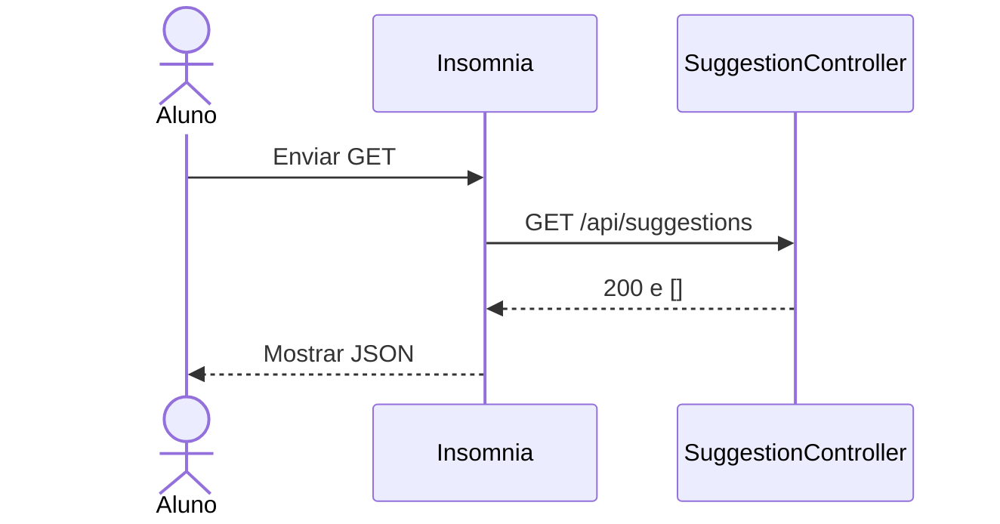

# 02 — Abrir o balcão HTTP

[Roteiro](../README.md) · [Como estudar](como-estudar.md) · [Contrato](00-modelo-dados.md)

## Missão

Criar a primeira rota e observar método, caminho, status, headers e corpo JSON.

Continue **o mesmo projeto** que concluiu no [módulo 01](01-projeto-spring-boot.md). Preserve os arquivos anteriores, exceto os explicitamente substituídos abaixo.

**Checkpoint de apoio:** `02-api-rest-impl`. Os blocos abaixo contêm arquivos completos desta etapa; não adicione as dependências dos próximos módulos antecipadamente.



## 1. Crie o pacote REST e o controller

Na IDE, crie o pacote `interfaces.rest` abaixo do pacote raiz. `@RestController`
faz o retorno do método ser serializado em JSON. `@GetMapping` associa uma rota
a uma operação. A lista vazia é uma demonstração; a consulta real entra em 04.

### `src/main/java/br/com/etecalbertoferes/CaixaDeSugestoes/interfaces/rest/SuggestionController.java`

Crie este arquivo. `List.of()` será devolvido como `[]`, sem paginação.

<!-- arquivo: src/main/java/br/com/etecalbertoferes/CaixaDeSugestoes/interfaces/rest/SuggestionController.java -->
```java
package br.com.etecalbertoferes.CaixaDeSugestoes.interfaces.rest;

import java.util.List;
import org.springframework.web.bind.annotation.GetMapping;
import org.springframework.web.bind.annotation.RestController;

@RestController
public class SuggestionController {
    @GetMapping("/api/suggestions")
    public List<Object> list() { return List.of(); }
}
```

## 2. Execute e confira a primeira resposta

```powershell
.\gradlew.bat test
.\gradlew.bat bootRun
```

Em outro terminal:

```powershell
curl.exe -i http://localhost:8000/api/suggestions
```

Espere status **200**, `Content-Type: application/json` e corpo `[]`.
Neste checkpoint, `test` ainda executa apenas o teste de contexto; os testes
MockMvc completos de contrato entram em 05. A conferência HTTP aqui é manual.

## 3. Monte a primeira coleção no Insomnia

Crie uma coleção chamada `Caixa de Sugestões`. No ambiente base, informe:

```json
{
  "baseUrl": "http://localhost:8000",
  "courseId": "",
  "categoryId": "",
  "suggestionId": ""
}
```

Crie uma requisição `GET` com URL `{{ _.baseUrl }}/api/suggestions` e envie.
Exporte sua coleção e salve no seu projeto em `collections/`. Ela pode começar
com apenas esta requisição. Em 04, você acrescentará o CRUD e, em 07, poderá
importar as collections completas do material de apoio, com captura de IDs.

No Postman, a mesma variável é escrita `{{baseUrl}}`. O nome da variável deve
continuar `baseUrl` em ambos os clientes.

## 4. Entenda o contrato que será implementado

| Método | Caminho | Resultado final esperado |
| --- | --- | --- |
| GET | `/api/suggestions` | 200 e array |
| POST | `/api/suggestions` | 201, objeto e `Location` |
| GET | `/api/suggestions/{id}` | 200 e objeto |
| PUT | `/api/suggestions/{id}` | 200 e objeto atualizado |
| DELETE | `/api/suggestions/{id}` | 204, sem corpo |
| GET | `/api/courses` | 200 e array de cursos |
| GET | `/api/categories` | 200 e array de categorias |

Somente o primeiro GET funciona agora. Não crie métodos vazios que devolvam
sucesso para as operações futuras. O contrato completo está no módulo 00.

## Confira antes de avançar

- [ ] GET retorna 200 e `[]`.
- [ ] A requisição funciona pelo terminal e pelo Insomnia.
- [ ] Você exportou sua coleção e entende que as outras rotas ainda não existem.

## Explique com suas palavras

Por que uma lista vazia é 200? Qual a diferença entre 201 com Location e 204 sem corpo?

## Registre sua entrega

No seu projeto, revise `git status`, adicione apenas os arquivos desta missão e faça um commit. Exemplo:

```bash
git add .
git commit -m "Conclui modulo 02: api-rest"
```

Não versione `.env`, senhas reais, `build/` ou `.gradle/`. Consulte o checkpoint em outra pasta, conforme o [guia de estudo](como-estudar.md), e compare responsabilidades e comportamento.

[Próxima etapa: módulo 03](03-postgresql-flyway-jpa.md)
