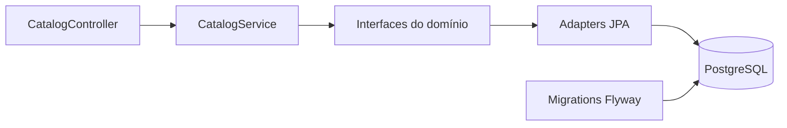
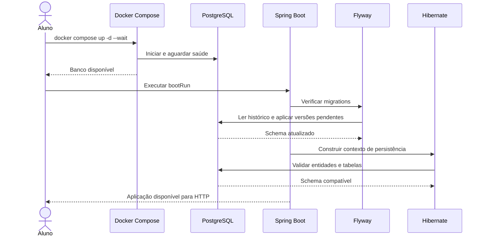

# 03 — Guardar as ideias

[Roteiro](../README.md) · [Como estudar](como-estudar.md) · [Contrato](00-modelo-dados.md)

## Missão

Criar PostgreSQL reproduzível, migrations e catálogos reais, separando domínio e persistência.

Continue **o mesmo projeto** que concluiu no [módulo 02](02-api-rest.md). Preserve os arquivos anteriores, exceto os explicitamente substituídos abaixo.

**Checkpoint de apoio:** `03-postgresql-flyway-jpa-impl`. Os blocos abaixo contêm arquivos completos desta etapa; não adicione as dependências dos próximos módulos antecipadamente.



## 1. Acrescente somente as dependências desta etapa

Substitua o `build.gradle` abaixo e recarregue o projeto Gradle na IDE.
O starter Flyway habilita migrations; o módulo PostgreSQL permite executá-las
nesse banco. Os módulos Testcontainers serão usados no teste ao final.
Não use H2 e não acrescente Lombok: os arquivos desta trilha usam Java explícito.

### `build.gradle`

Substitua o conteúdo inteiro deste arquivo. Preserva as dependências HTTP e acrescenta persistência e testes PostgreSQL.

<!-- arquivo: build.gradle -->
```groovy
plugins {
    id 'java'
    id 'org.springframework.boot' version '4.1.1'
    id 'io.spring.dependency-management' version '1.1.7'
}
group = 'br.com.etecalbertoferes'
version = '0.0.1-SNAPSHOT'
java { toolchain { languageVersion = JavaLanguageVersion.of(17) } }
repositories { mavenCentral() }
dependencies {
    implementation 'org.springframework.boot:spring-boot-starter-webmvc'
    implementation 'org.springframework.boot:spring-boot-starter-data-jpa'
    implementation 'org.springframework.boot:spring-boot-starter-flyway'
    implementation 'org.flywaydb:flyway-database-postgresql'
    runtimeOnly 'org.postgresql:postgresql'
    testImplementation 'org.springframework.boot:spring-boot-starter-webmvc-test'
    testImplementation 'org.testcontainers:testcontainers-junit-jupiter'
    testImplementation 'org.testcontainers:testcontainers-postgresql'
    testRuntimeOnly 'org.junit.platform:junit-platform-launcher'
}
tasks.named('test') { useJUnitPlatform() }
```

## 2. Prepare o PostgreSQL e a conexão

Inicie Docker Desktop antes de continuar. As credenciais abaixo são somente para desenvolvimento local. O volume preserva os registros ao reiniciar os containers.

### `compose.yaml`

Crie este arquivo. A porta 5432 é publicada apenas no endereço local do computador.

<!-- arquivo: compose.yaml -->
```yaml
services:
  postgres:
    image: postgres:17
    environment:
      POSTGRES_DB: suggestions
      POSTGRES_USER: suggestions
      POSTGRES_PASSWORD: ${DB_PASSWORD:-suggestions}
    ports:
      - "127.0.0.1:5432:5432"
    volumes:
      - postgres_data:/var/lib/postgresql/data
    healthcheck:
      test: ["CMD-SHELL", "pg_isready -U suggestions -d suggestions"]
      interval: 5s
      timeout: 5s
      retries: 15
volumes:
  postgres_data:
```

### `src/main/resources/application.yaml`

Substitua o conteúdo inteiro deste arquivo. Banco, usuário e senha de referência são `suggestions`. O schema é validado pelo Hibernate, não criado por ele.

<!-- arquivo: src/main/resources/application.yaml -->
```yaml
server:
  port: ${SERVER_PORT:8000}
spring:
  application:
    name: CaixaDeSugestoes
  datasource:
    url: ${DB_URL:jdbc:postgresql://localhost:5432/suggestions}
    username: ${DB_USERNAME:suggestions}
    password: ${DB_PASSWORD:suggestions}
  jpa:
    open-in-view: false
    hibernate:
      ddl-auto: validate
    properties:
      hibernate:
        jdbc:
          time_zone: UTC
  flyway:
    enabled: true
```

```powershell
docker compose up -d --wait
docker compose ps
```

Se a porta 5432 estiver ocupada, altere o mapeamento no Compose para
`127.0.0.1:5433:5432` e, no terminal que iniciará a API, defina:

```powershell
$env:DB_URL = "jdbc:postgresql://localhost:5433/suggestions"
```

Os placeholders aceitam `DB_URL`, `DB_USERNAME` e `DB_PASSWORD` definidos no
terminal ou na IDE. Um `.env` do Compose não é automaticamente carregado pelo
Spring. Para usar uma senha diferente, defina `DB_PASSWORD` também na execução
da API. A senha do usuário de um volume já inicializado não muda apenas porque
a variável mudou. Não apague um volume com dados para resolver isso sem backup.

## 3. Crie o schema e os catálogos com Flyway

Crie a pasta `src/main/resources/db/migration`. Os nomes dos arquivos usam dois
underscores entre a versão e a descrição. Depois de aplicar uma migration, não
edite seu conteúdo: use outra versão para evoluir o banco.

### `src/main/resources/db/migration/V1__create_tables.sql`

Crie este arquivo. IDs são identity; os textos não têm limite implícito de 255 caracteres. FKs não apagam os catálogos junto com a sugestão.

<!-- arquivo: src/main/resources/db/migration/V1__create_tables.sql -->
```sql
CREATE TABLE courses (
    id BIGINT GENERATED BY DEFAULT AS IDENTITY PRIMARY KEY,
    name TEXT NOT NULL UNIQUE
);
CREATE TABLE categories (
    id BIGINT GENERATED BY DEFAULT AS IDENTITY PRIMARY KEY,
    name TEXT NOT NULL UNIQUE
);
CREATE TABLE suggestions (
    id BIGINT GENERATED BY DEFAULT AS IDENTITY PRIMARY KEY,
    title TEXT NOT NULL,
    content TEXT NOT NULL,
    author TEXT,
    created_at TIMESTAMPTZ NOT NULL,
    course_id BIGINT NOT NULL REFERENCES courses(id),
    category_id BIGINT NOT NULL REFERENCES categories(id)
);
CREATE INDEX suggestions_course_idx ON suggestions(course_id);
CREATE INDEX suggestions_category_idx ON suggestions(category_id);
CREATE INDEX suggestions_created_idx ON suggestions(created_at DESC, id DESC);
```

### `src/main/resources/db/migration/V2__seed_catalogs.sql`

Crie este arquivo. São quatro cursos didáticos e três categorias. Consulte os IDs pela API, sem fixá-los no cliente.

<!-- arquivo: src/main/resources/db/migration/V2__seed_catalogs.sql -->
```sql
INSERT INTO courses(name) VALUES
('Desenvolvimento de Software Multiplataforma'),
('Gestão Empresarial'),
('Análise e Desenvolvimento de Sistemas'),
('Administração de Empresas');
INSERT INTO categories(name) VALUES ('Sugestão'), ('Crítica'), ('Elogio');
```

### Quem prepara o banco ao iniciar?

O banco precisa estar acessível antes da API. Flyway aplica apenas migrations
pendentes; depois Hibernate compara as entidades com as tabelas existentes.



**Pergunta para a turma:** se uma tabela estiver incompatível, por que iniciar
Hibernate com `validate` deve interromper a aplicação em vez de alterar o banco?

## 4. Defina o domínio sem JPA

Records representam os dados de forma imutável. As interfaces descrevem o acesso necessário aos catálogos; o domínio não conhece controllers nem banco. `Suggestion` ainda não tem caso de uso de gravação.

### `src/main/java/br/com/etecalbertoferes/CaixaDeSugestoes/domain/Course.java`

Crie este arquivo. Modelo de domínio.

<!-- arquivo: src/main/java/br/com/etecalbertoferes/CaixaDeSugestoes/domain/Course.java -->
```java
package br.com.etecalbertoferes.CaixaDeSugestoes.domain;

public record Course(Long id, String name) {}
```

### `src/main/java/br/com/etecalbertoferes/CaixaDeSugestoes/domain/Category.java`

Crie este arquivo. Modelo de domínio.

<!-- arquivo: src/main/java/br/com/etecalbertoferes/CaixaDeSugestoes/domain/Category.java -->
```java
package br.com.etecalbertoferes.CaixaDeSugestoes.domain;

public record Category(Long id, String name) {}
```

### `src/main/java/br/com/etecalbertoferes/CaixaDeSugestoes/domain/Suggestion.java`

Crie este arquivo. Modelo de domínio.

<!-- arquivo: src/main/java/br/com/etecalbertoferes/CaixaDeSugestoes/domain/Suggestion.java -->
```java
package br.com.etecalbertoferes.CaixaDeSugestoes.domain;

import java.time.Instant;
public record Suggestion(Long id, String title, String content, String author,
                         Instant createdAt, Course course, Category category) {}
```

### `src/main/java/br/com/etecalbertoferes/CaixaDeSugestoes/domain/CourseRepository.java`

Crie este arquivo. Contrato de consulta implementado pelo adapter JPA.

<!-- arquivo: src/main/java/br/com/etecalbertoferes/CaixaDeSugestoes/domain/CourseRepository.java -->
```java
package br.com.etecalbertoferes.CaixaDeSugestoes.domain;

import java.util.List;
import java.util.Optional;
public interface CourseRepository {
    List<Course> findAll();
    Optional<Course> findById(Long id);
}
```

### `src/main/java/br/com/etecalbertoferes/CaixaDeSugestoes/domain/CategoryRepository.java`

Crie este arquivo. Contrato de consulta implementado pelo adapter JPA.

<!-- arquivo: src/main/java/br/com/etecalbertoferes/CaixaDeSugestoes/domain/CategoryRepository.java -->
```java
package br.com.etecalbertoferes.CaixaDeSugestoes.domain;

import java.util.List;
import java.util.Optional;
public interface CategoryRepository {
    List<Category> findAll();
    Optional<Category> findById(Long id);
}
```

## 5. Mapeie as tabelas para entidades JPA

Essas classes são diferentes dos modelos anteriores. `@ManyToOne` representa as referências obrigatórias da sugestão; `LAZY` adia o carregamento dos catálogos. Não adicione cascade de remoção. O nome da tabela de categorias é **categories**.

### `src/main/java/br/com/etecalbertoferes/CaixaDeSugestoes/infrastructure/persistence/CourseEntity.java`

Crie este arquivo. Os construtores sem argumentos são utilizados pelo JPA.

<!-- arquivo: src/main/java/br/com/etecalbertoferes/CaixaDeSugestoes/infrastructure/persistence/CourseEntity.java -->
```java
package br.com.etecalbertoferes.CaixaDeSugestoes.infrastructure.persistence;

import jakarta.persistence.*;
@Entity
@Table(name = "courses")
public class CourseEntity {
    @Id @GeneratedValue(strategy = GenerationType.IDENTITY)
    Long id;
    @Column(nullable = false, unique = true, columnDefinition = "text")
    String name;
    protected CourseEntity() {}
}
```

### `src/main/java/br/com/etecalbertoferes/CaixaDeSugestoes/infrastructure/persistence/CategoryEntity.java`

Crie este arquivo. Os construtores sem argumentos são utilizados pelo JPA.

<!-- arquivo: src/main/java/br/com/etecalbertoferes/CaixaDeSugestoes/infrastructure/persistence/CategoryEntity.java -->
```java
package br.com.etecalbertoferes.CaixaDeSugestoes.infrastructure.persistence;

import jakarta.persistence.*;
@Entity
@Table(name = "categories")
public class CategoryEntity {
    @Id @GeneratedValue(strategy = GenerationType.IDENTITY)
    Long id;
    @Column(nullable = false, unique = true, columnDefinition = "text")
    String name;
    protected CategoryEntity() {}
}
```

### `src/main/java/br/com/etecalbertoferes/CaixaDeSugestoes/infrastructure/persistence/SuggestionEntity.java`

Crie este arquivo. Os construtores sem argumentos são utilizados pelo JPA.

<!-- arquivo: src/main/java/br/com/etecalbertoferes/CaixaDeSugestoes/infrastructure/persistence/SuggestionEntity.java -->
```java
package br.com.etecalbertoferes.CaixaDeSugestoes.infrastructure.persistence;

import java.time.Instant;
import jakarta.persistence.*;
@Entity
@Table(name = "suggestions")
public class SuggestionEntity {
    @Id @GeneratedValue(strategy = GenerationType.IDENTITY)
    Long id;
    @Column(nullable = false, columnDefinition = "text") String title;
    @Column(nullable = false, columnDefinition = "text") String content;
    @Column(columnDefinition = "text") String author;
    @Column(name = "created_at", nullable = false, updatable = false) Instant createdAt;
    @ManyToOne(fetch = FetchType.LAZY, optional = false)
    @JoinColumn(name = "course_id", nullable = false) CourseEntity course;
    @ManyToOne(fetch = FetchType.LAZY, optional = false)
    @JoinColumn(name = "category_id", nullable = false) CategoryEntity category;
    protected SuggestionEntity() {}
}
```

## 6. Implemente os repositories e adapters dos catálogos

Spring Data gera a consulta pelo nome `findAllByOrderByNameAsc`. O adapter converte a entidade em record antes de sair da transação, sem devolver entidades pelo HTTP.

### `src/main/java/br/com/etecalbertoferes/CaixaDeSugestoes/infrastructure/persistence/CourseJpaRepository.java`

Crie este arquivo.

<!-- arquivo: src/main/java/br/com/etecalbertoferes/CaixaDeSugestoes/infrastructure/persistence/CourseJpaRepository.java -->
```java
package br.com.etecalbertoferes.CaixaDeSugestoes.infrastructure.persistence;

import java.util.List;
import org.springframework.data.jpa.repository.JpaRepository;
interface CourseJpaRepository extends JpaRepository<CourseEntity, Long> {
    List<CourseEntity> findAllByOrderByNameAsc();
}
```

### `src/main/java/br/com/etecalbertoferes/CaixaDeSugestoes/infrastructure/persistence/CoursePersistenceAdapter.java`

Crie este arquivo.

<!-- arquivo: src/main/java/br/com/etecalbertoferes/CaixaDeSugestoes/infrastructure/persistence/CoursePersistenceAdapter.java -->
```java
package br.com.etecalbertoferes.CaixaDeSugestoes.infrastructure.persistence;

import java.util.List;
import java.util.Optional;
import org.springframework.stereotype.Repository;
import br.com.etecalbertoferes.CaixaDeSugestoes.domain.*;
@Repository
public class CoursePersistenceAdapter implements CourseRepository {
    private final CourseJpaRepository repository;
    public CoursePersistenceAdapter(CourseJpaRepository repository) { this.repository = repository; }
    public List<Course> findAll() { return repository.findAllByOrderByNameAsc().stream().map(e -> new Course(e.id, e.name)).toList(); }
    public Optional<Course> findById(Long id) { return repository.findById(id).map(e -> new Course(e.id, e.name)); }
}
```

### `src/main/java/br/com/etecalbertoferes/CaixaDeSugestoes/infrastructure/persistence/CategoryJpaRepository.java`

Crie este arquivo.

<!-- arquivo: src/main/java/br/com/etecalbertoferes/CaixaDeSugestoes/infrastructure/persistence/CategoryJpaRepository.java -->
```java
package br.com.etecalbertoferes.CaixaDeSugestoes.infrastructure.persistence;

import java.util.List;
import org.springframework.data.jpa.repository.JpaRepository;
interface CategoryJpaRepository extends JpaRepository<CategoryEntity, Long> {
    List<CategoryEntity> findAllByOrderByNameAsc();
}
```

### `src/main/java/br/com/etecalbertoferes/CaixaDeSugestoes/infrastructure/persistence/CategoryPersistenceAdapter.java`

Crie este arquivo.

<!-- arquivo: src/main/java/br/com/etecalbertoferes/CaixaDeSugestoes/infrastructure/persistence/CategoryPersistenceAdapter.java -->
```java
package br.com.etecalbertoferes.CaixaDeSugestoes.infrastructure.persistence;

import java.util.List;
import java.util.Optional;
import org.springframework.stereotype.Repository;
import br.com.etecalbertoferes.CaixaDeSugestoes.domain.*;
@Repository
public class CategoryPersistenceAdapter implements CategoryRepository {
    private final CategoryJpaRepository repository;
    public CategoryPersistenceAdapter(CategoryJpaRepository repository) { this.repository = repository; }
    public List<Category> findAll() { return repository.findAllByOrderByNameAsc().stream().map(e -> new Category(e.id, e.name)).toList(); }
    public Optional<Category> findById(Long id) { return repository.findById(id).map(e -> new Category(e.id, e.name)); }
}
```

## 7. Exponha as consultas via serviço e REST

`CatalogService` delimita transações somente de leitura. Os records `Course` e `Category` já têm exatamente `id` e `name`, usados como saída dos catálogos. DTOs próprios de sugestões entram no módulo 04.

### `src/main/java/br/com/etecalbertoferes/CaixaDeSugestoes/application/CatalogService.java`

Crie este arquivo.

<!-- arquivo: src/main/java/br/com/etecalbertoferes/CaixaDeSugestoes/application/CatalogService.java -->
```java
package br.com.etecalbertoferes.CaixaDeSugestoes.application;

import java.util.List;
import org.springframework.stereotype.Service;
import org.springframework.transaction.annotation.Transactional;
import br.com.etecalbertoferes.CaixaDeSugestoes.domain.*;
@Service
@Transactional(readOnly = true)
public class CatalogService {
    private final CourseRepository courses;
    private final CategoryRepository categories;
    public CatalogService(CourseRepository courses, CategoryRepository categories) {
        this.courses = courses; this.categories = categories;
    }
    public List<Course> courses() { return courses.findAll(); }
    public List<Category> categories() { return categories.findAll(); }
}
```

### `src/main/java/br/com/etecalbertoferes/CaixaDeSugestoes/interfaces/rest/CatalogController.java`

Crie este arquivo.

<!-- arquivo: src/main/java/br/com/etecalbertoferes/CaixaDeSugestoes/interfaces/rest/CatalogController.java -->
```java
package br.com.etecalbertoferes.CaixaDeSugestoes.interfaces.rest;

import java.util.List;
import org.springframework.web.bind.annotation.*;
import br.com.etecalbertoferes.CaixaDeSugestoes.application.CatalogService;
import br.com.etecalbertoferes.CaixaDeSugestoes.domain.*;
@RestController
@RequestMapping("/api")
public class CatalogController {
    private final CatalogService service;
    public CatalogController(CatalogService service) { this.service = service; }
    @GetMapping("/courses") public List<Course> courses() { return service.courses(); }
    @GetMapping("/categories") public List<Category> categories() { return service.categories(); }
}
```

## 8. Troque o teste de contexto por um teste com PostgreSQL

O teste anterior passa a precisar de banco ao carregar JPA. Substitua-o pelo teste abaixo. Testcontainers cria um PostgreSQL isolado; `@DynamicPropertySource` fornece a conexão dinâmica. Ele não usa o banco do Compose nem deve ignorar a execução caso Docker esteja indisponível.

### `src/test/java/br/com/etecalbertoferes/CaixaDeSugestoes/ContextTest.java`

Substitua o conteúdo inteiro deste arquivo. Verifica migrations, contexto e os sete registros de catálogo.

<!-- arquivo: src/test/java/br/com/etecalbertoferes/CaixaDeSugestoes/ContextTest.java -->
```java
package br.com.etecalbertoferes.CaixaDeSugestoes;

import org.junit.jupiter.api.Test;
import org.springframework.beans.factory.annotation.Autowired;
import org.springframework.boot.test.context.SpringBootTest;
import org.springframework.jdbc.core.JdbcTemplate;
import org.springframework.test.context.DynamicPropertyRegistry;
import org.springframework.test.context.DynamicPropertySource;
import org.testcontainers.junit.jupiter.Container;
import org.testcontainers.junit.jupiter.Testcontainers;
import org.testcontainers.postgresql.PostgreSQLContainer;
import static org.assertj.core.api.Assertions.assertThat;

@SpringBootTest
@Testcontainers
class ContextTest {
    @Container static final PostgreSQLContainer postgres = new PostgreSQLContainer("postgres:17");
    @DynamicPropertySource static void database(DynamicPropertyRegistry registry) {
        registry.add("spring.datasource.url", postgres::getJdbcUrl);
        registry.add("spring.datasource.username", postgres::getUsername);
        registry.add("spring.datasource.password", postgres::getPassword);
    }
    @Autowired JdbcTemplate jdbc;
    @Test void migrationsAndSeeds() {
        assertThat(jdbc.queryForObject("select count(*) from courses", Long.class)).isEqualTo(4L);
        assertThat(jdbc.queryForObject("select count(*) from categories", Long.class)).isEqualTo(3L);
        assertThat(jdbc.queryForObject("select count(*) from suggestions", Long.class)).isZero();
    }
}
```

## 9. Execute e confira

```powershell
.\gradlew.bat test
.\gradlew.bat bootRun
```

Em outro terminal:

```powershell
curl.exe -i http://localhost:8000/api/courses
curl.exe -i http://localhost:8000/api/categories
curl.exe -i http://localhost:8000/api/suggestions
docker compose exec postgres psql -U suggestions -d suggestions -c "SELECT version, success FROM flyway_schema_history ORDER BY installed_rank;"
```

Espere quatro cursos, três categorias, ordenados por `name`, e sugestões ainda
como `[]` demonstrativo. Reinicie somente a API: os seeds não duplicam.
Erros `connection refused` indicam banco indisponível ou URL/porta incorreta;
`password authentication failed` indica credenciais incompatíveis.

## Confira antes de avançar

- [ ] Migrations V1 e V2 aplicadas e Hibernate valida as tabelas.
- [ ] GET courses retorna quatro itens e categories retorna três.
- [ ] `test` passa com PostgreSQL Testcontainers; sugestões ainda são demonstrativas.

## Explique com suas palavras

Por que Flyway cria as tabelas e Hibernate apenas valida? Por que não expor entidades JPA diretamente?

## Registre sua entrega

No seu projeto, revise `git status`, adicione apenas os arquivos desta missão e faça um commit. Exemplo:

```bash
git add .
git commit -m "Conclui modulo 03: postgresql-flyway-jpa"
```

Não versione `.env`, senhas reais, `build/` ou `.gradle/`. Consulte o checkpoint em outra pasta, conforme o [guia de estudo](como-estudar.md), e compare responsabilidades e comportamento.

[Próxima etapa: módulo 04](04-casos-de-uso-crud.md)
