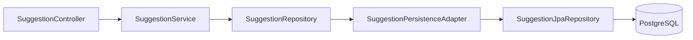
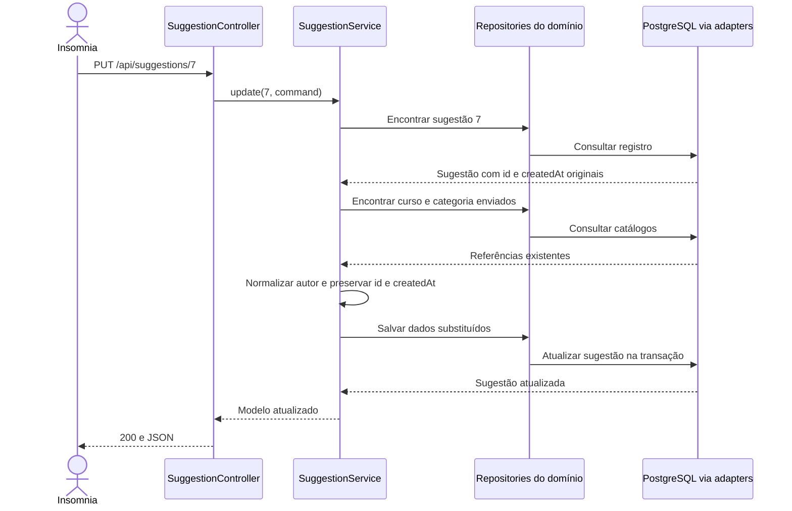

# 04 — Dar vida à caixa

[Roteiro](../README.md) · [Como estudar](como-estudar.md) · [Contrato](00-modelo-dados.md)

## Missão

Implementar criação, listagem, filtros, detalhe, atualização e exclusão de sugestões.

Continue **o mesmo projeto** que concluiu no [módulo 03](03-postgresql-flyway-jpa.md). Preserve os arquivos anteriores, exceto os explicitamente substituídos abaixo.

**Checkpoint de apoio:** `04-casos-de-uso-crud-impl`. Os blocos abaixo contêm arquivos completos desta etapa; não adicione as dependências dos próximos módulos antecipadamente.



## 1. Defina o contrato de persistência e o erro de ausência

Mantenha os modelos e catálogos de 03. Acrescente os dois arquivos abaixo.
A exceção representa um recurso não encontrado; seu mapeamento uniforme para
HTTP 404 será adicionado em 05. Até lá, os testes manuais desta etapa se
concentram em entradas válidas.

### `src/main/java/br/com/etecalbertoferes/CaixaDeSugestoes/domain/SuggestionRepository.java`

Crie este arquivo.

<!-- arquivo: src/main/java/br/com/etecalbertoferes/CaixaDeSugestoes/domain/SuggestionRepository.java -->
```java
package br.com.etecalbertoferes.CaixaDeSugestoes.domain;

import java.util.List;
import java.util.Optional;
public interface SuggestionRepository {
    Suggestion save(Suggestion suggestion);
    Optional<Suggestion> findById(Long id);
    List<Suggestion> search(Long courseId, Long categoryId, String term);
    void delete(Long id);
}
```

### `src/main/java/br/com/etecalbertoferes/CaixaDeSugestoes/domain/ResourceNotFoundException.java`

Crie este arquivo.

<!-- arquivo: src/main/java/br/com/etecalbertoferes/CaixaDeSugestoes/domain/ResourceNotFoundException.java -->
```java
package br.com.etecalbertoferes.CaixaDeSugestoes.domain;

public class ResourceNotFoundException extends RuntimeException {
    public ResourceNotFoundException(String message) { super(message); }
}
```

## 2. Implemente o comando e o serviço

O comando contém somente os dados editáveis. O serviço consulta os catálogos, normaliza o autor e define a data no servidor. Consultas são `readOnly`; métodos de escrita usam transação de escrita. O PUT reaproveita o ID e a data originais.

### `src/main/java/br/com/etecalbertoferes/CaixaDeSugestoes/application/SuggestionCommand.java`

Crie este arquivo.

<!-- arquivo: src/main/java/br/com/etecalbertoferes/CaixaDeSugestoes/application/SuggestionCommand.java -->
```java
package br.com.etecalbertoferes.CaixaDeSugestoes.application;

public record SuggestionCommand(String title, String content, String author, Long courseId, Long categoryId) {}
```

### `src/main/java/br/com/etecalbertoferes/CaixaDeSugestoes/application/SuggestionService.java`

Crie este arquivo. Em 07, ajustaremos a geração do instante para a precisão de microssegundos do PostgreSQL.

<!-- arquivo: src/main/java/br/com/etecalbertoferes/CaixaDeSugestoes/application/SuggestionService.java -->
```java
package br.com.etecalbertoferes.CaixaDeSugestoes.application;

import java.time.Instant;
import java.util.List;
import org.springframework.stereotype.Service;
import org.springframework.transaction.annotation.Transactional;
import br.com.etecalbertoferes.CaixaDeSugestoes.domain.*;

@Service
@Transactional(readOnly = true)
public class SuggestionService {
    private final SuggestionRepository suggestions;
    private final CourseRepository courses;
    private final CategoryRepository categories;
    public SuggestionService(SuggestionRepository suggestions, CourseRepository courses, CategoryRepository categories) {
        this.suggestions = suggestions; this.courses = courses; this.categories = categories;
    }
    public List<Suggestion> list(Long courseId, Long categoryId, String q) {
        String term = q == null ? null : q.strip();
        return suggestions.search(courseId, categoryId, term == null || term.isEmpty() ? null : term);
    }
    public Suggestion get(Long id) {
        return suggestions.findById(id).orElseThrow(() -> new ResourceNotFoundException("Sugestão não encontrada"));
    }
    @Transactional
    public Suggestion create(SuggestionCommand command) {
        return suggestions.save(build(null, Instant.now(), command));
    }
    @Transactional
    public Suggestion update(Long id, SuggestionCommand command) {
        Suggestion current = get(id);
        return suggestions.save(build(current.id(), current.createdAt(), command));
    }
    @Transactional
    public void delete(Long id) { get(id); suggestions.delete(id); }
    private Suggestion build(Long id, Instant createdAt, SuggestionCommand command) {
        Course course = courses.findById(command.courseId()).orElseThrow(() -> new ResourceNotFoundException("Curso não encontrado"));
        Category category = categories.findById(command.categoryId()).orElseThrow(() -> new ResourceNotFoundException("Categoria não encontrada"));
        String author = command.author() == null ? null : command.author().strip();
        if (author != null && author.isBlank()) author = null;
        return new Suggestion(id, command.title(), command.content(), author, createdAt, course, category);
    }
}
```

### Acompanhe uma atualização válida

O PUT substitui os campos editáveis. O serviço primeiro encontra a sugestão e
os catálogos; só depois manda salvar. A identidade e a criação vêm do registro
original, nunca do corpo enviado pelo cliente.



**Leia o diagrama:** este é o caminho de sucesso com entrada válida. Em 05,
veremos como entrada inválida interrompe o fluxo antes do serviço e como a
exceção de recurso ausente passa a retornar 404.

## 3. Prepare os catálogos para referências lazy

Substitua estas duas entidades. Os métodos de acesso permitem que o proxy Hibernate carregue a referência lazy ao mapear a resposta. Acesso direto ao campo de um proxy pode devolver um valor ainda não inicializado.

### `src/main/java/br/com/etecalbertoferes/CaixaDeSugestoes/infrastructure/persistence/CourseEntity.java`

Substitua o conteúdo inteiro deste arquivo.

<!-- arquivo: src/main/java/br/com/etecalbertoferes/CaixaDeSugestoes/infrastructure/persistence/CourseEntity.java -->
```java
package br.com.etecalbertoferes.CaixaDeSugestoes.infrastructure.persistence;

import jakarta.persistence.*;
@Entity
@Table(name = "courses")
public class CourseEntity {
    @Id @GeneratedValue(strategy = GenerationType.IDENTITY)
    Long id;
    @Column(nullable = false, unique = true, columnDefinition = "text")
    String name;
    Long getId() { return id; }
    String getName() { return name; }
    protected CourseEntity() {}
}
```

### `src/main/java/br/com/etecalbertoferes/CaixaDeSugestoes/infrastructure/persistence/CategoryEntity.java`

Substitua o conteúdo inteiro deste arquivo.

<!-- arquivo: src/main/java/br/com/etecalbertoferes/CaixaDeSugestoes/infrastructure/persistence/CategoryEntity.java -->
```java
package br.com.etecalbertoferes.CaixaDeSugestoes.infrastructure.persistence;

import jakarta.persistence.*;
@Entity
@Table(name = "categories")
public class CategoryEntity {
    @Id @GeneratedValue(strategy = GenerationType.IDENTITY)
    Long id;
    @Column(nullable = false, unique = true, columnDefinition = "text")
    String name;
    Long getId() { return id; }
    String getName() { return name; }
    protected CategoryEntity() {}
}
```

## 4. Consulte e mapeie sugestões no adapter

`@EntityGraph` carrega curso e categoria na consulta, evitando consultas adicionais para cada item. A `Specification` combina filtros por AND e os dois campos de texto por OR. A busca escapa `!`, `%` e `_` usando `!` como escape SQL. Não concatene texto do cliente em SQL.

### `src/main/java/br/com/etecalbertoferes/CaixaDeSugestoes/infrastructure/persistence/SuggestionJpaRepository.java`

Crie este arquivo.

<!-- arquivo: src/main/java/br/com/etecalbertoferes/CaixaDeSugestoes/infrastructure/persistence/SuggestionJpaRepository.java -->
```java
package br.com.etecalbertoferes.CaixaDeSugestoes.infrastructure.persistence;

import java.util.List;
import java.util.Optional;
import org.springframework.data.jpa.repository.*;

interface SuggestionJpaRepository extends JpaRepository<SuggestionEntity, Long>, JpaSpecificationExecutor<SuggestionEntity> {
    @Override
    @EntityGraph(attributePaths = {"course", "category"})
    Optional<SuggestionEntity> findById(Long id);
    @Override
    @EntityGraph(attributePaths = {"course", "category"})
    List<SuggestionEntity> findAll(org.springframework.data.jpa.domain.Specification<SuggestionEntity> spec, org.springframework.data.domain.Sort sort);
}
```

### `src/main/java/br/com/etecalbertoferes/CaixaDeSugestoes/infrastructure/persistence/SuggestionPersistenceAdapter.java`

Crie este arquivo.

<!-- arquivo: src/main/java/br/com/etecalbertoferes/CaixaDeSugestoes/infrastructure/persistence/SuggestionPersistenceAdapter.java -->
```java
package br.com.etecalbertoferes.CaixaDeSugestoes.infrastructure.persistence;

import java.util.ArrayList;
import java.util.List;
import java.util.Locale;
import java.util.Optional;
import jakarta.persistence.EntityManager;
import jakarta.persistence.criteria.Predicate;
import org.springframework.data.domain.Sort;
import org.springframework.data.jpa.domain.Specification;
import org.springframework.stereotype.Repository;
import br.com.etecalbertoferes.CaixaDeSugestoes.domain.*;

@Repository
public class SuggestionPersistenceAdapter implements SuggestionRepository {
    private final SuggestionJpaRepository repository;
    private final EntityManager em;
    public SuggestionPersistenceAdapter(SuggestionJpaRepository repository, EntityManager em) {
        this.repository = repository; this.em = em;
    }
    public Suggestion save(Suggestion suggestion) {
        SuggestionEntity entity = suggestion.id() == null ? new SuggestionEntity() : repository.findById(suggestion.id()).orElseThrow(() -> new ResourceNotFoundException("Sugestão não encontrada"));
        entity.title = suggestion.title(); entity.content = suggestion.content(); entity.author = suggestion.author();
        entity.createdAt = suggestion.createdAt();
        entity.course = em.getReference(CourseEntity.class, suggestion.course().id());
        entity.category = em.getReference(CategoryEntity.class, suggestion.category().id());
        return map(repository.save(entity));
    }
    public Optional<Suggestion> findById(Long id) { return repository.findById(id).map(this::map); }
    public List<Suggestion> search(Long courseId, Long categoryId, String term) {
        Specification<SuggestionEntity> spec = (root, query, cb) -> {
            List<Predicate> predicates = new ArrayList<>();
            if (courseId != null) predicates.add(cb.equal(root.get("course").get("id"), courseId));
            if (categoryId != null) predicates.add(cb.equal(root.get("category").get("id"), categoryId));
            if (term != null) {
                String pattern = "%" + term.toLowerCase(Locale.ROOT).replace("!", "!!").replace("%", "!%").replace("_", "!_") + "%";
                predicates.add(cb.or(cb.like(cb.lower(root.get("title")), pattern, '!'), cb.like(cb.lower(root.get("content")), pattern, '!')));
            }
            return cb.and(predicates.toArray(Predicate[]::new));
        };
        return repository.findAll(spec, Sort.by(Sort.Order.desc("createdAt"), Sort.Order.desc("id"))).stream().map(this::map).toList();
    }
    public void delete(Long id) { repository.deleteById(id); }
    private Suggestion map(SuggestionEntity e) {
        return new Suggestion(e.id, e.title, e.content, e.author, e.createdAt,
            new Course(e.course.getId(), e.course.getName()), new Category(e.category.getId(), e.category.getName()));
    }
}
```

## 5. Separe entrada e saída HTTP

O request não permite editar `id` nem `createdAt`. O response devolve os catálogos como objetos e converte autor nulo em `Anônimo`; o banco continua armazenando `null`. Ainda não há Bean Validation no request.

### `src/main/java/br/com/etecalbertoferes/CaixaDeSugestoes/interfaces/rest/SuggestionRequest.java`

Crie este arquivo.

<!-- arquivo: src/main/java/br/com/etecalbertoferes/CaixaDeSugestoes/interfaces/rest/SuggestionRequest.java -->
```java
package br.com.etecalbertoferes.CaixaDeSugestoes.interfaces.rest;

import br.com.etecalbertoferes.CaixaDeSugestoes.application.SuggestionCommand;
public record SuggestionRequest(String title, String content, String author, Long courseId, Long categoryId) {
    public SuggestionCommand command() { return new SuggestionCommand(title, content, author, courseId, categoryId); }
}
```

### `src/main/java/br/com/etecalbertoferes/CaixaDeSugestoes/interfaces/rest/SuggestionResponse.java`

Crie este arquivo.

<!-- arquivo: src/main/java/br/com/etecalbertoferes/CaixaDeSugestoes/interfaces/rest/SuggestionResponse.java -->
```java
package br.com.etecalbertoferes.CaixaDeSugestoes.interfaces.rest;

import java.time.Instant;
import br.com.etecalbertoferes.CaixaDeSugestoes.domain.*;
public record SuggestionResponse(Long id, String title, String content, String author, Instant createdAt, Course course, Category category) {
    public static SuggestionResponse from(Suggestion suggestion) {
        return new SuggestionResponse(suggestion.id(), suggestion.title(), suggestion.content(),
            suggestion.author() == null ? "Anônimo" : suggestion.author(), suggestion.createdAt(), suggestion.course(), suggestion.category());
    }
}
```

## 6. Substitua o controller demonstrativo pelo CRUD

Não crie outro controller para o mesmo caminho. `ResponseEntity.created` monta 201 e Location; a exclusão retorna 204 sem corpo.

### `src/main/java/br/com/etecalbertoferes/CaixaDeSugestoes/interfaces/rest/SuggestionController.java`

Substitua o conteúdo inteiro deste arquivo.

<!-- arquivo: src/main/java/br/com/etecalbertoferes/CaixaDeSugestoes/interfaces/rest/SuggestionController.java -->
```java
package br.com.etecalbertoferes.CaixaDeSugestoes.interfaces.rest;

import java.net.URI;
import java.util.List;
import org.springframework.http.ResponseEntity;
import org.springframework.web.bind.annotation.*;
import br.com.etecalbertoferes.CaixaDeSugestoes.application.SuggestionService;

@RestController
@RequestMapping("/api/suggestions")
public class SuggestionController {
    private final SuggestionService service;
    public SuggestionController(SuggestionService service) { this.service = service; }
    @GetMapping
    public List<SuggestionResponse> list(@RequestParam(required = false) Long courseId,
            @RequestParam(required = false) Long categoryId, @RequestParam(required = false) String q) {
        return service.list(courseId, categoryId, q).stream().map(SuggestionResponse::from).toList();
    }
    @GetMapping("/{id}")
    public SuggestionResponse get(@PathVariable Long id) { return SuggestionResponse.from(service.get(id)); }
    @PostMapping
    public ResponseEntity<SuggestionResponse> create(@RequestBody SuggestionRequest request) {
        SuggestionResponse response = SuggestionResponse.from(service.create(request.command()));
        return ResponseEntity.created(URI.create("/api/suggestions/" + response.id())).body(response);
    }
    @PutMapping("/{id}")
    public SuggestionResponse update(@PathVariable Long id, @RequestBody SuggestionRequest request) {
        return SuggestionResponse.from(service.update(id, request.command()));
    }
    @DeleteMapping("/{id}")
    public ResponseEntity<Void> delete(@PathVariable Long id) { service.delete(id); return ResponseEntity.noContent().build(); }
}
```

## 7. Valide o ciclo no Insomnia

Inicie o banco e a API. Consulte `/api/courses` e `/api/categories`; copie um ID de
cada resposta para `courseId` e `categoryId` no ambiente. Crie um POST em
`{{ _.baseUrl }}/api/suggestions`, com Body **JSON**:

```json
{
  "title": "Mais tomadas na biblioteca 100%_!",
  "content": "Instalar tomadas nas mesas de estudo.",
  "author": "  Pessoa Exemplo  ",
  "courseId": {{ _.courseId }},
  "categoryId": {{ _.categoryId }}
}
```

Os placeholders acima são um template do cliente: depois da substituição, os IDs
precisam ser números no JSON enviado. Não coloque aspas em volta deles. Fora do
Insomnia, substitua-os pelos números reais antes de enviar.

Espere 201, nome `Pessoa Exemplo` e Location. Copie o ID criado para `suggestionId`.

| Ordem | Método e URL no Insomnia | Conferência |
| --- | --- | --- |
| 1 | GET `{{ _.baseUrl }}/api/suggestions/{{ _.suggestionId }}` | Mesmo registro |
| 2 | GET `{{ _.baseUrl }}/api/suggestions` | Array, mais recentes primeiro |
| 3 | GET `/api/suggestions?courseId=ID_CURSO` | Somente o curso escolhido |
| 4 | GET `/api/suggestions?categoryId=ID_CATEGORIA` | Somente a categoria escolhida |
| 5 | GET `/api/suggestions?courseId=ID_CURSO&categoryId=ID_CATEGORIA&q=biblioteca` | Filtros combinados |
| 6 | PUT `{{ _.baseUrl }}/api/suggestions/{{ _.suggestionId }}` | Mesmo ID e criação |
| 7 | DELETE `{{ _.baseUrl }}/api/suggestions/{{ _.suggestionId }}` | 204 sem corpo |

Nas linhas com caminho relativo, use `{{ _.baseUrl }}` como prefixo e troque
`ID_CURSO`/`ID_CATEGORIA` pelos valores reais. No PUT, envie todos os campos
obrigatórios novamente. Omitir `author` remove o nome anterior. Uma lista filtrada
por ID positivo inexistente retorna `[]`, sem erro.

Use a aba de query parameters do cliente para testar `q=100%_!`, sem aplicar URL
encoding manualmente nessa aba. No terminal, o parâmetro equivalente é
`q=100%25_%21`. Crie também sugestões com outros cursos e categorias para
verificar AND entre filtros e OR entre título e conteúdo.

Execute `test` com Docker disponível. Nesta etapa, a suíte verifica contexto e
migrations; os testes de serviço e CRUD completos serão acrescentados em 07.

## Confira antes de avançar

- [ ] Ciclo CRUD com dados válidos funciona.
- [ ] Autor é normalizado e o PUT preserva ID e criação.
- [ ] Busca por título/conteúdo, filtros combinados e caracteres literais funcionam.
- [ ] Excluir sugestão preserva catálogos.

## Explique com suas palavras

Por que omitir author no PUT apaga o nome? Como EntityGraph ajuda uma lista com muitas sugestões?

## Registre sua entrega

No seu projeto, revise `git status`, adicione apenas os arquivos desta missão e faça um commit. Exemplo:

```bash
git add .
git commit -m "Conclui modulo 04: casos-de-uso-crud"
```

Não versione `.env`, senhas reais, `build/` ou `.gradle/`. Consulte o checkpoint em outra pasta, conforme o [guia de estudo](como-estudar.md), e compare responsabilidades e comportamento.

[Próxima etapa: módulo 05](05-validacao-erros.md)
