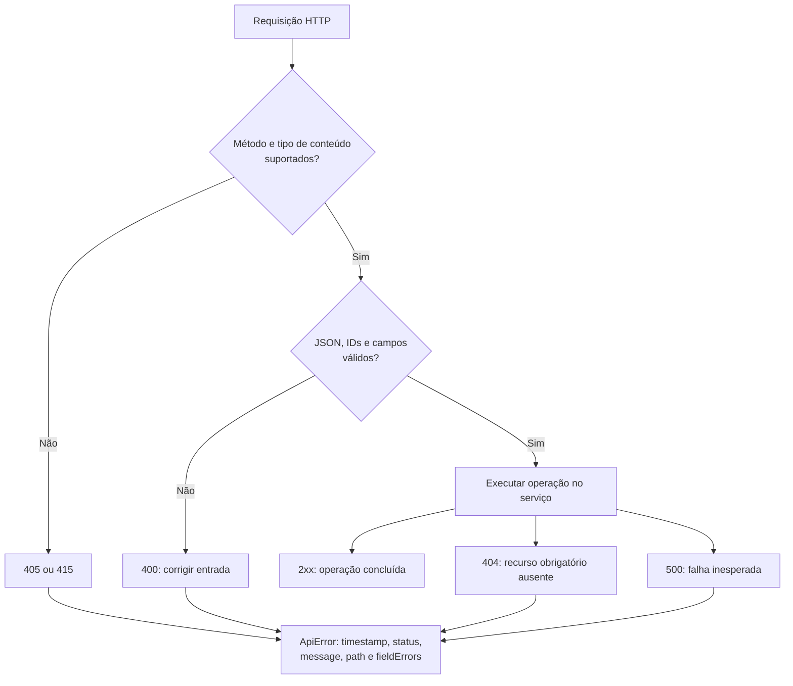

# 05 — Conversar sobre erros

[Roteiro](../README.md) · [Como estudar](como-estudar.md) · [Contrato](00-modelo-dados.md)

## Missão

Validar entradas e devolver um formato previsível de erro sem expor SQL, credenciais ou stack trace.

Continue **o mesmo projeto** que concluiu no [módulo 04](04-casos-de-uso-crud.md). Preserve os arquivos anteriores, exceto os explicitamente substituídos abaixo.

**Checkpoint de apoio:** `05-validacao-erros-impl`. Os blocos abaixo contêm arquivos completos desta etapa; não adicione as dependências dos próximos módulos antecipadamente.



O desenho resume a classificação das falhas, não todos os detalhes da ordem
interna do MVC. A ausência só é 404 quando a operação exige encontrar o recurso;
uma busca sem resultados retorna **200 com `[]`**. Falhas inesperadas também
podem ocorrer antes do serviço e continuam recebendo 500 genérico.

## 1. Adicione Validation

Substitua o build completo abaixo e sincronize o Gradle. O contrato dos endpoints permanece o mesmo.

### `build.gradle`

Substitua o conteúdo inteiro deste arquivo.

<!-- arquivo: build.gradle -->
```groovy
plugins {
    id 'java'
    id 'org.springframework.boot' version '4.1.1'
    id 'io.spring.dependency-management' version '1.1.7'
}
group = 'br.com.etecalbertoferes'
version = '0.0.1-SNAPSHOT'
java { toolchain { languageVersion = JavaLanguageVersion.of(17) } }
repositories { mavenCentral() }
dependencies {
    implementation 'org.springframework.boot:spring-boot-starter-webmvc'
    implementation 'org.springframework.boot:spring-boot-starter-validation'
    implementation 'org.springframework.boot:spring-boot-starter-data-jpa'
    implementation 'org.springframework.boot:spring-boot-starter-flyway'
    implementation 'org.flywaydb:flyway-database-postgresql'
    runtimeOnly 'org.postgresql:postgresql'
    testImplementation 'org.springframework.boot:spring-boot-starter-webmvc-test'
    testImplementation 'org.testcontainers:testcontainers-junit-jupiter'
    testImplementation 'org.testcontainers:testcontainers-postgresql'
    testRuntimeOnly 'org.junit.platform:junit-platform-launcher'
}
tasks.named('test') { useJUnitPlatform() }
```

## 2. Valide os campos de entrada

`@NotBlank` rejeita nulo, vazio e somente espaços; `@NotNull` exige o ID e `@Positive` rejeita zero e negativos. O autor continua opcional.

### `src/main/java/br/com/etecalbertoferes/CaixaDeSugestoes/interfaces/rest/SuggestionRequest.java`

Substitua o conteúdo inteiro deste arquivo.

<!-- arquivo: src/main/java/br/com/etecalbertoferes/CaixaDeSugestoes/interfaces/rest/SuggestionRequest.java -->
```java
package br.com.etecalbertoferes.CaixaDeSugestoes.interfaces.rest;

import jakarta.validation.constraints.*;
import br.com.etecalbertoferes.CaixaDeSugestoes.application.SuggestionCommand;
public record SuggestionRequest(
    @NotBlank(message = "Título é obrigatório") String title,
    @NotBlank(message = "Conteúdo é obrigatório") String content,
    String author,
    @NotNull(message = "Curso é obrigatório") @Positive(message = "Curso deve ser positivo") Long courseId,
    @NotNull(message = "Categoria é obrigatória") @Positive(message = "Categoria deve ser positiva") Long categoryId) {
    public SuggestionCommand command() { return new SuggestionCommand(title, content, author, courseId, categoryId); }
}
```

## 3. Habilite a validação HTTP

Substitua o controller. `@Valid` aciona validação do corpo; as constraints nos parâmetros validam rota e filtros. Usamos a validação de métodos do Spring MVC, sem adicionar `@Validated` à classe. Conversões inválidas, como `id=abc`, também viram 400.

### `src/main/java/br/com/etecalbertoferes/CaixaDeSugestoes/interfaces/rest/SuggestionController.java`

Substitua o conteúdo inteiro deste arquivo.

<!-- arquivo: src/main/java/br/com/etecalbertoferes/CaixaDeSugestoes/interfaces/rest/SuggestionController.java -->
```java
package br.com.etecalbertoferes.CaixaDeSugestoes.interfaces.rest;

import java.net.URI;
import jakarta.validation.Valid;
import jakarta.validation.constraints.Positive;
import java.util.List;
import org.springframework.http.ResponseEntity;
import org.springframework.web.bind.annotation.*;
import br.com.etecalbertoferes.CaixaDeSugestoes.application.SuggestionService;

@RestController
@RequestMapping("/api/suggestions")
public class SuggestionController {
    private final SuggestionService service;
    public SuggestionController(SuggestionService service) { this.service = service; }
    @GetMapping
    public List<SuggestionResponse> list(@RequestParam(required = false) @Positive(message = "ID deve ser positivo") Long courseId,
            @RequestParam(required = false) @Positive(message = "ID deve ser positivo") Long categoryId, @RequestParam(required = false) String q) {
        return service.list(courseId, categoryId, q).stream().map(SuggestionResponse::from).toList();
    }
    @GetMapping("/{id}")
    public SuggestionResponse get(@PathVariable @Positive(message = "ID deve ser positivo") Long id) { return SuggestionResponse.from(service.get(id)); }
    @PostMapping
    public ResponseEntity<SuggestionResponse> create(@Valid @RequestBody SuggestionRequest request) {
        SuggestionResponse response = SuggestionResponse.from(service.create(request.command()));
        return ResponseEntity.created(URI.create("/api/suggestions/" + response.id())).body(response);
    }
    @PutMapping("/{id}")
    public SuggestionResponse update(@PathVariable @Positive(message = "ID deve ser positivo") Long id, @Valid @RequestBody SuggestionRequest request) {
        return SuggestionResponse.from(service.update(id, request.command()));
    }
    @DeleteMapping("/{id}")
    public ResponseEntity<Void> delete(@PathVariable @Positive(message = "ID deve ser positivo") Long id) { service.delete(id); return ResponseEntity.noContent().build(); }
}
```

## 4. Crie o formato de erro e o advice

`ApiError` contém timestamp, status, message, path e fieldErrors. O advice estende o tratamento padrão do MVC para preservar status e headers de protocolo, incluindo Allow no 405. Recurso ausente vira 404; uma exceção inesperada é registrada no log e devolve mensagem genérica com 500.

### `src/main/java/br/com/etecalbertoferes/CaixaDeSugestoes/interfaces/rest/ApiError.java`

Crie este arquivo.

<!-- arquivo: src/main/java/br/com/etecalbertoferes/CaixaDeSugestoes/interfaces/rest/ApiError.java -->
```java
package br.com.etecalbertoferes.CaixaDeSugestoes.interfaces.rest;

import java.time.Instant;
import java.util.Map;
public record ApiError(Instant timestamp, int status, String message, String path, Map<String, String> fieldErrors) {}
```

### `src/main/java/br/com/etecalbertoferes/CaixaDeSugestoes/interfaces/rest/ApiExceptionHandler.java`

Crie este arquivo.

<!-- arquivo: src/main/java/br/com/etecalbertoferes/CaixaDeSugestoes/interfaces/rest/ApiExceptionHandler.java -->
```java
package br.com.etecalbertoferes.CaixaDeSugestoes.interfaces.rest;

import java.time.Instant;
import java.util.LinkedHashMap;
import java.util.Map;
import jakarta.servlet.http.HttpServletRequest;
import org.slf4j.Logger;
import org.slf4j.LoggerFactory;
import org.springframework.http.*;
import org.springframework.web.ErrorResponse;
import org.springframework.web.bind.MethodArgumentNotValidException;
import org.springframework.web.bind.annotation.*;
import org.springframework.web.context.request.*;
import org.springframework.web.method.annotation.HandlerMethodValidationException;
import org.springframework.web.servlet.mvc.method.annotation.ResponseEntityExceptionHandler;
import br.com.etecalbertoferes.CaixaDeSugestoes.domain.ResourceNotFoundException;

@RestControllerAdvice
public class ApiExceptionHandler extends ResponseEntityExceptionHandler {
    private static final Logger log = LoggerFactory.getLogger(ApiExceptionHandler.class);
    @Override
    protected ResponseEntity<Object> handleMethodArgumentNotValid(MethodArgumentNotValidException ex,
            HttpHeaders headers, HttpStatusCode status, WebRequest request) {
        Map<String, String> fields = new LinkedHashMap<>();
        ex.getBindingResult().getFieldErrors().forEach(e -> fields.putIfAbsent(e.getField(), e.getDefaultMessage()));
        return respond(status, "Dados inválidos", fields, headers, request);
    }
    @Override
    protected ResponseEntity<Object> handleHandlerMethodValidationException(HandlerMethodValidationException ex,
            HttpHeaders headers, HttpStatusCode status, WebRequest request) {
        Map<String, String> fields = new LinkedHashMap<>();
        ex.getParameterValidationResults().forEach(result -> {
            String name = result.getMethodParameter().getParameterName();
            result.getResolvableErrors().forEach(error -> fields.putIfAbsent(name == null ? "id" : name, error.getDefaultMessage()));
        });
        return respond(status, "Dados inválidos", fields, headers, request);
    }
    @Override
    protected ResponseEntity<Object> handleExceptionInternal(Exception ex, Object body, HttpHeaders headers,
            HttpStatusCode status, WebRequest request) {
        String message = switch (status.value()) {
            case 400 -> "Requisição inválida";
            case 404 -> "Recurso não encontrado";
            case 405 -> "Método HTTP não permitido";
            case 406 -> "Formato de resposta não suportado";
            case 415 -> "Tipo de conteúdo não suportado";
            default -> status.is5xxServerError() ? "Erro interno do servidor" : "Requisição não permitida";
        };
        return respond(status, message, Map.of(), headers, request);
    }
    @ExceptionHandler(ResourceNotFoundException.class)
    public ResponseEntity<Object> notFound(ResourceNotFoundException ex, WebRequest request) {
        return respond(HttpStatus.NOT_FOUND, ex.getMessage(), Map.of(), new HttpHeaders(), request);
    }
    @ExceptionHandler(Exception.class)
    public ResponseEntity<Object> unexpected(Exception ex, WebRequest request) {
        if (ex instanceof ErrorResponse error) {
            return respond(error.getStatusCode(), "Requisição inválida", Map.of(), error.getHeaders(), request);
        }
        log.error("Falha inesperada ao processar requisição", ex);
        return respond(HttpStatus.INTERNAL_SERVER_ERROR, "Erro interno do servidor", Map.of(), new HttpHeaders(), request);
    }
    private ResponseEntity<Object> respond(HttpStatusCode status, String message, Map<String, String> fields,
            HttpHeaders headers, WebRequest request) {
        HttpServletRequest servlet = ((ServletWebRequest) request).getRequest();
        return new ResponseEntity<>(new ApiError(Instant.now(), status.value(), message, servlet.getRequestURI(), fields), headers, status);
    }
}
```

## 5. Acrescente testes HTTP sem banco

`@WebMvcTest` carrega apenas a camada web. `@MockitoBean` substitui o serviço para que cada teste defina sua resposta e verifique o contrato HTTP. Não removemos o `ContextTest`: ele continua responsável pelo banco real. O log de exceção inesperada neste teste é proposital.

### `src/test/java/br/com/etecalbertoferes/CaixaDeSugestoes/interfaces/rest/SuggestionControllerTest.java`

Crie este arquivo.

<!-- arquivo: src/test/java/br/com/etecalbertoferes/CaixaDeSugestoes/interfaces/rest/SuggestionControllerTest.java -->
```java
package br.com.etecalbertoferes.CaixaDeSugestoes.interfaces.rest;

import br.com.etecalbertoferes.CaixaDeSugestoes.application.*;
import br.com.etecalbertoferes.CaixaDeSugestoes.domain.*;
import java.time.Instant;
import java.util.List;
import org.junit.jupiter.api.Test;
import org.springframework.beans.factory.annotation.Autowired;
import org.springframework.boot.webmvc.test.autoconfigure.WebMvcTest;
import org.springframework.http.MediaType;
import org.springframework.test.context.bean.override.mockito.MockitoBean;
import org.springframework.test.web.servlet.MockMvc;
import static org.mockito.ArgumentMatchers.*;
import static org.mockito.Mockito.*;
import static org.springframework.test.web.servlet.request.MockMvcRequestBuilders.*;
import static org.springframework.test.web.servlet.result.MockMvcResultMatchers.*;

@WebMvcTest(SuggestionController.class)
class SuggestionControllerTest {
    @Autowired MockMvc mvc;
    @MockitoBean SuggestionService service;
    private static final String VALID = """
        {"title":"Biblioteca","content":"Mais tomadas","courseId":1,"categoryId":2}
        """;
    private Suggestion example() {
        return new Suggestion(7L, "Biblioteca", "Mais tomadas", null, Instant.parse("2026-10-08T12:00:00Z"),
            new Course(1L, "Curso"), new Category(2L, "Sugestão"));
    }
    @Test void createReturnsLocationAndAnonymous() throws Exception {
        when(service.create(any())).thenReturn(example());
        mvc.perform(post("/api/suggestions").contentType(MediaType.APPLICATION_JSON).content(VALID))
            .andExpect(status().isCreated()).andExpect(header().string("Location", "/api/suggestions/7"))
            .andExpect(jsonPath("$.author").value("Anônimo")).andExpect(jsonPath("$.course.id").value(1))
            .andExpect(jsonPath("$.createdAt").value("2026-10-08T12:00:00Z"));
    }
    @Test void emptyListIsArray() throws Exception {
        when(service.list(null, null, null)).thenReturn(List.of());
        mvc.perform(get("/api/suggestions")).andExpect(status().isOk()).andExpect(content().json("[]"));
    }
    @Test void getUpdateAndDelete() throws Exception {
        when(service.get(7L)).thenReturn(example());
        when(service.update(eq(7L), any())).thenReturn(example());
        mvc.perform(get("/api/suggestions/7")).andExpect(status().isOk()).andExpect(jsonPath("$.id").value(7));
        mvc.perform(put("/api/suggestions/7").contentType(MediaType.APPLICATION_JSON).content(VALID))
            .andExpect(status().isOk());
        mvc.perform(delete("/api/suggestions/7")).andExpect(status().isNoContent()).andExpect(content().string(""));
    }
    @Test void invalidBodyHasFieldErrors() throws Exception {
        mvc.perform(post("/api/suggestions").contentType(MediaType.APPLICATION_JSON)
                .content("{\"title\":\"  \",\"content\":\"\",\"courseId\":0,\"categoryId\":-1}"))
            .andExpect(status().isBadRequest()).andExpect(jsonPath("$.status").value(400))
            .andExpect(jsonPath("$.fieldErrors.title").value("Título é obrigatório"))
            .andExpect(jsonPath("$.fieldErrors.content").exists()).andExpect(jsonPath("$.fieldErrors.courseId").exists())
            .andExpect(jsonPath("$.fieldErrors.categoryId").exists());
        verifyNoInteractions(service);
    }
    @Test void invalidIdsAndFilters() throws Exception {
        for (String path : List.of("/api/suggestions/0", "/api/suggestions/-1", "/api/suggestions/abc",
                "/api/suggestions?courseId=-1", "/api/suggestions?categoryId=0", "/api/suggestions?courseId=abc")) {
            mvc.perform(get(path)).andExpect(status().isBadRequest()).andExpect(jsonPath("$.status").value(400));
        }
        verifyNoInteractions(service);
    }
    @Test void malformedMissingAndNullBodies() throws Exception {
        for (String body : List.of("", "{", "null", "{}")) {
            mvc.perform(post("/api/suggestions").contentType(MediaType.APPLICATION_JSON).content(body))
                .andExpect(status().isBadRequest()).andExpect(jsonPath("$.path").value("/api/suggestions"));
        }
        verifyNoInteractions(service);
    }
    @Test void notFoundAndCatalogNotFound() throws Exception {
        when(service.get(7L)).thenThrow(new ResourceNotFoundException("Sugestão não encontrada"));
        when(service.create(any())).thenThrow(new ResourceNotFoundException("Categoria não encontrada"));
        mvc.perform(get("/api/suggestions/7")).andExpect(status().isNotFound()).andExpect(jsonPath("$.message").value("Sugestão não encontrada"));
        mvc.perform(post("/api/suggestions").contentType(MediaType.APPLICATION_JSON).content(VALID))
            .andExpect(status().isNotFound()).andExpect(jsonPath("$.fieldErrors").isEmpty());
    }
    @Test void protocolStatusesAndGenericError() throws Exception {
        mvc.perform(patch("/api/suggestions/7").contentType(MediaType.APPLICATION_JSON).content(VALID))
            .andExpect(status().isMethodNotAllowed()).andExpect(header().exists("Allow")).andExpect(jsonPath("$.status").value(405));
        mvc.perform(post("/api/suggestions").contentType(MediaType.TEXT_PLAIN).content("texto"))
            .andExpect(status().isUnsupportedMediaType()).andExpect(jsonPath("$.status").value(415));
        when(service.get(7L)).thenThrow(new RuntimeException("SQL password secret"));
        mvc.perform(get("/api/suggestions/7")).andExpect(status().isInternalServerError())
            .andExpect(jsonPath("$.message").value("Erro interno do servidor"));
    }
}
```

## 6. Execute e confira as falhas

Para os oito testes HTTP isolados, sem Docker:

```powershell
.\gradlew.bat test --tests '*SuggestionControllerTest'
```

Para toda a suíte desta etapa, mantenha Docker iniciado e execute
`.\gradlew.bat test`: serão nove testes, incluindo o de contexto/banco.

Com a API iniciada, confira no Insomnia:

| Entrada | Resultado |
| --- | --- |
| POST com title somente espaços | 400 e `fieldErrors.title` |
| POST com content ausente | 400 e `fieldErrors.content` |
| courseId/categoryId nulo, zero ou negativo | 400 |
| GET `/api/suggestions/abc` ou `/0` | 400 |
| GET `/api/suggestions?courseId=-1` | 400 |
| POST com curso ou categoria positivo inexistente | 404 |
| GET/PUT/DELETE com sugestão positiva inexistente | 404 |
| GET com filtro positivo inexistente | 200 e `[]` |
| JSON vazio, nulo ou truncado | 400 |
| PATCH `/api/suggestions/ID` | 405 |
| POST com `Content-Type: text/plain` | 415 |

Um exemplo de resposta de erro:

```json
{
  "timestamp": "2026-10-29T18:00:00Z",
  "status": 400,
  "message": "Dados inválidos",
  "path": "/api/suggestions",
  "fieldErrors": {"title": "Título é obrigatório"}
}
```

`fieldErrors` fica vazio quando a falha não corresponde à validação de um campo.
Um PUT inválido não deve alterar os dados existentes. A suíte completa desse
cenário com banco estará em 07.

## Confira antes de avançar

- [ ] Nove testes aprovados com Docker; os oito HTTP também passam isolados.
- [ ] Validação retorna 400, ausência retorna 404 e filtro sem resultados retorna 200.
- [ ] 405/415 preservados; resposta 500 não expõe detalhes internos.

## Explique com suas palavras

Por que um ID inexistente pode significar 404 na escrita e lista vazia na busca? Por que capturar toda Exception como 500 seria incorreto?

## Registre sua entrega

No seu projeto, revise `git status`, adicione apenas os arquivos desta missão e faça um commit. Exemplo:

```bash
git add .
git commit -m "Conclui modulo 05: validacao-erros"
```

Não versione `.env`, senhas reais, `build/` ou `.gradle/`. Consulte o checkpoint em outra pasta, conforme o [guia de estudo](como-estudar.md), e compare responsabilidades e comportamento.

[Próxima etapa: módulo 06](06-openapi-swagger.md)
