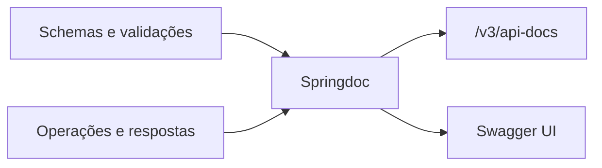
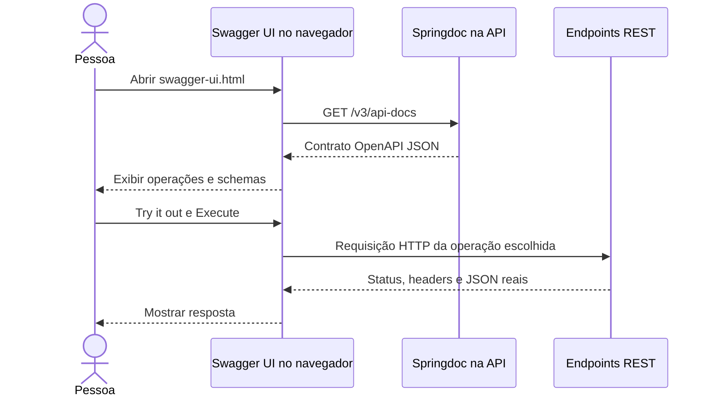

# 06 — Apresentar o contrato

[Roteiro](../README.md) · [Como estudar](como-estudar.md) · [Contrato](00-modelo-dados.md)

## Missão

Publicar Swagger e OpenAPI para que outra aplicação descubra e consuma as sete operações.

Continue **o mesmo projeto** que concluiu no [módulo 05](05-validacao-erros.md). Preserve os arquivos anteriores, exceto os explicitamente substituídos abaixo.

**Checkpoint de apoio:** `06-openapi-swagger-impl`. Os blocos abaixo contêm arquivos completos desta etapa; não adicione as dependências dos próximos módulos antecipadamente.



## 1. Adicione Springdoc

O build acrescenta `springdoc-openapi-starter-webmvc-ui:3.1.1`. Preserve todas as dependências anteriores.

### `build.gradle`

Substitua o conteúdo inteiro deste arquivo.

<!-- arquivo: build.gradle -->
```groovy
plugins {
    id 'java'
    id 'org.springframework.boot' version '4.1.1'
    id 'io.spring.dependency-management' version '1.1.7'
}
group = 'br.com.etecalbertoferes'
version = '0.0.1-SNAPSHOT'
java { toolchain { languageVersion = JavaLanguageVersion.of(17) } }
repositories { mavenCentral() }
dependencies {
    implementation 'org.springframework.boot:spring-boot-starter-webmvc'
    implementation 'org.springdoc:springdoc-openapi-starter-webmvc-ui:3.1.1'
    implementation 'org.springframework.boot:spring-boot-starter-validation'
    implementation 'org.springframework.boot:spring-boot-starter-data-jpa'
    implementation 'org.springframework.boot:spring-boot-starter-flyway'
    implementation 'org.flywaydb:flyway-database-postgresql'
    runtimeOnly 'org.postgresql:postgresql'
    testImplementation 'org.springframework.boot:spring-boot-starter-webmvc-test'
    testImplementation 'org.testcontainers:testcontainers-junit-jupiter'
    testImplementation 'org.testcontainers:testcontainers-postgresql'
    testRuntimeOnly 'org.junit.platform:junit-platform-launcher'
}
tasks.named('test') { useJUnitPlatform() }
```

## 2. Configure título e caminhos

A configuração expõe metadados; o YAML mantém banco e JPA e acrescenta `springdoc` no nível raiz. Não coloque essa chave dentro de `spring`.

### `src/main/java/br/com/etecalbertoferes/CaixaDeSugestoes/interfaces/rest/OpenApiConfiguration.java`

Crie este arquivo.

<!-- arquivo: src/main/java/br/com/etecalbertoferes/CaixaDeSugestoes/interfaces/rest/OpenApiConfiguration.java -->
```java
package br.com.etecalbertoferes.CaixaDeSugestoes.interfaces.rest;

import io.swagger.v3.oas.models.OpenAPI;
import io.swagger.v3.oas.models.info.Info;
import org.springframework.context.annotation.*;
@Configuration
public class OpenApiConfiguration {
    @Bean OpenAPI api() {
        return new OpenAPI().info(new Info().title("Caixa de Sugestões — Etec Prefeito Alberto Feres")
            .version("1.0.0").description("API de sugestões para consumo pelo projeto web com Thymeleaf. Catálogos didáticos somente para consulta. Datas em UTC."));
    }
}
```

### `src/main/resources/application.yaml`

Substitua o conteúdo inteiro deste arquivo.

<!-- arquivo: src/main/resources/application.yaml -->
```yaml
server:
  port: ${SERVER_PORT:8000}
spring:
  application:
    name: CaixaDeSugestoes
  datasource:
    url: ${DB_URL:jdbc:postgresql://localhost:5432/suggestions}
    username: ${DB_USERNAME:suggestions}
    password: ${DB_PASSWORD:suggestions}
  jpa:
    open-in-view: false
    hibernate:
      ddl-auto: validate
    properties:
      hibernate:
        jdbc:
          time_zone: UTC
  flyway:
    enabled: true
springdoc:
  swagger-ui:
    path: /swagger-ui.html
  api-docs:
    path: /v3/api-docs
```

## 3. Documente os DTOs

As anotações `@Schema` explicam título, conteúdo, autor, referências e criação UTC. Exemplos de IDs são ilustrativos; o consumidor deve consultar os catálogos.

### `src/main/java/br/com/etecalbertoferes/CaixaDeSugestoes/interfaces/rest/SuggestionRequest.java`

Substitua o conteúdo inteiro deste arquivo.

<!-- arquivo: src/main/java/br/com/etecalbertoferes/CaixaDeSugestoes/interfaces/rest/SuggestionRequest.java -->
```java
package br.com.etecalbertoferes.CaixaDeSugestoes.interfaces.rest;

import jakarta.validation.constraints.*;
import io.swagger.v3.oas.annotations.media.Schema;
import br.com.etecalbertoferes.CaixaDeSugestoes.application.SuggestionCommand;
public record SuggestionRequest(
    @NotBlank(message = "Título é obrigatório") @Schema(description = "Título obrigatório; texto preservado", example = "Mais tomadas na biblioteca") String title,
    @NotBlank(message = "Conteúdo é obrigatório") @Schema(description = "Conteúdo obrigatório; texto preservado", example = "Instalar tomadas nas mesas de estudo.") String content,
    @Schema(description = "Nome opcional; espaços externos removidos. Ausente, nulo ou em branco torna a sugestão anônima", example = "Pessoa Exemplo") String author,
    @NotNull(message = "Curso é obrigatório") @Positive(message = "Curso deve ser positivo") @Schema(description = "ID de curso existente", example = "1") Long courseId,
    @NotNull(message = "Categoria é obrigatória") @Positive(message = "Categoria deve ser positiva") @Schema(description = "ID de categoria existente", example = "1") Long categoryId) {
    public SuggestionCommand command() { return new SuggestionCommand(title, content, author, courseId, categoryId); }
}
```

### `src/main/java/br/com/etecalbertoferes/CaixaDeSugestoes/interfaces/rest/SuggestionResponse.java`

Substitua o conteúdo inteiro deste arquivo.

<!-- arquivo: src/main/java/br/com/etecalbertoferes/CaixaDeSugestoes/interfaces/rest/SuggestionResponse.java -->
```java
package br.com.etecalbertoferes.CaixaDeSugestoes.interfaces.rest;

import java.time.Instant;
import io.swagger.v3.oas.annotations.media.Schema;
import br.com.etecalbertoferes.CaixaDeSugestoes.domain.*;
public record SuggestionResponse(Long id, String title, String content, @Schema(description = "Nome normalizado ou Anônimo") String author, @Schema(description = "Data de criação UTC, preservada no PUT", example = "2026-10-08T12:00:00Z") Instant createdAt, Course course, Category category) {
    public static SuggestionResponse from(Suggestion suggestion) {
        return new SuggestionResponse(suggestion.id(), suggestion.title(), suggestion.content(),
            suggestion.author() == null ? "Anônimo" : suggestion.author(), suggestion.createdAt(), suggestion.course(), suggestion.category());
    }
}
```

## 4. Documente os controllers

Substitua os dois arquivos completos. `@Tag` agrupa operações e `@Operation` descreve comportamento. As respostas documentam os mesmos códigos verificados nos testes. Mantemos os DTOs e a lógica HTTP anteriores.

### `src/main/java/br/com/etecalbertoferes/CaixaDeSugestoes/interfaces/rest/CatalogController.java`

Substitua o conteúdo inteiro deste arquivo.

<!-- arquivo: src/main/java/br/com/etecalbertoferes/CaixaDeSugestoes/interfaces/rest/CatalogController.java -->
```java
package br.com.etecalbertoferes.CaixaDeSugestoes.interfaces.rest;

import io.swagger.v3.oas.annotations.Operation;
import io.swagger.v3.oas.annotations.Parameter;
import io.swagger.v3.oas.annotations.tags.Tag;
import io.swagger.v3.oas.annotations.responses.*;
import io.swagger.v3.oas.annotations.media.*;
import java.util.List;
import org.springframework.web.bind.annotation.*;
import br.com.etecalbertoferes.CaixaDeSugestoes.application.CatalogService;
import br.com.etecalbertoferes.CaixaDeSugestoes.domain.*;
@Tag(name = "Catálogos", description = "Cursos e categorias didáticos, ordenados por nome; somente consulta")
@RestController
@RequestMapping("/api")
public class CatalogController {
    private final CatalogService service;
    public CatalogController(CatalogService service) { this.service = service; }
    @Operation(summary = "Listar cursos", description = "Array de id/name ordenado por name crescente")
    @GetMapping("/courses") public List<Course> courses() { return service.courses(); }
    @Operation(summary = "Listar categorias", description = "Array de id/name ordenado por name crescente")
    @GetMapping("/categories") public List<Category> categories() { return service.categories(); }
}
```

### `src/main/java/br/com/etecalbertoferes/CaixaDeSugestoes/interfaces/rest/SuggestionController.java`

Substitua o conteúdo inteiro deste arquivo.

<!-- arquivo: src/main/java/br/com/etecalbertoferes/CaixaDeSugestoes/interfaces/rest/SuggestionController.java -->
```java
package br.com.etecalbertoferes.CaixaDeSugestoes.interfaces.rest;

import io.swagger.v3.oas.annotations.Operation;
import io.swagger.v3.oas.annotations.Parameter;
import io.swagger.v3.oas.annotations.tags.Tag;
import io.swagger.v3.oas.annotations.responses.*;
import io.swagger.v3.oas.annotations.media.*;
import java.net.URI;
import jakarta.validation.Valid;
import jakarta.validation.constraints.Positive;
import java.util.List;
import org.springframework.http.ResponseEntity;
import org.springframework.web.bind.annotation.*;
import br.com.etecalbertoferes.CaixaDeSugestoes.application.SuggestionService;

@Tag(name = "Sugestões", description = "Cadastro, consulta, substituição e exclusão de sugestões")
@RestController
@RequestMapping("/api/suggestions")
@ApiResponses({
    @ApiResponse(responseCode = "400", description = "Dados, ID ou filtro inválido", content = @Content(schema = @Schema(implementation = ApiError.class))),
    @ApiResponse(responseCode = "404", description = "Sugestão, curso ou categoria não encontrado", content = @Content(schema = @Schema(implementation = ApiError.class))),
    @ApiResponse(responseCode = "500", description = "Erro interno", content = @Content(schema = @Schema(implementation = ApiError.class)))
})
public class SuggestionController {
    private final SuggestionService service;
    public SuggestionController(SuggestionService service) { this.service = service; }
    @Operation(summary = "Listar sugestões", description = "Array sem paginação. Filtros combinados por AND; q busca título OU conteúdo sem distinguir maiúsculas. Espaços externos são removidos; vazio é ignorado. %, _ e ! são literais. Ordem: createdAt e id decrescentes. IDs positivos inexistentes retornam [].")
    @ApiResponse(responseCode = "200", description = "Lista de sugestões, inclusive vazia")
    @GetMapping
    public List<SuggestionResponse> list(@Parameter(description = "ID positivo do curso") @RequestParam(required = false) @Positive(message = "ID deve ser positivo") Long courseId,
            @Parameter(description = "ID positivo da categoria") @RequestParam(required = false) @Positive(message = "ID deve ser positivo") Long categoryId, @Parameter(description = "Trecho literal do título ou conteúdo") @RequestParam(required = false) String q) {
        return service.list(courseId, categoryId, q).stream().map(SuggestionResponse::from).toList();
    }
    @Operation(summary = "Consultar sugestão por ID")
    @ApiResponse(responseCode = "200", description = "Sugestão encontrada")
    @GetMapping("/{id}")
    public SuggestionResponse get(@PathVariable @Positive(message = "ID deve ser positivo") Long id) { return SuggestionResponse.from(service.get(id)); }
    @Operation(summary = "Criar sugestão", description = "O servidor gera id e createdAt. Autor ausente, nulo ou em branco é armazenado como null e devolvido como Anônimo. Consulte os IDs dos catálogos antes de enviar.")
    @ApiResponse(responseCode = "201", description = "Sugestão criada; Location contém /api/suggestions/{id}", content = @Content(schema = @Schema(implementation = SuggestionResponse.class)), headers = @io.swagger.v3.oas.annotations.headers.Header(name = "Location", schema = @Schema(type = "string")))
    @PostMapping
    public ResponseEntity<SuggestionResponse> create(@Valid @RequestBody SuggestionRequest request) {
        SuggestionResponse response = SuggestionResponse.from(service.create(request.command()));
        return ResponseEntity.created(URI.create("/api/suggestions/" + response.id())).body(response);
    }
    @Operation(summary = "Substituir campos editáveis", description = "Preserva id e createdAt. Omitir author remove o nome anterior. Curso e categoria são obrigatórios. Falhas não alteram o registro.")
    @ApiResponse(responseCode = "200", description = "Sugestão atualizada")
    @PutMapping("/{id}")
    public SuggestionResponse update(@PathVariable @Positive(message = "ID deve ser positivo") Long id, @Valid @RequestBody SuggestionRequest request) {
        return SuggestionResponse.from(service.update(id, request.command()));
    }
    @Operation(summary = "Excluir sugestão", description = "Exclusão física, preservando curso e categoria. Repetir a exclusão retorna 404.")
    @ApiResponse(responseCode = "204", description = "Excluída, sem corpo", content = @Content)
    @DeleteMapping("/{id}")
    public ResponseEntity<Void> delete(@PathVariable @Positive(message = "ID deve ser positivo") Long id) { service.delete(id); return ResponseEntity.noContent().build(); }
}
```

## 5. Use o contrato pelo navegador

```powershell
.\gradlew.bat test
.\gradlew.bat bootRun
```

Abra `http://localhost:8000/swagger-ui.html`. Em **Catálogos**, execute as duas
consultas com **Try it out**. Copie os IDs retornados para o POST em
**Sugestões**. Crie, consulte, atualize e exclua uma sugestão pela interface.

Abra também `http://localhost:8000/v3/api-docs` e confira:

- Há sete operações distribuídas nos quatro caminhos do contrato.
- `course` e `category` são objetos com `id` e `name` na resposta.
- `createdAt` é informado pelo servidor e preservado no PUT.
- A listagem é um array sem paginação, com filtros e ordenação descritos.
- Não há esquema de autenticação nesta entrega.

Se a página não carregar, confira o log da API, a porta em uso e a dependência
Springdoc. Uma resposta 404 em `/` não significa que Swagger esteja indisponível.
A existência das sete operações será verificada automaticamente no módulo 07.

### Da documentação à requisição real

Swagger UI é uma interface de leitura e execução do contrato. O documento
OpenAPI descreve a API; clicar em **Execute** envia uma chamada HTTP real, que
pode criar ou alterar registros no banco da aplicação.



**Pergunta para a turma:** por que consultar o contrato JSON não cria uma
sugestão, mas executar o POST pelo Swagger cria?

## Confira antes de avançar

- [ ] Nove testes da suíte anterior passam.
- [ ] Swagger abre e permite executar as operações.
- [ ] OpenAPI JSON contém o contrato e os schemas correspondentes.

## Explique com suas palavras

Outra dupla consegue cadastrar uma sugestão usando somente Swagger? Qual a diferença entre o documento OpenAPI e sua interface visual?

## Registre sua entrega

No seu projeto, revise `git status`, adicione apenas os arquivos desta missão e faça um commit. Exemplo:

```bash
git add .
git commit -m "Conclui modulo 06: openapi-swagger"
```

Não versione `.env`, senhas reais, `build/` ou `.gradle/`. Consulte o checkpoint em outra pasta, conforme o [guia de estudo](como-estudar.md), e compare responsabilidades e comportamento.

[Próxima etapa: módulo 07](07-testes-entrega.md)
