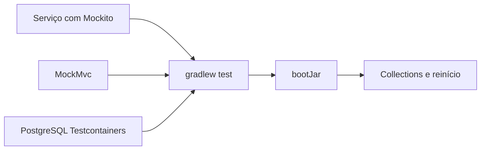
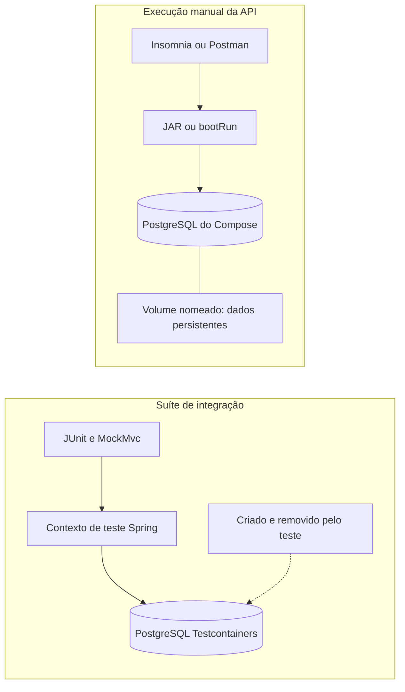

# 07 — Conferir e entregar

[Roteiro](../README.md) · [Como estudar](como-estudar.md) · [Contrato](00-modelo-dados.md)

## Missão

Completar a suíte, gerar o JAR e provar que a API preserva dados após reinício.

Continue **o mesmo projeto** que concluiu no [módulo 06](06-openapi-swagger.md). Preserve os arquivos anteriores, exceto os explicitamente substituídos abaixo.

**Checkpoint de apoio:** `07-testes-entrega-impl`. Os blocos abaixo contêm arquivos completos desta etapa; não adicione as dependências dos próximos módulos antecipadamente.



## 1. Alinhe o instante à precisão do banco

Substitua o serviço completo. A mudança em `create` usa `truncatedTo(MICROS)`: o PostgreSQL armazena microssegundos, então a resposta inicial e as consultas posteriores devem apresentar a mesma data. Os outros casos de uso permanecem iguais.

### `src/main/java/br/com/etecalbertoferes/CaixaDeSugestoes/application/SuggestionService.java`

Substitua o conteúdo inteiro deste arquivo.

<!-- arquivo: src/main/java/br/com/etecalbertoferes/CaixaDeSugestoes/application/SuggestionService.java -->
```java
package br.com.etecalbertoferes.CaixaDeSugestoes.application;

import java.time.Instant;
import java.util.List;
import org.springframework.stereotype.Service;
import org.springframework.transaction.annotation.Transactional;
import br.com.etecalbertoferes.CaixaDeSugestoes.domain.*;

@Service
@Transactional(readOnly = true)
public class SuggestionService {
    private final SuggestionRepository suggestions;
    private final CourseRepository courses;
    private final CategoryRepository categories;
    public SuggestionService(SuggestionRepository suggestions, CourseRepository courses, CategoryRepository categories) {
        this.suggestions = suggestions; this.courses = courses; this.categories = categories;
    }
    public List<Suggestion> list(Long courseId, Long categoryId, String q) {
        String term = q == null ? null : q.strip();
        return suggestions.search(courseId, categoryId, term == null || term.isEmpty() ? null : term);
    }
    public Suggestion get(Long id) {
        return suggestions.findById(id).orElseThrow(() -> new ResourceNotFoundException("Sugestão não encontrada"));
    }
    @Transactional
    public Suggestion create(SuggestionCommand command) {
        return suggestions.save(build(null, Instant.now().truncatedTo(java.time.temporal.ChronoUnit.MICROS), command));
    }
    @Transactional
    public Suggestion update(Long id, SuggestionCommand command) {
        Suggestion current = get(id);
        return suggestions.save(build(current.id(), current.createdAt(), command));
    }
    @Transactional
    public void delete(Long id) { get(id); suggestions.delete(id); }
    private Suggestion build(Long id, Instant createdAt, SuggestionCommand command) {
        Course course = courses.findById(command.courseId()).orElseThrow(() -> new ResourceNotFoundException("Curso não encontrado"));
        Category category = categories.findById(command.categoryId()).orElseThrow(() -> new ResourceNotFoundException("Categoria não encontrada"));
        String author = command.author() == null ? null : command.author().strip();
        if (author != null && author.isBlank()) author = null;
        return new Suggestion(id, command.title(), command.content(), author, createdAt, course, category);
    }
}
```

## 2. Teste as regras de aplicação

Acrescente o teste abaixo. Mockito isola as interfaces de domínio. O teste verifica normalização de autor, criação pelo servidor, preservação de ID/data, filtros e falhas antes da gravação.

### `src/test/java/br/com/etecalbertoferes/CaixaDeSugestoes/application/SuggestionServiceTest.java`

Crie este arquivo.

<!-- arquivo: src/test/java/br/com/etecalbertoferes/CaixaDeSugestoes/application/SuggestionServiceTest.java -->
```java
package br.com.etecalbertoferes.CaixaDeSugestoes.application;

import br.com.etecalbertoferes.CaixaDeSugestoes.domain.*;
import java.time.Instant;
import java.util.Optional;
import org.junit.jupiter.api.*;
import org.junit.jupiter.api.extension.ExtendWith;
import org.mockito.*;
import org.mockito.junit.jupiter.MockitoExtension;
import static org.assertj.core.api.Assertions.*;
import static org.mockito.ArgumentMatchers.*;
import static org.mockito.Mockito.*;

@ExtendWith(MockitoExtension.class)
class SuggestionServiceTest {
    @Mock SuggestionRepository suggestions;
    @Mock CourseRepository courses;
    @Mock CategoryRepository categories;
    @InjectMocks SuggestionService service;
    final Course course = new Course(10L, "Curso");
    final Category category = new Category(20L, "Sugestão");
    SuggestionCommand command(String author) { return new SuggestionCommand(" título ", " conteúdo ", author, 10L, 20L); }
    void catalogs() {
        when(courses.findById(10L)).thenReturn(Optional.of(course));
        when(categories.findById(20L)).thenReturn(Optional.of(category));
        when(suggestions.save(any())).thenAnswer(i -> i.getArgument(0));
    }
    @Test void createNormalizesAuthorAndAssignsTime() {
        catalogs();
        Instant before = Instant.now().truncatedTo(java.time.temporal.ChronoUnit.MICROS);
        Suggestion created = service.create(command("  Pessoa  "));
        assertThat(created.author()).isEqualTo("Pessoa");
        assertThat(created.title()).isEqualTo(" título ");
        assertThat(created.content()).isEqualTo(" conteúdo ");
        assertThat(created.id()).isNull();
        assertThat(created.createdAt()).isBetween(before, Instant.now());
        assertThat(service.create(command(null)).author()).isNull();
        assertThat(service.create(command(" \t ")).author()).isNull();
    }
    @Test void updatePreservesIdentityAndTimestampAndRemovesAuthor() {
        catalogs();
        Instant time = Instant.parse("2026-01-01T00:00:00Z");
        when(suggestions.findById(7L)).thenReturn(Optional.of(new Suggestion(7L, "old", "old", "Nome", time, course, category)));
        Suggestion updated = service.update(7L, command(null));
        assertThat(updated.id()).isEqualTo(7L);
        assertThat(updated.createdAt()).isEqualTo(time);
        assertThat(updated.author()).isNull();
    }
    @Test void searchNormalizesTermAndPreservesFilters() {
        service.list(10L, 20L, "  100%_!  ");
        verify(suggestions).search(10L, 20L, "100%_!");
        service.list(null, null, "  ");
        verify(suggestions).search(null, null, null);
    }
    @Test void missingSuggestionCannotUpdateOrDelete() {
        when(suggestions.findById(7L)).thenReturn(Optional.empty());
        assertThatThrownBy(() -> service.update(7L, command(null))).isInstanceOf(ResourceNotFoundException.class);
        assertThatThrownBy(() -> service.delete(7L)).isInstanceOf(ResourceNotFoundException.class);
        verify(suggestions, never()).save(any());
        verify(suggestions, never()).delete(any());
    }
    @Test void missingCatalogDoesNotSave() {
        when(courses.findById(10L)).thenReturn(Optional.empty());
        assertThatThrownBy(() -> service.create(command(null))).isInstanceOf(ResourceNotFoundException.class).hasMessage("Curso não encontrado");
        when(courses.findById(10L)).thenReturn(Optional.of(course));
        when(categories.findById(20L)).thenReturn(Optional.empty());
        assertThatThrownBy(() -> service.create(command(null))).isInstanceOf(ResourceNotFoundException.class).hasMessage("Categoria não encontrada");
        verify(suggestions, never()).save(any());
    }
    @Test void deleteChecksExistence() {
        when(suggestions.findById(7L)).thenReturn(Optional.of(new Suggestion(7L, "t", "c", null, Instant.now(), course, category)));
        service.delete(7L);
        verify(suggestions).delete(7L);
    }
}
```

## 3. Teste o fluxo completo com PostgreSQL

Mantenha `ContextTest` do módulo 03 e `SuggestionControllerTest` do 05. Acrescente a classe abaixo. Ela herda o container e a configuração de conexão de `ContextTest`; as transações de teste são revertidas ao fim. `em.flush()` sincroniza as alterações JPA antes da consulta SQL direta do teste de anonimato.

### `src/test/java/br/com/etecalbertoferes/CaixaDeSugestoes/ApiIntegrationTest.java`

Crie este arquivo.

<!-- arquivo: src/test/java/br/com/etecalbertoferes/CaixaDeSugestoes/ApiIntegrationTest.java -->
```java
package br.com.etecalbertoferes.CaixaDeSugestoes;

import java.time.Instant;
import java.util.Map;
import br.com.etecalbertoferes.CaixaDeSugestoes.application.*;
import br.com.etecalbertoferes.CaixaDeSugestoes.domain.*;
import org.junit.jupiter.api.Test;
import org.springframework.beans.factory.annotation.Autowired;
import org.springframework.boot.webmvc.test.autoconfigure.AutoConfigureMockMvc;
import org.springframework.http.MediaType;
import org.springframework.test.web.servlet.MockMvc;
import org.springframework.transaction.annotation.Transactional;
import static org.assertj.core.api.Assertions.*;
import static org.springframework.test.web.servlet.request.MockMvcRequestBuilders.*;
import static org.springframework.test.web.servlet.result.MockMvcResultMatchers.*;

@AutoConfigureMockMvc
@Transactional
class ApiIntegrationTest extends ContextTest {
    @Autowired MockMvc mvc;
    @Autowired jakarta.persistence.EntityManager em;
    @Autowired SuggestionService service;
    @Autowired SuggestionRepository repository;
    @Autowired CatalogService catalogs;
    Long course() { return catalogs.courses().get(0).id(); }
    Long category() { return catalogs.categories().get(0).id(); }
    Suggestion create(String title, String content, String author, Long courseId, Long categoryId) {
        return service.create(new SuggestionCommand(title, content, author, courseId, categoryId));
    }
    @Test void catalogAndHttpLifecycle() throws Exception {
        mvc.perform(get("/api/courses")).andExpect(status().isOk()).andExpect(jsonPath("$.length()").value(4));
        mvc.perform(get("/api/categories")).andExpect(status().isOk()).andExpect(jsonPath("$.length()").value(3));
        String body = "{\"title\":\"Tomadas\",\"content\":\"Biblioteca\",\"author\":\"  Pessoa  \",\"courseId\":"+course()+",\"categoryId\":"+category()+"}";
        String location = mvc.perform(post("/api/suggestions").contentType(MediaType.APPLICATION_JSON).content(body))
            .andExpect(status().isCreated()).andExpect(jsonPath("$.author").value("Pessoa"))
            .andReturn().getResponse().getHeader("Location");
        Long id = Long.valueOf(location.substring(location.lastIndexOf('/')+1));
        Instant time = service.get(id).createdAt();
        mvc.perform(get(location)).andExpect(status().isOk()).andExpect(jsonPath("$.title").value("Tomadas"));
        mvc.perform(put(location).contentType(MediaType.APPLICATION_JSON).content(body.replace("  Pessoa  ", "  ")))
            .andExpect(status().isOk()).andExpect(jsonPath("$.author").value("Anônimo"));
        assertThat(service.get(id).createdAt()).isEqualTo(time);
        em.flush();
        assertThat(jdbc.queryForObject("select author from suggestions where id=?", String.class, id)).isNull();
        mvc.perform(delete(location)).andExpect(status().isNoContent()).andExpect(content().string(""));
        mvc.perform(get(location)).andExpect(status().isNotFound());
        mvc.perform(delete(location)).andExpect(status().isNotFound());
        mvc.perform(put(location).contentType(MediaType.APPLICATION_JSON).content(body)).andExpect(status().isNotFound());
        assertThat(catalogs.courses()).hasSize(4);
        assertThat(catalogs.categories()).hasSize(3);
    }
    @Test void filtersLiteralCharactersAndOrdering() {
        Long c1 = course(), c2 = catalogs.courses().get(1).id();
        Long t1 = category(), t2 = catalogs.categories().get(1).id();
        Suggestion a = create("Tomadas 100%_!", "biblioteca", null, c1, t1);
        Suggestion b = create("outro", "TOMADAS 100xyz", "", c2, t1);
        Suggestion c = create("Tomadas", "terceiro", "Pessoa", c1, t2);
        assertThat(service.list(null,null,"tomadas")).extracting(Suggestion::id).containsExactly(c.id(), b.id(), a.id());
        assertThat(service.list(c1,null,null)).extracting(Suggestion::id).containsExactly(c.id(), a.id());
        assertThat(service.list(null,t1,null)).extracting(Suggestion::id).containsExactly(b.id(), a.id());
        assertThat(service.list(c1,t1," TOMADAS ")).extracting(Suggestion::id).containsExactly(a.id());
        for (String literal : new String[]{"%", "_", "!", "100%_!"})
            assertThat(service.list(null,null,literal)).extracting(Suggestion::id).containsExactly(a.id());
        assertThat(service.list(999999L,null,null)).isEmpty();
        assertThat(service.list(null,999999L,null)).isEmpty();
        assertThat(service.list(null,null,"inexistente")).isEmpty();
        assertThat(service.list(null,null,"  ")).hasSize(3);
        Instant same = Instant.parse("2026-01-01T00:00:00Z");
        jdbc.update("update suggestions set created_at=?", java.sql.Timestamp.from(same));
        assertThat(service.list(null,null,null)).extracting(Suggestion::id).containsExactly(c.id(), b.id(), a.id());
    }
    @Test void rejectedUpdatesPreserveStoredDataAndTextHasNo255Limit() throws Exception {
        Suggestion item = create("x".repeat(500), "y".repeat(1000), null, course(), category());
        String invalid = "{\"title\":\"change\",\"content\":\"change\",\"courseId\":"+course()+",\"categoryId\":999999}";
        mvc.perform(put("/api/suggestions/"+item.id()).contentType(MediaType.APPLICATION_JSON).content(invalid)).andExpect(status().isNotFound());
        assertThat(service.get(item.id()).title()).hasSize(500);
        assertThat(service.get(item.id()).content()).hasSize(1000);
        mvc.perform(post("/api/suggestions").contentType(MediaType.APPLICATION_JSON).content(invalid)).andExpect(status().isNotFound());
        assertThat(service.list(null,null,null)).hasSize(1);
    }
    @Test void openApiDocumentsAllOperations() throws Exception {
        mvc.perform(get("/v3/api-docs")).andExpect(status().isOk())
            .andExpect(jsonPath("$.paths['/api/suggestions'].get").exists())
            .andExpect(jsonPath("$.paths['/api/suggestions'].post.responses['201']").exists())
            .andExpect(jsonPath("$.paths['/api/suggestions/{id}'].get").exists())
            .andExpect(jsonPath("$.paths['/api/suggestions/{id}'].put").exists())
            .andExpect(jsonPath("$.paths['/api/suggestions/{id}'].delete.responses['204']").exists())
            .andExpect(jsonPath("$.paths['/api/courses'].get").exists())
            .andExpect(jsonPath("$.paths['/api/categories'].get").exists());
        mvc.perform(get("/swagger-ui.html")).andExpect(status().is3xxRedirection());
    }
}
```

## 4. Execute a suíte e gere o artefato

Com Docker iniciado:

```powershell
.\gradlew.bat test bootJar
```

O projeto reproduzido deve ter **20 testes**, sem falhas e sem ignorados:

| Classe | Quantidade | Responsabilidade |
| --- | --- | --- |
| ContextTest | 1 | Migrations e seeds |
| SuggestionControllerTest | 8 | HTTP, validação e erros |
| SuggestionServiceTest | 6 | Regras da aplicação |
| ApiIntegrationTest | 5 | Banco real, CRUD, filtros e OpenAPI |

A integração herda também o teste de migrations, por isso aparece com cinco
execuções. O relatório fica em `build/reports/tests/test/index.html`.

Para executar apenas os 14 testes sem banco:

```powershell
.\gradlew.bat test --tests '*SuggestionServiceTest' --tests '*SuggestionControllerTest'
```

Esse comando isolado não substitui a suíte completa. Docker indisponível deve
causar falha nos testes de integração; não use configurações que os ignorem.

Pare `bootRun`, se estiver aberto. Inicie o PostgreSQL do projeto e rode o JAR:

```powershell
docker compose up -d --wait
java -jar build/libs/CaixaDeSugestoes-0.0.1-SNAPSHOT.jar
```

Use o nome efetivamente gerado se alterar `settings.gradle` ou `version`.
Testcontainers não é o banco da aplicação: a execução do JAR usa o Compose.

### Dois bancos, duas finalidades

Os testes não devem gravar no banco que você usa pelo Insomnia. Cada execução
Testcontainers cria um PostgreSQL descartável; o Compose da aplicação usa um
volume que preserva os registros entre reinícios.



**Leia o diagrama:** rodar a suíte não prepara sugestões para o Insomnia, e
reiniciar o JAR não recria o banco de testes. Nos dois ambientes, Flyway aplica
as mesmas migrations a bancos independentes.

## 5. Importe as collections de apoio

A solução `07-testes-entrega-impl` inclui os arquivos abaixo, em `collections/`:

- `caixa-de-sugestoes.insomnia.json`: exportação JSON v4 do Insomnia.
- `caixa-de-sugestoes.postman_collection.json`: coleção Postman v2.1.
- `caixa-de-sugestoes.postman_environment.json`: ambiente local opcional.

Para obtê-los sem trocar o projeto que você construiu, use a cópia de consulta
separada descrita em [Como estudar](como-estudar.md), selecionando a branch
`07-testes-entrega-impl`. Importe o arquivo pelo menu **Import** do cliente.
As branches precisam estar publicadas pelo professor para o clone remoto funcionar.

| Parte | Requisições | O que verificar |
| --- | --- | --- |
| Preparação | 01–02 | Catálogos e captura de IDs reais |
| Criação e busca | 03–09 | POST, detalhe, listagem e filtros |
| Atualização | 10 | Anonimato e preservação da criação |
| Erros | 11–18 | 400, 404, 405 e 415 esperados |
| Exclusão | 19–22 | 204 e confirmação posterior de ausência |
| Contrato | 23 | OpenAPI JSON |

Execute em ordem. 01 e 02 salvam IDs dos catálogos; 03 salva o ID e a data da
sugestão. 19 apaga somente essa sugestão. Os erros previstos também são testes
bem-sucedidos quando retornam os códigos esperados. A importação visual deve
ser conferida no aplicativo; o registro técnico descreve o que foi automatizado.

No Insomnia, selecione o ambiente base da coleção. No Postman, `baseUrl` já está
na coleção; o ambiente é opcional. Se a API usar outra porta, altere `baseUrl`.
Não use variáveis de ID fixas vindas de outro banco.

Para construir sua própria captura automática no Insomnia, acrescente em
**Scripts → After-response** do GET de cursos:

```javascript
const courses = insomnia.response.json();
insomnia.environment.set('courseId', courses[0].id);
```

Repita para categorias (`categoryId`) e, no POST, salve `suggestionId` e `createdAt`.
No Postman, use `pm.response.json()` e `pm.collectionVariables.set(...)`.
As collections fornecidas já contêm essas capturas e as verificações de resposta.

## 6. Prove persistência e preservação dos dados

1. Execute 01–04, anote ID, título, autor e createdAt.
2. Encerre somente a API com `Ctrl+C`; mantenha o PostgreSQL/volume.
3. Execute novamente `java -jar ...` e repita 04. Os dados devem ser iguais.
4. Execute 10: o nome vira `Anônimo`, a criação permanece a mesma.
5. Execute 19–22: exclusão retorna 204, consultas e alterações posteriores retornam 404.
6. Consulte os catálogos: continuam quatro cursos e três categorias.
7. Use `docker compose down` ao concluir. `down -v` apaga os dados do volume.

## 7. Entregue sem dados locais

Revise o `.gitignore` do módulo 01. Não versione `.env`, credenciais reais,
`build/`, `.gradle/` nem dumps com dados pessoais. Registre no README do seu
projeto os comandos para iniciar banco, API, testes e Swagger. Use dados fictícios.

O material de apoio contém também `scripts/verify-collections.mjs`, executável
com Node.js 18 ou superior: `node scripts/verify-collections.mjs`. É opcional e
não adiciona Node.js como requisito para construir a API Java. Ele executa
requests e os métodos de script utilizados pelas collections com uma camada
local de compatibilidade; não automatiza a interface dos clientes.

## Confira antes de avançar

- [ ] 20 testes aprovados e JAR gerado.
- [ ] JAR inicia com PostgreSQL do Compose.
- [ ] Collections executadas na ordem e dados preservados após reinício.
- [ ] Catálogos preservados e arquivo de configuração local fora do Git.

## Explique com suas palavras

Por que o banco de Testcontainers não substitui o Compose da aplicação? Que teste diferencia filtro literal de wildcard SQL?

## Registre sua entrega

No seu projeto, revise `git status`, adicione apenas os arquivos desta missão e faça um commit. Exemplo:

```bash
git add .
git commit -m "Conclui modulo 07: testes-entrega"
```

Não versione `.env`, senhas reais, `build/` ou `.gradle/`. Consulte o checkpoint em outra pasta, conforme o [guia de estudo](como-estudar.md), e compare responsabilidades e comportamento.

[Próxima etapa: planejar o projeto web](08-continuacao-web.md)
