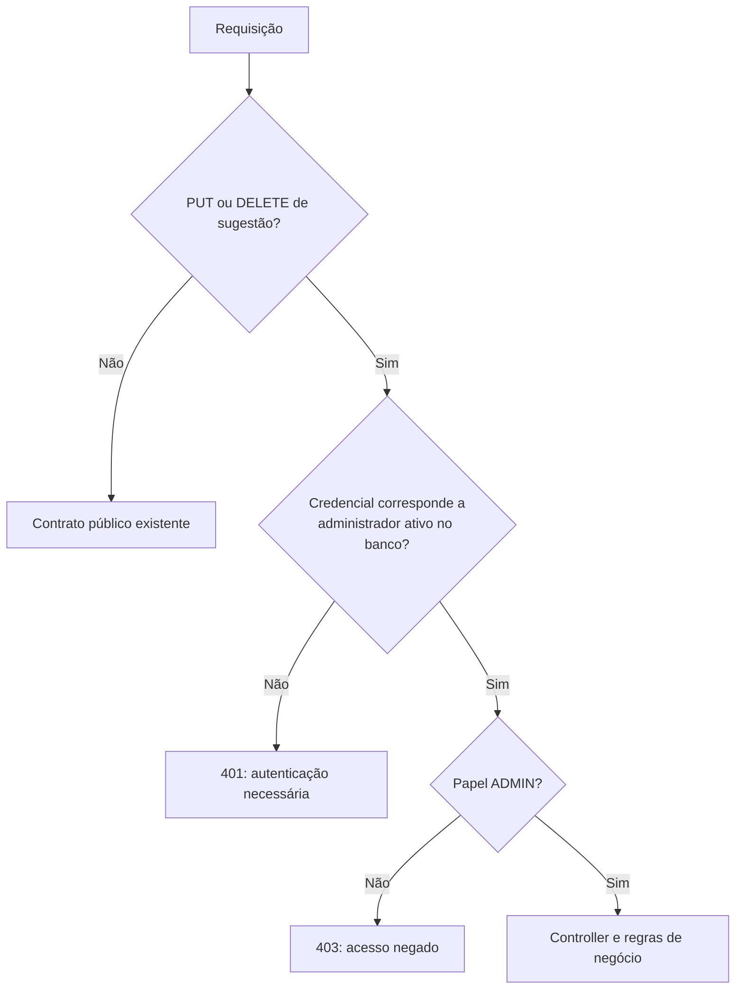
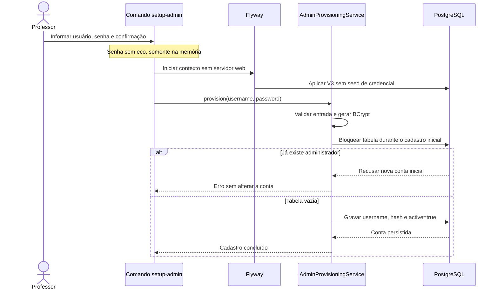

# 08 — Spring Security e administrador no banco

[Roteiro](../README.md) · [Contrato](00-modelo-dados.md) · [Etapa anterior](07-testes-entrega.md)

## Missão

Continue o projeto do módulo 07. A migration V3 cria a tabela `administrators`,
mas não cadastra credenciais. O comando `--setup-admin` pede usuário e senha,
aplica BCrypt e grava a primeira conta. Não há cadastro HTTP público de usuários.
O checkpoint desta etapa é `08-spring-security-impl`.

Nesta etapa, HTTP Basic permite estudar autenticação e permissões. No módulo 09,
Basic será substituído por login e Bearer JWT. Consultas e envio de sugestões
continuam públicos; somente alteração e exclusão exigem ADMIN. O texto author
continua independente da identidade administrativa.



## 1. Entenda as responsabilidades

| Parte | Responsabilidade |
| --- | --- |
| Migration V3 | Criar tabela, identidade, username único e campos obrigatórios |
| AdminAccount e repository | Modelar a conta e o acesso sem expor JPA ao domínio |
| Adapter JPA | Consultar conta e gravar o cadastro inicial |
| AdminProvisioningService | Validar entrada, aplicar BCrypt e impedir sobrescrita |
| AdminConfiguration | Adaptar conta persistida para UserDetailsService |
| SecurityConfiguration | Proteger PUT/DELETE e preservar acesso público |
| AdminSetupCommand | Ler usuário e senha em terminal, sem servidor web |

Não coloque uma senha real ou um hash com senha conhecida numa migration. Ela é
versionada e aplicada em todas as instalações. A tabela usa índice único em
username; não é necessário criar outro índice para a mesma busca.

## 2. Inicialização e cadastro inicial



O bloqueio exclusivo ocorre somente no provisionamento, dentro da transação.
Isso impede que duas execuções simultâneas criem duas primeiras contas. Não é
um bloqueio aplicado às consultas normais ou a cada login.

## 3. Crie ou substitua os arquivos desta etapa

Aplique todos os arquivos abaixo. Eles são completos e correspondem ao checkpoint.
O build acrescenta Spring Security e seu suporte de testes. O domínio continua
sem JPA; a persistência segue o mesmo padrão dos catálogos.

### `build.gradle`

Crie o arquivo ou substitua seu conteúdo inteiro. Preserve os demais arquivos.

<!-- arquivo: build.gradle -->
```groovy
plugins {
    id 'java'
    id 'org.springframework.boot' version '4.1.1'
    id 'io.spring.dependency-management' version '1.1.7'
}
group = 'br.com.etecalbertoferes'
version = '0.0.1-SNAPSHOT'
java { toolchain { languageVersion = JavaLanguageVersion.of(17) } }
repositories { mavenCentral() }
dependencies {
    implementation 'org.springframework.boot:spring-boot-starter-webmvc'
    implementation 'org.springframework.boot:spring-boot-starter-security'
    implementation 'org.springdoc:springdoc-openapi-starter-webmvc-ui:3.1.1'
    implementation 'org.springframework.boot:spring-boot-starter-validation'
    implementation 'org.springframework.boot:spring-boot-starter-data-jpa'
    implementation 'org.springframework.boot:spring-boot-starter-flyway'
    implementation 'org.flywaydb:flyway-database-postgresql'
    runtimeOnly 'org.postgresql:postgresql'
    testImplementation 'org.springframework.boot:spring-boot-starter-webmvc-test'
    testImplementation 'org.testcontainers:testcontainers-junit-jupiter'
    testImplementation 'org.testcontainers:testcontainers-postgresql'
    testImplementation 'org.springframework.security:spring-security-test'
    testRuntimeOnly 'org.junit.platform:junit-platform-launcher'
}
tasks.named('test') { useJUnitPlatform() }
```

### `src/main/resources/db/migration/V3__create_administrators.sql`

Crie o arquivo ou substitua seu conteúdo inteiro. Preserve os demais arquivos.

<!-- arquivo: src/main/resources/db/migration/V3__create_administrators.sql -->
```sql
CREATE TABLE administrators (
    id BIGINT GENERATED BY DEFAULT AS IDENTITY PRIMARY KEY,
    username VARCHAR(100) NOT NULL UNIQUE CHECK (length(btrim(username)) > 0),
    password_hash VARCHAR(60) NOT NULL,
    active BOOLEAN NOT NULL DEFAULT TRUE,
    created_at TIMESTAMPTZ NOT NULL DEFAULT CURRENT_TIMESTAMP
);
-- A primeira conta é provisionada interativamente, nunca por seed de senha.
```

### `src/main/java/br/com/etecalbertoferes/CaixaDeSugestoes/domain/AdminAccount.java`

Crie o arquivo ou substitua seu conteúdo inteiro. Preserve os demais arquivos.

<!-- arquivo: src/main/java/br/com/etecalbertoferes/CaixaDeSugestoes/domain/AdminAccount.java -->
```java
package br.com.etecalbertoferes.CaixaDeSugestoes.domain;

public record AdminAccount(Long id, String username, String passwordHash, boolean active) {
    @Override public String toString() { return "AdminAccount[id=" + id + ", active=" + active + "]"; }
}
```

### `src/main/java/br/com/etecalbertoferes/CaixaDeSugestoes/domain/AdminAccountRepository.java`

Crie o arquivo ou substitua seu conteúdo inteiro. Preserve os demais arquivos.

<!-- arquivo: src/main/java/br/com/etecalbertoferes/CaixaDeSugestoes/domain/AdminAccountRepository.java -->
```java
package br.com.etecalbertoferes.CaixaDeSugestoes.domain;

import java.util.Optional;
public interface AdminAccountRepository {
    Optional<AdminAccount> findByUsername(String username);
    boolean createInitial(String username, String passwordHash);
}
```

### `src/main/java/br/com/etecalbertoferes/CaixaDeSugestoes/infrastructure/persistence/AdminAccountEntity.java`

Crie o arquivo ou substitua seu conteúdo inteiro. Preserve os demais arquivos.

<!-- arquivo: src/main/java/br/com/etecalbertoferes/CaixaDeSugestoes/infrastructure/persistence/AdminAccountEntity.java -->
```java
package br.com.etecalbertoferes.CaixaDeSugestoes.infrastructure.persistence;

import jakarta.persistence.*;
@Entity
@Table(name = "administrators")
public class AdminAccountEntity {
    @Id @GeneratedValue(strategy = GenerationType.IDENTITY) Long id;
    @Column(nullable = false, unique = true, length = 100) String username;
    @Column(name = "password_hash", nullable = false, length = 60) String passwordHash;
    @Column(nullable = false) boolean active;
    protected AdminAccountEntity() {}
}
```

### `src/main/java/br/com/etecalbertoferes/CaixaDeSugestoes/infrastructure/persistence/AdminAccountJpaRepository.java`

Crie o arquivo ou substitua seu conteúdo inteiro. Preserve os demais arquivos.

<!-- arquivo: src/main/java/br/com/etecalbertoferes/CaixaDeSugestoes/infrastructure/persistence/AdminAccountJpaRepository.java -->
```java
package br.com.etecalbertoferes.CaixaDeSugestoes.infrastructure.persistence;

import java.util.Optional;
import org.springframework.data.jpa.repository.JpaRepository;
interface AdminAccountJpaRepository extends JpaRepository<AdminAccountEntity, Long> {
    Optional<AdminAccountEntity> findByUsername(String username);
}
```

### `src/main/java/br/com/etecalbertoferes/CaixaDeSugestoes/infrastructure/persistence/AdminAccountPersistenceAdapter.java`

Crie o arquivo ou substitua seu conteúdo inteiro. Preserve os demais arquivos.

<!-- arquivo: src/main/java/br/com/etecalbertoferes/CaixaDeSugestoes/infrastructure/persistence/AdminAccountPersistenceAdapter.java -->
```java
package br.com.etecalbertoferes.CaixaDeSugestoes.infrastructure.persistence;

import java.util.Optional;
import jakarta.persistence.EntityManager;
import org.springframework.stereotype.Repository;
import org.springframework.transaction.annotation.Transactional;
import br.com.etecalbertoferes.CaixaDeSugestoes.domain.*;
@Repository
@Transactional(readOnly = true)
public class AdminAccountPersistenceAdapter implements AdminAccountRepository {
    private final AdminAccountJpaRepository repository;
    private final EntityManager em;
    public AdminAccountPersistenceAdapter(AdminAccountJpaRepository repository, EntityManager em) {
        this.repository = repository; this.em = em;
    }
    public Optional<AdminAccount> findByUsername(String username) {
        return repository.findByUsername(username).map(e -> new AdminAccount(e.id, e.username, e.passwordHash, e.active));
    }
    @Transactional
    public boolean createInitial(String username, String passwordHash) {
        // Serializa apenas o provisionamento; duas execuções não criam duas contas iniciais.
        em.createNativeQuery("LOCK TABLE administrators IN EXCLUSIVE MODE").executeUpdate();
        if (repository.count() != 0) return false;
        AdminAccountEntity entity = new AdminAccountEntity();
        entity.username = username; entity.passwordHash = passwordHash; entity.active = true;
        repository.saveAndFlush(entity);
        return true;
    }
}
```

### `src/main/java/br/com/etecalbertoferes/CaixaDeSugestoes/application/AdminProvisioningService.java`

Crie o arquivo ou substitua seu conteúdo inteiro. Preserve os demais arquivos.

<!-- arquivo: src/main/java/br/com/etecalbertoferes/CaixaDeSugestoes/application/AdminProvisioningService.java -->
```java
package br.com.etecalbertoferes.CaixaDeSugestoes.application;

import java.nio.charset.StandardCharsets;
import org.springframework.security.crypto.password.PasswordEncoder;
import org.springframework.stereotype.Service;
import org.springframework.transaction.annotation.Transactional;
import br.com.etecalbertoferes.CaixaDeSugestoes.domain.AdminAccountRepository;
@Service
public class AdminProvisioningService {
    private final AdminAccountRepository accounts;
    private final PasswordEncoder encoder;
    public AdminProvisioningService(AdminAccountRepository accounts, PasswordEncoder encoder) {
        this.accounts = accounts; this.encoder = encoder;
    }
    @Transactional
    public void provision(String username, String password) {
        if (username == null || username.isBlank() || username.length() > 100 || !username.equals(username.strip()))
            throw new IllegalArgumentException("Use um usuário de até 100 caracteres, sem espaços nas extremidades");
        if (password == null || password.length() < 12 || password.getBytes(StandardCharsets.UTF_8).length > 72)
            throw new IllegalArgumentException("A senha deve ter ao menos 12 caracteres e no máximo 72 bytes UTF-8");
        if (!accounts.createInitial(username, encoder.encode(password)))
            throw new IllegalStateException("Já existe administrador; o provisionamento não altera contas existentes");
    }
}
```

### `src/main/java/br/com/etecalbertoferes/CaixaDeSugestoes/infrastructure/security/AdminConfiguration.java`

Crie o arquivo ou substitua seu conteúdo inteiro. Preserve os demais arquivos.

<!-- arquivo: src/main/java/br/com/etecalbertoferes/CaixaDeSugestoes/infrastructure/security/AdminConfiguration.java -->
```java
package br.com.etecalbertoferes.CaixaDeSugestoes.infrastructure.security;

import org.springframework.context.annotation.*;
import org.springframework.security.authentication.*;
import org.springframework.security.authentication.dao.DaoAuthenticationProvider;
import org.springframework.security.core.userdetails.*;
import org.springframework.security.crypto.bcrypt.BCryptPasswordEncoder;
import org.springframework.security.crypto.password.PasswordEncoder;
import br.com.etecalbertoferes.CaixaDeSugestoes.domain.AdminAccountRepository;
@Configuration
public class AdminConfiguration {
    @Bean PasswordEncoder passwordEncoder() { return new BCryptPasswordEncoder(12); }
    @Bean UserDetailsService adminUsers(AdminAccountRepository accounts) {
        return username -> {
            var account = accounts.findByUsername(username)
                .orElseThrow(() -> new UsernameNotFoundException("Credenciais inválidas"));
            return User.withUsername(account.username()).password(account.passwordHash())
                .disabled(!account.active()).roles("ADMIN").build();
        };
    }
    @Bean AuthenticationManager authenticationManager(UserDetailsService users, PasswordEncoder encoder) {
        DaoAuthenticationProvider provider = new DaoAuthenticationProvider(users);
        provider.setPasswordEncoder(encoder);
        return new ProviderManager(provider);
    }
}
```

### `src/main/java/br/com/etecalbertoferes/CaixaDeSugestoes/infrastructure/security/AdminPasswordHash.java`

Crie o arquivo ou substitua seu conteúdo inteiro. Preserve os demais arquivos.

<!-- arquivo: src/main/java/br/com/etecalbertoferes/CaixaDeSugestoes/infrastructure/security/AdminPasswordHash.java -->
```java
package br.com.etecalbertoferes.CaixaDeSugestoes.infrastructure.security;

import java.io.Console;
import java.nio.charset.StandardCharsets;
import java.util.Arrays;
import org.springframework.security.crypto.bcrypt.BCryptPasswordEncoder;

public final class AdminPasswordHash {
    private AdminPasswordHash() {}
    public static void generate() {
        Console console = System.console();
        if (console == null) throw new IllegalStateException("Execute em terminal interativo: java -jar ... --generate-admin-password-hash");
        char[] password = console.readPassword("Senha administrativa (mínimo 12 caracteres): ");
        if (password == null) throw new IllegalStateException("Leitura cancelada");
        try {
            String value = new String(password);
            if (password.length < 12 || value.getBytes(StandardCharsets.UTF_8).length > 72)
                throw new IllegalArgumentException("Use ao menos 12 caracteres e no máximo 72 bytes UTF-8");
            console.printf("%s%n", new BCryptPasswordEncoder(12).encode(value));
        } finally { Arrays.fill(password, '\0'); }
    }
}
```

### `src/main/java/br/com/etecalbertoferes/CaixaDeSugestoes/infrastructure/security/AdminSetupCommand.java`

Crie o arquivo ou substitua seu conteúdo inteiro. Preserve os demais arquivos.

<!-- arquivo: src/main/java/br/com/etecalbertoferes/CaixaDeSugestoes/infrastructure/security/AdminSetupCommand.java -->
```java
package br.com.etecalbertoferes.CaixaDeSugestoes.infrastructure.security;

import java.io.Console;
import java.util.Arrays;
import org.springframework.boot.WebApplicationType;
import org.springframework.boot.builder.SpringApplicationBuilder;
import br.com.etecalbertoferes.CaixaDeSugestoes.CaixaDeSugestoesApplication;
import br.com.etecalbertoferes.CaixaDeSugestoes.application.AdminProvisioningService;
public final class AdminSetupCommand {
    private AdminSetupCommand() {}
    public static void run() {
        Console console = System.console();
        if (console == null) throw new IllegalStateException("Execute o JAR em terminal interativo com --setup-admin");
        String username = console.readLine("Usuário do administrador: ");
        char[] password = console.readPassword("Senha (mínimo 12 caracteres): ");
        char[] confirmation = console.readPassword("Confirme a senha: ");
        try {
            if (password == null || confirmation == null || !Arrays.equals(password, confirmation))
                throw new IllegalArgumentException("As senhas não conferem ou a leitura foi cancelada");
            try (var context = new SpringApplicationBuilder(CaixaDeSugestoesApplication.class)
                    .web(WebApplicationType.NONE).run()) {
                context.getBean(AdminProvisioningService.class).provision(username, new String(password));
                console.printf("Administrador cadastrado no banco. Inicie a API e faça login com a senha escolhida.%n");
            }
        } finally {
            if (password != null) Arrays.fill(password, '\0');
            if (confirmation != null) Arrays.fill(confirmation, '\0');
        }
    }
}
```

### `src/main/java/br/com/etecalbertoferes/CaixaDeSugestoes/infrastructure/security/SecurityConfiguration.java`

Crie o arquivo ou substitua seu conteúdo inteiro. Preserve os demais arquivos.

<!-- arquivo: src/main/java/br/com/etecalbertoferes/CaixaDeSugestoes/infrastructure/security/SecurityConfiguration.java -->
```java
package br.com.etecalbertoferes.CaixaDeSugestoes.infrastructure.security;

import jakarta.servlet.DispatcherType;
import org.springframework.context.annotation.*;
import org.springframework.http.HttpMethod;
import org.springframework.security.config.annotation.web.builders.HttpSecurity;
import org.springframework.security.config.http.SessionCreationPolicy;
import org.springframework.security.web.SecurityFilterChain;

@org.springframework.boot.autoconfigure.condition.ConditionalOnWebApplication
@Configuration
public class SecurityConfiguration {
    @Bean SecurityFilterChain apiSecurity(HttpSecurity http, SecurityErrorWriter errors) throws Exception {
        return http
            .csrf(csrf -> csrf.disable())
            .sessionManagement(session -> session.sessionCreationPolicy(SessionCreationPolicy.STATELESS))
            .requestCache(cache -> cache.disable())
            .authorizeHttpRequests(auth -> auth
                .dispatcherTypeMatchers(DispatcherType.ERROR).permitAll()
                .requestMatchers(HttpMethod.PUT, "/api/suggestions/*").hasRole("ADMIN")
                .requestMatchers(HttpMethod.DELETE, "/api/suggestions/*").hasRole("ADMIN")
                .anyRequest().permitAll())
            .httpBasic(basic -> basic.authenticationEntryPoint((req, res, ex) -> {
                res.setHeader("WWW-Authenticate", "Basic realm=\"administracao\"");
                errors.write(req, res, 401, "Autenticação necessária");
            }))
            .exceptionHandling(ex -> ex
                .authenticationEntryPoint((req, res, cause) -> {
                    res.setHeader("WWW-Authenticate", "Basic realm=\"administracao\"");
                    errors.write(req, res, 401, "Autenticação necessária");
                })
                .accessDeniedHandler((req, res, cause) -> errors.write(req, res, 403, "Acesso negado")))
            .build();
    }
}
```

### `src/main/java/br/com/etecalbertoferes/CaixaDeSugestoes/infrastructure/security/SecurityErrorWriter.java`

Crie o arquivo ou substitua seu conteúdo inteiro. Preserve os demais arquivos.

<!-- arquivo: src/main/java/br/com/etecalbertoferes/CaixaDeSugestoes/infrastructure/security/SecurityErrorWriter.java -->
```java
package br.com.etecalbertoferes.CaixaDeSugestoes.infrastructure.security;

import java.io.IOException;
import java.time.Instant;
import java.util.Map;
import jakarta.servlet.http.*;
import org.springframework.http.MediaType;
import org.springframework.stereotype.Component;
import tools.jackson.databind.ObjectMapper;
import br.com.etecalbertoferes.CaixaDeSugestoes.interfaces.rest.ApiError;

@Component
public class SecurityErrorWriter {
    private final ObjectMapper mapper;
    public SecurityErrorWriter(ObjectMapper mapper) { this.mapper = mapper; }
    public void write(HttpServletRequest request, HttpServletResponse response, int status, String message) throws IOException {
        response.setStatus(status);
        response.setContentType(MediaType.APPLICATION_JSON_VALUE);
        response.setCharacterEncoding("UTF-8");
        mapper.writeValue(response.getOutputStream(), new ApiError(Instant.now(), status, message, request.getRequestURI(), Map.of()));
    }
}
```

### `src/main/java/br/com/etecalbertoferes/CaixaDeSugestoes/CaixaDeSugestoesApplication.java`

Crie o arquivo ou substitua seu conteúdo inteiro. Preserve os demais arquivos.

<!-- arquivo: src/main/java/br/com/etecalbertoferes/CaixaDeSugestoes/CaixaDeSugestoesApplication.java -->
```java
package br.com.etecalbertoferes.CaixaDeSugestoes;

import org.springframework.boot.SpringApplication;
import org.springframework.boot.autoconfigure.SpringBootApplication;

@SpringBootApplication
public class CaixaDeSugestoesApplication {
    public static void main(String[] args) {
        if (args.length == 1 && "--setup-admin".equals(args[0])) {
            br.com.etecalbertoferes.CaixaDeSugestoes.infrastructure.security.AdminSetupCommand.run();
            return;
        }
        if (args.length == 1 && "--generate-admin-password-hash".equals(args[0])) {
            br.com.etecalbertoferes.CaixaDeSugestoes.infrastructure.security.AdminPasswordHash.generate();
            return;
        }
        SpringApplication.run(CaixaDeSugestoesApplication.class, args);
    }
}
```

### `src/main/java/br/com/etecalbertoferes/CaixaDeSugestoes/interfaces/rest/OpenApiConfiguration.java`

Crie o arquivo ou substitua seu conteúdo inteiro. Preserve os demais arquivos.

<!-- arquivo: src/main/java/br/com/etecalbertoferes/CaixaDeSugestoes/interfaces/rest/OpenApiConfiguration.java -->
```java
package br.com.etecalbertoferes.CaixaDeSugestoes.interfaces.rest;

import io.swagger.v3.oas.models.OpenAPI;
import io.swagger.v3.oas.models.info.Info;
import org.springframework.context.annotation.*;
@Configuration
public class OpenApiConfiguration {
    @Bean OpenAPI api() {
        return new OpenAPI().components(new io.swagger.v3.oas.models.Components().addSecuritySchemes("basicAdmin",
            new io.swagger.v3.oas.models.security.SecurityScheme().type(io.swagger.v3.oas.models.security.SecurityScheme.Type.HTTP).scheme("basic"))).info(new Info().title("Caixa de Sugestões — Etec Prefeito Alberto Feres")
            .version("1.0.0").description("API de sugestões para consumo pelo projeto web com Thymeleaf. Catálogos didáticos somente para consulta. Datas em UTC."));
    }
}
```

### `src/main/java/br/com/etecalbertoferes/CaixaDeSugestoes/interfaces/rest/SuggestionController.java`

Crie o arquivo ou substitua seu conteúdo inteiro. Preserve os demais arquivos.

<!-- arquivo: src/main/java/br/com/etecalbertoferes/CaixaDeSugestoes/interfaces/rest/SuggestionController.java -->
```java
package br.com.etecalbertoferes.CaixaDeSugestoes.interfaces.rest;

import io.swagger.v3.oas.annotations.Operation;
import io.swagger.v3.oas.annotations.Parameter;
import io.swagger.v3.oas.annotations.tags.Tag;
import io.swagger.v3.oas.annotations.responses.*;
import io.swagger.v3.oas.annotations.media.*;
import java.net.URI;
import jakarta.validation.Valid;
import jakarta.validation.constraints.Positive;
import java.util.List;
import org.springframework.http.ResponseEntity;
import org.springframework.web.bind.annotation.*;
import br.com.etecalbertoferes.CaixaDeSugestoes.application.SuggestionService;

@Tag(name = "Sugestões", description = "Cadastro, consulta, substituição e exclusão de sugestões")
@RestController
@RequestMapping("/api/suggestions")
@ApiResponses({
    @ApiResponse(responseCode = "400", description = "Dados, ID ou filtro inválido", content = @Content(schema = @Schema(implementation = ApiError.class))),
    @ApiResponse(responseCode = "404", description = "Sugestão, curso ou categoria não encontrado", content = @Content(schema = @Schema(implementation = ApiError.class))),
    @ApiResponse(responseCode = "500", description = "Erro interno", content = @Content(schema = @Schema(implementation = ApiError.class)))
})
public class SuggestionController {
    private final SuggestionService service;
    public SuggestionController(SuggestionService service) { this.service = service; }
    @Operation(summary = "Listar sugestões", description = "Array sem paginação. Filtros combinados por AND; q busca título OU conteúdo sem distinguir maiúsculas. Espaços externos são removidos; vazio é ignorado. %, _ e ! são literais. Ordem: createdAt e id decrescentes. IDs positivos inexistentes retornam [].")
    @ApiResponse(responseCode = "200", description = "Lista de sugestões, inclusive vazia")
    @GetMapping
    public List<SuggestionResponse> list(@Parameter(description = "ID positivo do curso") @RequestParam(required = false) @Positive(message = "ID deve ser positivo") Long courseId,
            @Parameter(description = "ID positivo da categoria") @RequestParam(required = false) @Positive(message = "ID deve ser positivo") Long categoryId, @Parameter(description = "Trecho literal do título ou conteúdo") @RequestParam(required = false) String q) {
        return service.list(courseId, categoryId, q).stream().map(SuggestionResponse::from).toList();
    }
    @Operation(summary = "Consultar sugestão por ID")
    @ApiResponse(responseCode = "200", description = "Sugestão encontrada")
    @GetMapping("/{id}")
    public SuggestionResponse get(@PathVariable @Positive(message = "ID deve ser positivo") Long id) { return SuggestionResponse.from(service.get(id)); }
    @Operation(summary = "Criar sugestão", description = "O servidor gera id e createdAt. Autor ausente, nulo ou em branco é armazenado como null e devolvido como Anônimo. Consulte os IDs dos catálogos antes de enviar.")
    @ApiResponse(responseCode = "201", description = "Sugestão criada; Location contém /api/suggestions/{id}", content = @Content(schema = @Schema(implementation = SuggestionResponse.class)), headers = @io.swagger.v3.oas.annotations.headers.Header(name = "Location", schema = @Schema(type = "string")))
    @PostMapping
    public ResponseEntity<SuggestionResponse> create(@Valid @RequestBody SuggestionRequest request) {
        SuggestionResponse response = SuggestionResponse.from(service.create(request.command()));
        return ResponseEntity.created(URI.create("/api/suggestions/" + response.id())).body(response);
    }
    @Operation(summary = "Substituir campos editáveis", description = "Preserva id e createdAt. Omitir author remove o nome anterior. Curso e categoria são obrigatórios. Falhas não alteram o registro.")
    @ApiResponse(responseCode = "200", description = "Sugestão atualizada")
    @io.swagger.v3.oas.annotations.security.SecurityRequirement(name = "basicAdmin")
    @ApiResponse(responseCode = "401", description = "Autenticação necessária", content = @Content(schema = @Schema(implementation = ApiError.class)))
    @ApiResponse(responseCode = "403", description = "Acesso negado", content = @Content(schema = @Schema(implementation = ApiError.class)))
    @PutMapping("/{id}")
    public SuggestionResponse update(@PathVariable @Positive(message = "ID deve ser positivo") Long id, @Valid @RequestBody SuggestionRequest request) {
        return SuggestionResponse.from(service.update(id, request.command()));
    }
    @Operation(summary = "Excluir sugestão", description = "Exclusão física, preservando curso e categoria. Repetir a exclusão retorna 404.")
    @ApiResponse(responseCode = "204", description = "Excluída, sem corpo", content = @Content)
    @io.swagger.v3.oas.annotations.security.SecurityRequirement(name = "basicAdmin")
    @ApiResponse(responseCode = "401", description = "Autenticação necessária", content = @Content(schema = @Schema(implementation = ApiError.class)))
    @ApiResponse(responseCode = "403", description = "Acesso negado", content = @Content(schema = @Schema(implementation = ApiError.class)))
    @DeleteMapping("/{id}")
    public ResponseEntity<Void> delete(@PathVariable @Positive(message = "ID deve ser positivo") Long id) { service.delete(id); return ResponseEntity.noContent().build(); }
}
```

### `src/test/java/br/com/etecalbertoferes/CaixaDeSugestoes/AdminProvisioningIntegrationTest.java`

Crie o arquivo ou substitua seu conteúdo inteiro. Preserve os demais arquivos.

<!-- arquivo: src/test/java/br/com/etecalbertoferes/CaixaDeSugestoes/AdminProvisioningIntegrationTest.java -->
```java
package br.com.etecalbertoferes.CaixaDeSugestoes;

import org.junit.jupiter.api.Test;
import org.springframework.beans.factory.annotation.Autowired;
import org.springframework.security.crypto.password.PasswordEncoder;
import org.springframework.transaction.annotation.Transactional;
import static org.assertj.core.api.Assertions.*;

@Transactional
class AdminProvisioningIntegrationTest extends ContextTest {
    @Autowired PasswordEncoder encoder;
    @Test void firstAccountStoresHashAndRefusesReplacement() {
        jdbc.update("delete from administrators");
        provisioning.provision("first-admin", ADMIN_PASSWORD);
        var account = accounts.findByUsername("first-admin").orElseThrow();
        assertThat(account.active()).isTrue();
        assertThat(account.passwordHash()).isNotEqualTo(ADMIN_PASSWORD);
        assertThat(encoder.matches(ADMIN_PASSWORD, account.passwordHash())).isTrue();
        assertThatThrownBy(() -> provisioning.provision("another-admin", "Another-Password-2026!"))
            .isInstanceOf(IllegalStateException.class).hasMessageContaining("Já existe administrador");
        assertThat(jdbc.queryForObject("select count(*) from administrators", Long.class)).isEqualTo(1L);
        assertThat(accounts.findByUsername("first-admin").orElseThrow().passwordHash()).isEqualTo(account.passwordHash());
    }
    @Test void invalidInputDoesNotCreateAccounts() {
        jdbc.update("delete from administrators");
        for (String name : new String[]{"", "  ", " padded ", "x".repeat(101)})
            assertThatThrownBy(() -> provisioning.provision(name, ADMIN_PASSWORD)).isInstanceOf(IllegalArgumentException.class);
        for (String password : new String[]{"short", "ç".repeat(50)})
            assertThatThrownBy(() -> provisioning.provision("admin", password)).isInstanceOf(IllegalArgumentException.class);
        assertThat(jdbc.queryForObject("select count(*) from administrators", Long.class)).isZero();
    }
}
```

### `src/test/java/br/com/etecalbertoferes/CaixaDeSugestoes/ApiIntegrationTest.java`

Crie o arquivo ou substitua seu conteúdo inteiro. Preserve os demais arquivos.

<!-- arquivo: src/test/java/br/com/etecalbertoferes/CaixaDeSugestoes/ApiIntegrationTest.java -->
```java
package br.com.etecalbertoferes.CaixaDeSugestoes;

import java.time.Instant;
import java.util.Map;
import br.com.etecalbertoferes.CaixaDeSugestoes.application.*;
import br.com.etecalbertoferes.CaixaDeSugestoes.domain.*;
import org.junit.jupiter.api.Test;
import org.springframework.beans.factory.annotation.Autowired;
import org.springframework.boot.webmvc.test.autoconfigure.AutoConfigureMockMvc;
import org.springframework.http.MediaType;
import org.springframework.test.web.servlet.MockMvc;
import org.springframework.transaction.annotation.Transactional;
import static org.assertj.core.api.Assertions.*;
import static org.springframework.security.test.web.servlet.request.SecurityMockMvcRequestPostProcessors.user;
import static org.springframework.test.web.servlet.request.MockMvcRequestBuilders.*;
import static org.springframework.test.web.servlet.result.MockMvcResultMatchers.*;

@AutoConfigureMockMvc
@Transactional
class ApiIntegrationTest extends ContextTest {
    @Autowired MockMvc mvc;
    @Autowired jakarta.persistence.EntityManager em;
    @Autowired SuggestionService service;
    @Autowired SuggestionRepository repository;
    @Autowired CatalogService catalogs;
    Long course() { return catalogs.courses().get(0).id(); }
    Long category() { return catalogs.categories().get(0).id(); }
    Suggestion create(String title, String content, String author, Long courseId, Long categoryId) {
        return service.create(new SuggestionCommand(title, content, author, courseId, categoryId));
    }
    @Test void catalogAndHttpLifecycle() throws Exception {
        mvc.perform(get("/api/courses")).andExpect(status().isOk()).andExpect(jsonPath("$.length()").value(4));
        mvc.perform(get("/api/categories")).andExpect(status().isOk()).andExpect(jsonPath("$.length()").value(3));
        String body = "{\"title\":\"Tomadas\",\"content\":\"Biblioteca\",\"author\":\"  Pessoa  \",\"courseId\":"+course()+",\"categoryId\":"+category()+"}";
        String location = mvc.perform(post("/api/suggestions").contentType(MediaType.APPLICATION_JSON).content(body))
            .andExpect(status().isCreated()).andExpect(jsonPath("$.author").value("Pessoa"))
            .andReturn().getResponse().getHeader("Location");
        Long id = Long.valueOf(location.substring(location.lastIndexOf('/')+1));
        Instant time = service.get(id).createdAt();
        mvc.perform(get(location)).andExpect(status().isOk()).andExpect(jsonPath("$.title").value("Tomadas"));
        mvc.perform(put(location).with(user("test-admin").roles("ADMIN")).contentType(MediaType.APPLICATION_JSON).content(body.replace("  Pessoa  ", "  ")))
            .andExpect(status().isOk()).andExpect(jsonPath("$.author").value("Anônimo"));
        assertThat(service.get(id).createdAt()).isEqualTo(time);
        em.flush();
        assertThat(jdbc.queryForObject("select author from suggestions where id=?", String.class, id)).isNull();
        mvc.perform(delete(location).with(user("test-admin").roles("ADMIN"))).andExpect(status().isNoContent()).andExpect(content().string(""));
        mvc.perform(get(location)).andExpect(status().isNotFound());
        mvc.perform(delete(location).with(user("test-admin").roles("ADMIN"))).andExpect(status().isNotFound());
        mvc.perform(put(location).with(user("test-admin").roles("ADMIN")).contentType(MediaType.APPLICATION_JSON).content(body)).andExpect(status().isNotFound());
        assertThat(catalogs.courses()).hasSize(4);
        assertThat(catalogs.categories()).hasSize(3);
    }
    @Test void filtersLiteralCharactersAndOrdering() {
        Long c1 = course(), c2 = catalogs.courses().get(1).id();
        Long t1 = category(), t2 = catalogs.categories().get(1).id();
        Suggestion a = create("Tomadas 100%_!", "biblioteca", null, c1, t1);
        Suggestion b = create("outro", "TOMADAS 100xyz", "", c2, t1);
        Suggestion c = create("Tomadas", "terceiro", "Pessoa", c1, t2);
        assertThat(service.list(null,null,"tomadas")).extracting(Suggestion::id).containsExactly(c.id(), b.id(), a.id());
        assertThat(service.list(c1,null,null)).extracting(Suggestion::id).containsExactly(c.id(), a.id());
        assertThat(service.list(null,t1,null)).extracting(Suggestion::id).containsExactly(b.id(), a.id());
        assertThat(service.list(c1,t1," TOMADAS ")).extracting(Suggestion::id).containsExactly(a.id());
        for (String literal : new String[]{"%", "_", "!", "100%_!"})
            assertThat(service.list(null,null,literal)).extracting(Suggestion::id).containsExactly(a.id());
        assertThat(service.list(999999L,null,null)).isEmpty();
        assertThat(service.list(null,999999L,null)).isEmpty();
        assertThat(service.list(null,null,"inexistente")).isEmpty();
        assertThat(service.list(null,null,"  ")).hasSize(3);
        Instant same = Instant.parse("2026-01-01T00:00:00Z");
        jdbc.update("update suggestions set created_at=?", java.sql.Timestamp.from(same));
        assertThat(service.list(null,null,null)).extracting(Suggestion::id).containsExactly(c.id(), b.id(), a.id());
    }
    @Test void rejectedUpdatesPreserveStoredDataAndTextHasNo255Limit() throws Exception {
        Suggestion item = create("x".repeat(500), "y".repeat(1000), null, course(), category());
        String invalid = "{\"title\":\"change\",\"content\":\"change\",\"courseId\":"+course()+",\"categoryId\":999999}";
        mvc.perform(put("/api/suggestions/"+item.id()).with(user("test-admin").roles("ADMIN")).contentType(MediaType.APPLICATION_JSON).content(invalid)).andExpect(status().isNotFound());
        assertThat(service.get(item.id()).title()).hasSize(500);
        assertThat(service.get(item.id()).content()).hasSize(1000);
        mvc.perform(post("/api/suggestions").contentType(MediaType.APPLICATION_JSON).content(invalid)).andExpect(status().isNotFound());
        assertThat(service.list(null,null,null)).hasSize(1);
    }
    @Test void openApiDocumentsAllOperations() throws Exception {
        mvc.perform(get("/v3/api-docs")).andExpect(status().isOk())
            .andExpect(jsonPath("$.paths['/api/suggestions'].get").exists())
            .andExpect(jsonPath("$.paths['/api/suggestions'].post.responses['201']").exists())
            .andExpect(jsonPath("$.paths['/api/suggestions/{id}'].get").exists())
            .andExpect(jsonPath("$.paths['/api/suggestions/{id}'].put").exists())
            .andExpect(jsonPath("$.paths['/api/suggestions/{id}'].delete.responses['204']").exists())
            .andExpect(jsonPath("$.paths['/api/courses'].get").exists())
            .andExpect(jsonPath("$.paths['/api/categories'].get").exists());
        mvc.perform(get("/swagger-ui.html")).andExpect(status().is3xxRedirection());
    }
}
```

### `src/test/java/br/com/etecalbertoferes/CaixaDeSugestoes/BasicSecurityIntegrationTest.java`

Crie o arquivo ou substitua seu conteúdo inteiro. Preserve os demais arquivos.

<!-- arquivo: src/test/java/br/com/etecalbertoferes/CaixaDeSugestoes/BasicSecurityIntegrationTest.java -->
```java
package br.com.etecalbertoferes.CaixaDeSugestoes;

import org.junit.jupiter.api.Test;
import org.springframework.beans.factory.annotation.Autowired;
import org.springframework.boot.webmvc.test.autoconfigure.AutoConfigureMockMvc;
import org.springframework.http.MediaType;
import org.springframework.test.web.servlet.MockMvc;
import static org.springframework.security.test.web.servlet.request.SecurityMockMvcRequestPostProcessors.*;
import static org.springframework.test.web.servlet.request.MockMvcRequestBuilders.*;
import static org.springframework.test.web.servlet.result.MockMvcResultMatchers.*;

@AutoConfigureMockMvc
class BasicSecurityIntegrationTest extends ContextTest {
    @Autowired MockMvc mvc;
    @Test void publicReadsRemainAccessible() throws Exception {
        for (String path : new String[]{"/api/suggestions", "/api/courses", "/api/categories", "/v3/api-docs"})
            mvc.perform(get(path)).andExpect(status().isOk());
    }
    @Test void anonymousCanSubmitWithoutCsrfOrLogin() throws Exception {
        mvc.perform(post("/api/suggestions").contentType(MediaType.APPLICATION_JSON).content("{}"))
            .andExpect(status().isBadRequest()).andExpect(jsonPath("$.fieldErrors.title").exists());
    }
    @Test void adminOperationsRequireAuthentication() throws Exception {
        mvc.perform(delete("/api/suggestions/999999")).andExpect(status().isUnauthorized())
            .andExpect(header().string("WWW-Authenticate", "Basic realm=\"administracao\""))
            .andExpect(jsonPath("$.status").value(401)).andExpect(jsonPath("$.fieldErrors").isEmpty());
        mvc.perform(put("/api/suggestions/999999")).andExpect(status().isUnauthorized());
    }
    @Test void basicAuthenticatesOnlyConfiguredAdmin() throws Exception {
        mvc.perform(delete("/api/suggestions/999999").with(httpBasic("test-admin", ADMIN_PASSWORD)))
            .andExpect(status().isNotFound());
        mvc.perform(delete("/api/suggestions/999999").with(httpBasic("test-admin", "wrong")))
            .andExpect(status().isUnauthorized());
    }
    @Test void inactiveAdminCannotAuthenticate() throws Exception {
        jdbc.update("update administrators set active=false where username=?", "test-admin");
        try {
            mvc.perform(delete("/api/suggestions/999999").with(httpBasic("test-admin", ADMIN_PASSWORD)))
                .andExpect(status().isUnauthorized());
        } finally { jdbc.update("update administrators set active=true where username=?", "test-admin"); }
    }
    @Test void authenticatedNonAdminGetsForbidden() throws Exception {
        mvc.perform(delete("/api/suggestions/999999").with(user("reader").roles("READER")))
            .andExpect(status().isForbidden()).andExpect(jsonPath("$.status").value(403));
    }
}
```

### `src/test/java/br/com/etecalbertoferes/CaixaDeSugestoes/ContextTest.java`

Crie o arquivo ou substitua seu conteúdo inteiro. Preserve os demais arquivos.

<!-- arquivo: src/test/java/br/com/etecalbertoferes/CaixaDeSugestoes/ContextTest.java -->
```java
package br.com.etecalbertoferes.CaixaDeSugestoes;

import org.junit.jupiter.api.Test;
import org.springframework.beans.factory.annotation.Autowired;
import org.springframework.boot.test.context.SpringBootTest;
import org.springframework.jdbc.core.JdbcTemplate;
import org.springframework.test.context.DynamicPropertyRegistry;
import org.springframework.test.context.DynamicPropertySource;
import org.testcontainers.junit.jupiter.Container;
import org.testcontainers.junit.jupiter.Testcontainers;
import org.testcontainers.postgresql.PostgreSQLContainer;
import static org.assertj.core.api.Assertions.assertThat;

@org.springframework.test.context.ActiveProfiles("test")
@org.springframework.test.annotation.DirtiesContext(classMode = org.springframework.test.annotation.DirtiesContext.ClassMode.AFTER_CLASS)
@SpringBootTest
@Testcontainers
class ContextTest {
    static final String ADMIN_PASSWORD = "Test-Admin-2026!";
    @Container static final PostgreSQLContainer postgres = new PostgreSQLContainer("postgres:17");
    @DynamicPropertySource static void database(DynamicPropertyRegistry registry) {
        registry.add("spring.datasource.url", postgres::getJdbcUrl);
        registry.add("spring.datasource.username", postgres::getUsername);
        registry.add("spring.datasource.password", postgres::getPassword);
    }
    @Autowired JdbcTemplate jdbc;
    @Autowired br.com.etecalbertoferes.CaixaDeSugestoes.domain.AdminAccountRepository accounts;
    @Autowired br.com.etecalbertoferes.CaixaDeSugestoes.application.AdminProvisioningService provisioning;
    @org.junit.jupiter.api.BeforeEach void provisionTestAdmin() {
        if (accounts.findByUsername("test-admin").isEmpty()) provisioning.provision("test-admin", ADMIN_PASSWORD);
    }
    @Test void migrationsAndSeeds() {
        assertThat(jdbc.queryForObject("select count(*) from courses", Long.class)).isEqualTo(4L);
        assertThat(jdbc.queryForObject("select count(*) from categories", Long.class)).isEqualTo(3L);
        assertThat(jdbc.queryForObject("select count(*) from suggestions", Long.class)).isZero();
    }
}
```

### `src/test/java/br/com/etecalbertoferes/CaixaDeSugestoes/interfaces/rest/SuggestionControllerTest.java`

Crie o arquivo ou substitua seu conteúdo inteiro. Preserve os demais arquivos.

<!-- arquivo: src/test/java/br/com/etecalbertoferes/CaixaDeSugestoes/interfaces/rest/SuggestionControllerTest.java -->
```java
package br.com.etecalbertoferes.CaixaDeSugestoes.interfaces.rest;

import br.com.etecalbertoferes.CaixaDeSugestoes.application.*;
import br.com.etecalbertoferes.CaixaDeSugestoes.domain.*;
import java.time.Instant;
import java.util.List;
import org.junit.jupiter.api.Test;
import org.springframework.beans.factory.annotation.Autowired;
import org.springframework.boot.webmvc.test.autoconfigure.WebMvcTest;
import org.springframework.http.MediaType;
import org.springframework.test.context.bean.override.mockito.MockitoBean;
import org.springframework.test.web.servlet.MockMvc;
import static org.mockito.ArgumentMatchers.*;
import static org.mockito.Mockito.*;
import static org.springframework.test.web.servlet.request.MockMvcRequestBuilders.*;
import static org.springframework.test.web.servlet.result.MockMvcResultMatchers.*;

@org.springframework.boot.webmvc.test.autoconfigure.AutoConfigureMockMvc(addFilters = false)
@WebMvcTest(SuggestionController.class)
class SuggestionControllerTest {
    @Autowired MockMvc mvc;
    @MockitoBean SuggestionService service;
    private static final String VALID = """
        {"title":"Biblioteca","content":"Mais tomadas","courseId":1,"categoryId":2}
        """;
    private Suggestion example() {
        return new Suggestion(7L, "Biblioteca", "Mais tomadas", null, Instant.parse("2026-10-08T12:00:00Z"),
            new Course(1L, "Curso"), new Category(2L, "Sugestão"));
    }
    @Test void createReturnsLocationAndAnonymous() throws Exception {
        when(service.create(any())).thenReturn(example());
        mvc.perform(post("/api/suggestions").contentType(MediaType.APPLICATION_JSON).content(VALID))
            .andExpect(status().isCreated()).andExpect(header().string("Location", "/api/suggestions/7"))
            .andExpect(jsonPath("$.author").value("Anônimo")).andExpect(jsonPath("$.course.id").value(1))
            .andExpect(jsonPath("$.createdAt").value("2026-10-08T12:00:00Z"));
    }
    @Test void emptyListIsArray() throws Exception {
        when(service.list(null, null, null)).thenReturn(List.of());
        mvc.perform(get("/api/suggestions")).andExpect(status().isOk()).andExpect(content().json("[]"));
    }
    @Test void getUpdateAndDelete() throws Exception {
        when(service.get(7L)).thenReturn(example());
        when(service.update(eq(7L), any())).thenReturn(example());
        mvc.perform(get("/api/suggestions/7")).andExpect(status().isOk()).andExpect(jsonPath("$.id").value(7));
        mvc.perform(put("/api/suggestions/7").contentType(MediaType.APPLICATION_JSON).content(VALID))
            .andExpect(status().isOk());
        mvc.perform(delete("/api/suggestions/7")).andExpect(status().isNoContent()).andExpect(content().string(""));
    }
    @Test void invalidBodyHasFieldErrors() throws Exception {
        mvc.perform(post("/api/suggestions").contentType(MediaType.APPLICATION_JSON)
                .content("{\"title\":\"  \",\"content\":\"\",\"courseId\":0,\"categoryId\":-1}"))
            .andExpect(status().isBadRequest()).andExpect(jsonPath("$.status").value(400))
            .andExpect(jsonPath("$.fieldErrors.title").value("Título é obrigatório"))
            .andExpect(jsonPath("$.fieldErrors.content").exists()).andExpect(jsonPath("$.fieldErrors.courseId").exists())
            .andExpect(jsonPath("$.fieldErrors.categoryId").exists());
        verifyNoInteractions(service);
    }
    @Test void invalidIdsAndFilters() throws Exception {
        for (String path : List.of("/api/suggestions/0", "/api/suggestions/-1", "/api/suggestions/abc",
                "/api/suggestions?courseId=-1", "/api/suggestions?categoryId=0", "/api/suggestions?courseId=abc")) {
            mvc.perform(get(path)).andExpect(status().isBadRequest()).andExpect(jsonPath("$.status").value(400));
        }
        verifyNoInteractions(service);
    }
    @Test void malformedMissingAndNullBodies() throws Exception {
        for (String body : List.of("", "{", "null", "{}")) {
            mvc.perform(post("/api/suggestions").contentType(MediaType.APPLICATION_JSON).content(body))
                .andExpect(status().isBadRequest()).andExpect(jsonPath("$.path").value("/api/suggestions"));
        }
        verifyNoInteractions(service);
    }
    @Test void notFoundAndCatalogNotFound() throws Exception {
        when(service.get(7L)).thenThrow(new ResourceNotFoundException("Sugestão não encontrada"));
        when(service.create(any())).thenThrow(new ResourceNotFoundException("Categoria não encontrada"));
        mvc.perform(get("/api/suggestions/7")).andExpect(status().isNotFound()).andExpect(jsonPath("$.message").value("Sugestão não encontrada"));
        mvc.perform(post("/api/suggestions").contentType(MediaType.APPLICATION_JSON).content(VALID))
            .andExpect(status().isNotFound()).andExpect(jsonPath("$.fieldErrors").isEmpty());
    }
    @Test void protocolStatusesAndGenericError() throws Exception {
        mvc.perform(patch("/api/suggestions/7").contentType(MediaType.APPLICATION_JSON).content(VALID))
            .andExpect(status().isMethodNotAllowed()).andExpect(header().exists("Allow")).andExpect(jsonPath("$.status").value(405));
        mvc.perform(post("/api/suggestions").contentType(MediaType.TEXT_PLAIN).content("texto"))
            .andExpect(status().isUnsupportedMediaType()).andExpect(jsonPath("$.status").value(415));
        when(service.get(7L)).thenThrow(new RuntimeException("SQL password secret"));
        mvc.perform(get("/api/suggestions/7")).andExpect(status().isInternalServerError())
            .andExpect(jsonPath("$.message").value("Erro interno do servidor"));
    }
}
```

### `src/test/resources/application-test.yaml`

Crie o arquivo ou substitua seu conteúdo inteiro. Preserve os demais arquivos.

<!-- arquivo: src/test/resources/application-test.yaml -->
```yaml
spring:
  datasource:
    hikari:
      connection-timeout: 3000
```

Os auxiliares antigos de geração de hash continuam apenas por compatibilidade;
o fluxo principal abaixo não pede que você copie um hash para a configuração.
O bean da cadeia HTTP é condicional ao contexto web, permitindo executar o
provisionamento sem abrir uma porta HTTP.

Os testes de contrato MVC isolados desabilitam filtros; os de segurança e
integração mantêm os filtros reais. O administrador dos testes é provisionado no
PostgreSQL temporário pelo BeforeEach, não por seed de produção.

## 4. Cadastre o administrador uma única vez

No terminal do VSCode, a partir da raiz do projeto:

```bash
docker compose up -d --wait
./gradlew bootJar
java -jar build/libs/CaixaDeSugestoes-0.0.1-SNAPSHOT.jar --setup-admin
```

No Windows, use `.\gradlew.bat bootJar`. Digite username, senha e confirmação.
A senha exige pelo menos 12 caracteres e no máximo 72 bytes UTF-8. O comando usa
terminal interativo; execute o JAR diretamente para que a senha fique sem eco.
Ele aplica migrations e fecha o contexto ao terminar, sem iniciar HTTP.

O cadastro não exige ADMIN_USERNAME nem ADMIN_PASSWORD_HASH. Se a tabela já tiver
uma conta, o comando falha e não altera usuário, senha ou estado ativo. Não é um
comando de reset de senha. Não apague contas para repetir a aula em um banco com
dados reais; use um banco isolado de demonstração.

Depois:

```bash
./gradlew bootRun
```

É possível iniciar a API antes de provisionar: consultas e envios públicos
funcionam; nenhuma credencial administrativa será aceita enquanto não houver
conta ativa. Basic deve usar HTTPS fora de localhost. Esta configuração sem CSRF
é um checkpoint de clientes HTTP, não uma configuração de sessão de navegador.

## 5. Confira no cliente e nos testes

Nas collections do checkpoint 08, preencha `adminUsername` e `adminPassword` com
a conta cadastrada. Somente PUT/DELETE usam Basic. Não exporte os valores reais.
O usuário pode enviar e consultar sugestões sem autenticação.

```bash
./gradlew test bootJar
```

Espere **30 testes**, com PostgreSQL real. A suíte verifica BCrypt persistido,
recusa de segundo provisionamento, validação de entrada, conta inativa, 401 e 403,
além do contrato anterior. Desativar a conta no banco impede novo login Basic.
O schema não cria uma relação de propriedade entre administrador e sugestão.

## Pronto quando

- A migration V3 existe sem credencial embutida.
- O comando interativo cadastra a primeira conta e recusa sobrescrevê-la.
- O banco contém hash BCrypt, nunca senha em texto puro.
- API pública continua acessível, e PUT/DELETE exigem ADMIN ativo.
- Os 30 testes passam sem ignorar integração.

Faça um commit e explique a diferença entre preparar o schema e provisionar uma
credencial. Continue em [09 — JWT e Bearer](09-jwt-bearer-token.md).

Referência: [DaoAuthenticationProvider](https://docs.spring.io/spring-security/reference/7.0/servlet/authentication/passwords/dao-authentication-provider.html).
