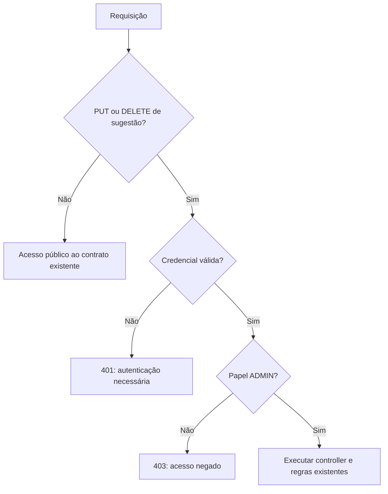

# 08 — Spring Security e administrador

[Roteiro](../README.md) · [Contrato](00-modelo-dados.md) · [Etapa anterior](07-testes-entrega.md)

## Missão

Proteger alteração e exclusão de sugestões com um administrador provisionado pelo
professor. Consultas e envio continuam públicos. Continue o projeto do módulo 07.
O checkpoint é `08-spring-security-impl`.

Neste módulo intermediário, HTTP Basic permite estudar autenticação, BCrypt e
permissões. No módulo 09, ele será desabilitado e substituído pelo login com JWT.
Não há cadastro público de usuários nem vínculo entre o texto `author` e a conta.



O desenho representa a política das operações existentes, não um cadastro de
papéis acessível ao público. A aplicação provisiona somente um administrador.
Um ID inexistente retorna 404 somente depois de passar pela autorização.

## 1. Dependências e autenticação administrativa

Spring Security usa um `UserDetailsService` em memória para a única conta do
administrador. O username e o hash BCrypt são exigidos no ambiente da API.
Não existe senha padrão nem seed de credencial no PostgreSQL.
O serviço compara a senha apresentada com BCrypt através de
`DaoAuthenticationProvider`; o código não compara senhas diretamente.

### `build.gradle`

Crie o arquivo ou substitua seu conteúdo inteiro, se já existir.

<!-- arquivo: build.gradle -->
```groovy
plugins {
    id 'java'
    id 'org.springframework.boot' version '4.1.1'
    id 'io.spring.dependency-management' version '1.1.7'
}
group = 'br.com.etecalbertoferes'
version = '0.0.1-SNAPSHOT'
java { toolchain { languageVersion = JavaLanguageVersion.of(17) } }
repositories { mavenCentral() }
dependencies {
    implementation 'org.springframework.boot:spring-boot-starter-webmvc'
    implementation 'org.springframework.boot:spring-boot-starter-security'
    implementation 'org.springdoc:springdoc-openapi-starter-webmvc-ui:3.1.1'
    implementation 'org.springframework.boot:spring-boot-starter-validation'
    implementation 'org.springframework.boot:spring-boot-starter-data-jpa'
    implementation 'org.springframework.boot:spring-boot-starter-flyway'
    implementation 'org.flywaydb:flyway-database-postgresql'
    runtimeOnly 'org.postgresql:postgresql'
    testImplementation 'org.springframework.boot:spring-boot-starter-webmvc-test'
    testImplementation 'org.testcontainers:testcontainers-junit-jupiter'
    testImplementation 'org.testcontainers:testcontainers-postgresql'
    testImplementation 'org.springframework.security:spring-security-test'
    testRuntimeOnly 'org.junit.platform:junit-platform-launcher'
}
tasks.named('test') { useJUnitPlatform() }
```

### `src/main/java/br/com/etecalbertoferes/CaixaDeSugestoes/infrastructure/security/AdminConfiguration.java`

Crie o arquivo ou substitua seu conteúdo inteiro, se já existir.

<!-- arquivo: src/main/java/br/com/etecalbertoferes/CaixaDeSugestoes/infrastructure/security/AdminConfiguration.java -->
```java
package br.com.etecalbertoferes.CaixaDeSugestoes.infrastructure.security;

import org.springframework.context.annotation.*;
import org.springframework.core.env.Environment;
import org.springframework.security.authentication.*;
import org.springframework.security.authentication.dao.DaoAuthenticationProvider;
import org.springframework.security.core.userdetails.*;
import org.springframework.security.crypto.bcrypt.BCryptPasswordEncoder;
import org.springframework.security.crypto.password.PasswordEncoder;
import org.springframework.security.provisioning.InMemoryUserDetailsManager;

@Configuration
public class AdminConfiguration {
    @Bean PasswordEncoder passwordEncoder() { return new BCryptPasswordEncoder(12); }
    @Bean UserDetailsService adminUsers(Environment env) {
        String username = env.getRequiredProperty("app.admin.username");
        String hash = env.getRequiredProperty("app.admin.password-hash");
        if (username.isBlank() || !hash.matches("\\$2[aby]\\$\\d{2}\\$[./A-Za-z0-9]{53}")) {
            throw new IllegalStateException("Configure ADMIN_USERNAME e ADMIN_PASSWORD_HASH com um hash BCrypt válido");
        }
        return new InMemoryUserDetailsManager(User.withUsername(username).password(hash).roles("ADMIN").build());
    }
    @Bean AuthenticationManager authenticationManager(UserDetailsService users, PasswordEncoder encoder) {
        DaoAuthenticationProvider provider = new DaoAuthenticationProvider(users);
        provider.setPasswordEncoder(encoder);
        return new ProviderManager(provider);
    }
}
```

## 2. Respostas de segurança e permissões

Falhas nos filtros de segurança ocorrem antes dos controllers; por isso precisam
de handlers próprios para produzir o mesmo `ApiError` usado no REST.
O 401 inclui `WWW-Authenticate`, enquanto 403 significa identidade reconhecida
sem a permissão requerida. As respostas não incluem senha, hash ou stack trace.
A conta disponível no produto tem ADMIN; o cenário READER existe somente em teste.

### `src/main/java/br/com/etecalbertoferes/CaixaDeSugestoes/infrastructure/security/SecurityErrorWriter.java`

Crie o arquivo ou substitua seu conteúdo inteiro, se já existir.

<!-- arquivo: src/main/java/br/com/etecalbertoferes/CaixaDeSugestoes/infrastructure/security/SecurityErrorWriter.java -->
```java
package br.com.etecalbertoferes.CaixaDeSugestoes.infrastructure.security;

import java.io.IOException;
import java.time.Instant;
import java.util.Map;
import jakarta.servlet.http.*;
import org.springframework.http.MediaType;
import org.springframework.stereotype.Component;
import tools.jackson.databind.ObjectMapper;
import br.com.etecalbertoferes.CaixaDeSugestoes.interfaces.rest.ApiError;

@Component
public class SecurityErrorWriter {
    private final ObjectMapper mapper;
    public SecurityErrorWriter(ObjectMapper mapper) { this.mapper = mapper; }
    public void write(HttpServletRequest request, HttpServletResponse response, int status, String message) throws IOException {
        response.setStatus(status);
        response.setContentType(MediaType.APPLICATION_JSON_VALUE);
        response.setCharacterEncoding("UTF-8");
        mapper.writeValue(response.getOutputStream(), new ApiError(Instant.now(), status, message, request.getRequestURI(), Map.of()));
    }
}
```

### `src/main/java/br/com/etecalbertoferes/CaixaDeSugestoes/infrastructure/security/SecurityConfiguration.java`

Crie o arquivo ou substitua seu conteúdo inteiro, se já existir.

<!-- arquivo: src/main/java/br/com/etecalbertoferes/CaixaDeSugestoes/infrastructure/security/SecurityConfiguration.java -->
```java
package br.com.etecalbertoferes.CaixaDeSugestoes.infrastructure.security;

import jakarta.servlet.DispatcherType;
import org.springframework.context.annotation.*;
import org.springframework.http.HttpMethod;
import org.springframework.security.config.annotation.web.builders.HttpSecurity;
import org.springframework.security.config.http.SessionCreationPolicy;
import org.springframework.security.web.SecurityFilterChain;

@Configuration
public class SecurityConfiguration {
    @Bean SecurityFilterChain apiSecurity(HttpSecurity http, SecurityErrorWriter errors) throws Exception {
        return http
            .csrf(csrf -> csrf.disable())
            .sessionManagement(session -> session.sessionCreationPolicy(SessionCreationPolicy.STATELESS))
            .requestCache(cache -> cache.disable())
            .authorizeHttpRequests(auth -> auth
                .dispatcherTypeMatchers(DispatcherType.ERROR).permitAll()
                .requestMatchers(HttpMethod.PUT, "/api/suggestions/*").hasRole("ADMIN")
                .requestMatchers(HttpMethod.DELETE, "/api/suggestions/*").hasRole("ADMIN")
                .anyRequest().permitAll())
            .httpBasic(basic -> basic.authenticationEntryPoint((req, res, ex) -> {
                res.setHeader("WWW-Authenticate", "Basic realm=\"administracao\"");
                errors.write(req, res, 401, "Autenticação necessária");
            }))
            .exceptionHandling(ex -> ex
                .authenticationEntryPoint((req, res, cause) -> {
                    res.setHeader("WWW-Authenticate", "Basic realm=\"administracao\"");
                    errors.write(req, res, 401, "Autenticação necessária");
                })
                .accessDeniedHandler((req, res, cause) -> errors.write(req, res, 403, "Acesso negado")))
            .build();
    }
}
```

Este checkpoint é um exercício intermediário de clientes HTTP. Basic deve usar
HTTPS fora de localhost e não será o mecanismo do projeto web. Não associe esta
configuração sem CSRF a login de navegador por cookies ou Basic automático;
no módulo 09 usaremos exclusivamente Bearer explícito e nenhuma sessão/cookie.

## 3. Gere o hash sem colocar senha no histórico

O modo auxiliar abaixo funciona antes de carregar Spring, banco ou credenciais.
A senha é lida em terminal interativo sem eco. BCrypt admite no máximo 72 bytes;
o provisionamento exige pelo menos 12 caracteres.

### `src/main/java/br/com/etecalbertoferes/CaixaDeSugestoes/infrastructure/security/AdminPasswordHash.java`

Crie o arquivo ou substitua seu conteúdo inteiro, se já existir.

<!-- arquivo: src/main/java/br/com/etecalbertoferes/CaixaDeSugestoes/infrastructure/security/AdminPasswordHash.java -->
```java
package br.com.etecalbertoferes.CaixaDeSugestoes.infrastructure.security;

import java.io.Console;
import java.nio.charset.StandardCharsets;
import java.util.Arrays;
import org.springframework.security.crypto.bcrypt.BCryptPasswordEncoder;

public final class AdminPasswordHash {
    private AdminPasswordHash() {}
    public static void generate() {
        Console console = System.console();
        if (console == null) throw new IllegalStateException("Execute em terminal interativo: java -jar ... --generate-admin-password-hash");
        char[] password = console.readPassword("Senha administrativa (mínimo 12 caracteres): ");
        if (password == null) throw new IllegalStateException("Leitura cancelada");
        try {
            String value = new String(password);
            if (password.length < 12 || value.getBytes(StandardCharsets.UTF_8).length > 72)
                throw new IllegalArgumentException("Use ao menos 12 caracteres e no máximo 72 bytes UTF-8");
            console.printf("%s%n", new BCryptPasswordEncoder(12).encode(value));
        } finally { Arrays.fill(password, '\0'); }
    }
}
```

### `src/main/java/br/com/etecalbertoferes/CaixaDeSugestoes/CaixaDeSugestoesApplication.java`

Crie o arquivo ou substitua seu conteúdo inteiro, se já existir.

<!-- arquivo: src/main/java/br/com/etecalbertoferes/CaixaDeSugestoes/CaixaDeSugestoesApplication.java -->
```java
package br.com.etecalbertoferes.CaixaDeSugestoes;

import org.springframework.boot.SpringApplication;
import org.springframework.boot.autoconfigure.SpringBootApplication;

@SpringBootApplication
public class CaixaDeSugestoesApplication {
    public static void main(String[] args) {
        if (args.length == 1 && "--generate-admin-password-hash".equals(args[0])) {
            br.com.etecalbertoferes.CaixaDeSugestoes.infrastructure.security.AdminPasswordHash.generate();
            return;
        }
        SpringApplication.run(CaixaDeSugestoesApplication.class, args);
    }
}
```

### `src/main/resources/application.yaml`

Crie o arquivo ou substitua seu conteúdo inteiro, se já existir.

<!-- arquivo: src/main/resources/application.yaml -->
```yaml
server:
  port: ${SERVER_PORT:8000}
spring:
  application:
    name: CaixaDeSugestoes
  datasource:
    url: ${DB_URL:jdbc:postgresql://localhost:5432/suggestions}
    username: ${DB_USERNAME:suggestions}
    password: ${DB_PASSWORD:suggestions}
  jpa:
    open-in-view: false
    hibernate:
      ddl-auto: validate
    properties:
      hibernate:
        jdbc:
          time_zone: UTC
  flyway:
    enabled: true
springdoc:
  swagger-ui:
    path: /swagger-ui.html
  api-docs:
    path: /v3/api-docs
app:
  admin:
    username: ${ADMIN_USERNAME}
    password-hash: ${ADMIN_PASSWORD_HASH}
```

Gere o JAR primeiro; `bootJar` não inicia o contexto nem exige configuração:

```powershell
.\gradlew.bat bootJar
java -jar build/libs/CaixaDeSugestoes-0.0.1-SNAPSHOT.jar --generate-admin-password-hash
```

Digite uma senha própria quando solicitado. Copie somente o hash impresso.
No terminal que iniciará a API, configure os valores locais:

```powershell
$env:ADMIN_USERNAME = 'administrador'
$env:ADMIN_PASSWORD_HASH = 'COLE_O_HASH_BCRYPT_GERADO'
docker compose up -d --wait
.\gradlew.bat bootRun
```

Use aspas simples em volta do hash para preservar `$`. Não salve a senha em
texto puro na configuração ou no Git. O hash também deve ficar fora dos arquivos
versionados. A API falha na inicialização se essas variáveis estiverem ausentes.
No Linux/macOS, use `export ADMIN_USERNAME=...` e `export ADMIN_PASSWORD_HASH='...'`.
Um `.env` do Compose não é automaticamente carregado pela aplicação Java.

## Swagger neste checkpoint

O botão Authorize usa Basic somente nas operações protegidas. Substitua os arquivos abaixo.

### `src/main/java/br/com/etecalbertoferes/CaixaDeSugestoes/interfaces/rest/OpenApiConfiguration.java`

Crie o arquivo ou substitua seu conteúdo inteiro, se já existir.

<!-- arquivo: src/main/java/br/com/etecalbertoferes/CaixaDeSugestoes/interfaces/rest/OpenApiConfiguration.java -->
```java
package br.com.etecalbertoferes.CaixaDeSugestoes.interfaces.rest;

import io.swagger.v3.oas.models.OpenAPI;
import io.swagger.v3.oas.models.info.Info;
import org.springframework.context.annotation.*;
@Configuration
public class OpenApiConfiguration {
    @Bean OpenAPI api() {
        return new OpenAPI().components(new io.swagger.v3.oas.models.Components().addSecuritySchemes("basicAdmin",
            new io.swagger.v3.oas.models.security.SecurityScheme().type(io.swagger.v3.oas.models.security.SecurityScheme.Type.HTTP).scheme("basic"))).info(new Info().title("Caixa de Sugestões — Etec Prefeito Alberto Feres")
            .version("1.0.0").description("API de sugestões para consumo pelo projeto web com Thymeleaf. Catálogos didáticos somente para consulta. Datas em UTC."));
    }
}
```

### `src/main/java/br/com/etecalbertoferes/CaixaDeSugestoes/interfaces/rest/SuggestionController.java`

Crie o arquivo ou substitua seu conteúdo inteiro, se já existir.

<!-- arquivo: src/main/java/br/com/etecalbertoferes/CaixaDeSugestoes/interfaces/rest/SuggestionController.java -->
```java
package br.com.etecalbertoferes.CaixaDeSugestoes.interfaces.rest;

import io.swagger.v3.oas.annotations.Operation;
import io.swagger.v3.oas.annotations.Parameter;
import io.swagger.v3.oas.annotations.tags.Tag;
import io.swagger.v3.oas.annotations.responses.*;
import io.swagger.v3.oas.annotations.media.*;
import java.net.URI;
import jakarta.validation.Valid;
import jakarta.validation.constraints.Positive;
import java.util.List;
import org.springframework.http.ResponseEntity;
import org.springframework.web.bind.annotation.*;
import br.com.etecalbertoferes.CaixaDeSugestoes.application.SuggestionService;

@Tag(name = "Sugestões", description = "Cadastro, consulta, substituição e exclusão de sugestões")
@RestController
@RequestMapping("/api/suggestions")
@ApiResponses({
    @ApiResponse(responseCode = "400", description = "Dados, ID ou filtro inválido", content = @Content(schema = @Schema(implementation = ApiError.class))),
    @ApiResponse(responseCode = "404", description = "Sugestão, curso ou categoria não encontrado", content = @Content(schema = @Schema(implementation = ApiError.class))),
    @ApiResponse(responseCode = "500", description = "Erro interno", content = @Content(schema = @Schema(implementation = ApiError.class)))
})
public class SuggestionController {
    private final SuggestionService service;
    public SuggestionController(SuggestionService service) { this.service = service; }
    @Operation(summary = "Listar sugestões", description = "Array sem paginação. Filtros combinados por AND; q busca título OU conteúdo sem distinguir maiúsculas. Espaços externos são removidos; vazio é ignorado. %, _ e ! são literais. Ordem: createdAt e id decrescentes. IDs positivos inexistentes retornam [].")
    @ApiResponse(responseCode = "200", description = "Lista de sugestões, inclusive vazia")
    @GetMapping
    public List<SuggestionResponse> list(@Parameter(description = "ID positivo do curso") @RequestParam(required = false) @Positive(message = "ID deve ser positivo") Long courseId,
            @Parameter(description = "ID positivo da categoria") @RequestParam(required = false) @Positive(message = "ID deve ser positivo") Long categoryId, @Parameter(description = "Trecho literal do título ou conteúdo") @RequestParam(required = false) String q) {
        return service.list(courseId, categoryId, q).stream().map(SuggestionResponse::from).toList();
    }
    @Operation(summary = "Consultar sugestão por ID")
    @ApiResponse(responseCode = "200", description = "Sugestão encontrada")
    @GetMapping("/{id}")
    public SuggestionResponse get(@PathVariable @Positive(message = "ID deve ser positivo") Long id) { return SuggestionResponse.from(service.get(id)); }
    @Operation(summary = "Criar sugestão", description = "O servidor gera id e createdAt. Autor ausente, nulo ou em branco é armazenado como null e devolvido como Anônimo. Consulte os IDs dos catálogos antes de enviar.")
    @ApiResponse(responseCode = "201", description = "Sugestão criada; Location contém /api/suggestions/{id}", content = @Content(schema = @Schema(implementation = SuggestionResponse.class)), headers = @io.swagger.v3.oas.annotations.headers.Header(name = "Location", schema = @Schema(type = "string")))
    @PostMapping
    public ResponseEntity<SuggestionResponse> create(@Valid @RequestBody SuggestionRequest request) {
        SuggestionResponse response = SuggestionResponse.from(service.create(request.command()));
        return ResponseEntity.created(URI.create("/api/suggestions/" + response.id())).body(response);
    }
    @Operation(summary = "Substituir campos editáveis", description = "Preserva id e createdAt. Omitir author remove o nome anterior. Curso e categoria são obrigatórios. Falhas não alteram o registro.")
    @ApiResponse(responseCode = "200", description = "Sugestão atualizada")
    @io.swagger.v3.oas.annotations.security.SecurityRequirement(name = "basicAdmin")
    @ApiResponse(responseCode = "401", description = "Autenticação necessária", content = @Content(schema = @Schema(implementation = ApiError.class)))
    @ApiResponse(responseCode = "403", description = "Acesso negado", content = @Content(schema = @Schema(implementation = ApiError.class)))
    @PutMapping("/{id}")
    public SuggestionResponse update(@PathVariable @Positive(message = "ID deve ser positivo") Long id, @Valid @RequestBody SuggestionRequest request) {
        return SuggestionResponse.from(service.update(id, request.command()));
    }
    @Operation(summary = "Excluir sugestão", description = "Exclusão física, preservando curso e categoria. Repetir a exclusão retorna 404.")
    @ApiResponse(responseCode = "204", description = "Excluída, sem corpo", content = @Content)
    @io.swagger.v3.oas.annotations.security.SecurityRequirement(name = "basicAdmin")
    @ApiResponse(responseCode = "401", description = "Autenticação necessária", content = @Content(schema = @Schema(implementation = ApiError.class)))
    @ApiResponse(responseCode = "403", description = "Acesso negado", content = @Content(schema = @Schema(implementation = ApiError.class)))
    @DeleteMapping("/{id}")
    public ResponseEntity<Void> delete(@PathVariable @Positive(message = "ID deve ser positivo") Long id) { service.delete(id); return ResponseEntity.noContent().build(); }
}
```

## 4. Adapte os testes mantendo os filtros nas verificações de segurança

O perfil `test` configura apenas valores de teste. `ContextTest` gera seu próprio
hash e fornece a conexão de Testcontainers. `DirtiesContext` impede reutilizar um
contexto cujo container já terminou quando outra classe herda a infraestrutura.
Os testes de contrato MVC isolados desabilitam filtros; a classe específica de
segurança e a integração completa mantêm os filtros reais.

### `src/test/resources/application-test.yaml`

Crie o arquivo ou substitua seu conteúdo inteiro, se já existir.

<!-- arquivo: src/test/resources/application-test.yaml -->
```yaml
app:
  admin:
    username: test-admin
spring:
  datasource:
    hikari:
      connection-timeout: 3000
```

### `src/test/java/br/com/etecalbertoferes/CaixaDeSugestoes/ContextTest.java`

Crie o arquivo ou substitua seu conteúdo inteiro, se já existir.

<!-- arquivo: src/test/java/br/com/etecalbertoferes/CaixaDeSugestoes/ContextTest.java -->
```java
package br.com.etecalbertoferes.CaixaDeSugestoes;

import org.junit.jupiter.api.Test;
import org.springframework.beans.factory.annotation.Autowired;
import org.springframework.boot.test.context.SpringBootTest;
import org.springframework.jdbc.core.JdbcTemplate;
import org.springframework.test.context.DynamicPropertyRegistry;
import org.springframework.test.context.DynamicPropertySource;
import org.testcontainers.junit.jupiter.Container;
import org.testcontainers.junit.jupiter.Testcontainers;
import org.testcontainers.postgresql.PostgreSQLContainer;
import static org.assertj.core.api.Assertions.assertThat;

@org.springframework.test.context.ActiveProfiles("test")
@org.springframework.test.annotation.DirtiesContext(classMode = org.springframework.test.annotation.DirtiesContext.ClassMode.AFTER_CLASS)
@SpringBootTest
@Testcontainers
class ContextTest {
    static final String ADMIN_PASSWORD = "Test-Admin-2026!";
    static final String ADMIN_HASH = new org.springframework.security.crypto.bcrypt.BCryptPasswordEncoder(10).encode(ADMIN_PASSWORD);
    @Container static final PostgreSQLContainer postgres = new PostgreSQLContainer("postgres:17");
    @DynamicPropertySource static void database(DynamicPropertyRegistry registry) {
        registry.add("app.admin.password-hash", () -> ADMIN_HASH);
        registry.add("spring.datasource.url", postgres::getJdbcUrl);
        registry.add("spring.datasource.username", postgres::getUsername);
        registry.add("spring.datasource.password", postgres::getPassword);
    }
    @Autowired JdbcTemplate jdbc;
    @Test void migrationsAndSeeds() {
        assertThat(jdbc.queryForObject("select count(*) from courses", Long.class)).isEqualTo(4L);
        assertThat(jdbc.queryForObject("select count(*) from categories", Long.class)).isEqualTo(3L);
        assertThat(jdbc.queryForObject("select count(*) from suggestions", Long.class)).isZero();
    }
}
```

### `src/test/java/br/com/etecalbertoferes/CaixaDeSugestoes/interfaces/rest/SuggestionControllerTest.java`

Crie o arquivo ou substitua seu conteúdo inteiro, se já existir.

<!-- arquivo: src/test/java/br/com/etecalbertoferes/CaixaDeSugestoes/interfaces/rest/SuggestionControllerTest.java -->
```java
package br.com.etecalbertoferes.CaixaDeSugestoes.interfaces.rest;

import br.com.etecalbertoferes.CaixaDeSugestoes.application.*;
import br.com.etecalbertoferes.CaixaDeSugestoes.domain.*;
import java.time.Instant;
import java.util.List;
import org.junit.jupiter.api.Test;
import org.springframework.beans.factory.annotation.Autowired;
import org.springframework.boot.webmvc.test.autoconfigure.WebMvcTest;
import org.springframework.http.MediaType;
import org.springframework.test.context.bean.override.mockito.MockitoBean;
import org.springframework.test.web.servlet.MockMvc;
import static org.mockito.ArgumentMatchers.*;
import static org.mockito.Mockito.*;
import static org.springframework.test.web.servlet.request.MockMvcRequestBuilders.*;
import static org.springframework.test.web.servlet.result.MockMvcResultMatchers.*;

@org.springframework.boot.webmvc.test.autoconfigure.AutoConfigureMockMvc(addFilters = false)
@WebMvcTest(SuggestionController.class)
class SuggestionControllerTest {
    @Autowired MockMvc mvc;
    @MockitoBean SuggestionService service;
    private static final String VALID = """
        {"title":"Biblioteca","content":"Mais tomadas","courseId":1,"categoryId":2}
        """;
    private Suggestion example() {
        return new Suggestion(7L, "Biblioteca", "Mais tomadas", null, Instant.parse("2026-10-08T12:00:00Z"),
            new Course(1L, "Curso"), new Category(2L, "Sugestão"));
    }
    @Test void createReturnsLocationAndAnonymous() throws Exception {
        when(service.create(any())).thenReturn(example());
        mvc.perform(post("/api/suggestions").contentType(MediaType.APPLICATION_JSON).content(VALID))
            .andExpect(status().isCreated()).andExpect(header().string("Location", "/api/suggestions/7"))
            .andExpect(jsonPath("$.author").value("Anônimo")).andExpect(jsonPath("$.course.id").value(1))
            .andExpect(jsonPath("$.createdAt").value("2026-10-08T12:00:00Z"));
    }
    @Test void emptyListIsArray() throws Exception {
        when(service.list(null, null, null)).thenReturn(List.of());
        mvc.perform(get("/api/suggestions")).andExpect(status().isOk()).andExpect(content().json("[]"));
    }
    @Test void getUpdateAndDelete() throws Exception {
        when(service.get(7L)).thenReturn(example());
        when(service.update(eq(7L), any())).thenReturn(example());
        mvc.perform(get("/api/suggestions/7")).andExpect(status().isOk()).andExpect(jsonPath("$.id").value(7));
        mvc.perform(put("/api/suggestions/7").contentType(MediaType.APPLICATION_JSON).content(VALID))
            .andExpect(status().isOk());
        mvc.perform(delete("/api/suggestions/7")).andExpect(status().isNoContent()).andExpect(content().string(""));
    }
    @Test void invalidBodyHasFieldErrors() throws Exception {
        mvc.perform(post("/api/suggestions").contentType(MediaType.APPLICATION_JSON)
                .content("{\"title\":\"  \",\"content\":\"\",\"courseId\":0,\"categoryId\":-1}"))
            .andExpect(status().isBadRequest()).andExpect(jsonPath("$.status").value(400))
            .andExpect(jsonPath("$.fieldErrors.title").value("Título é obrigatório"))
            .andExpect(jsonPath("$.fieldErrors.content").exists()).andExpect(jsonPath("$.fieldErrors.courseId").exists())
            .andExpect(jsonPath("$.fieldErrors.categoryId").exists());
        verifyNoInteractions(service);
    }
    @Test void invalidIdsAndFilters() throws Exception {
        for (String path : List.of("/api/suggestions/0", "/api/suggestions/-1", "/api/suggestions/abc",
                "/api/suggestions?courseId=-1", "/api/suggestions?categoryId=0", "/api/suggestions?courseId=abc")) {
            mvc.perform(get(path)).andExpect(status().isBadRequest()).andExpect(jsonPath("$.status").value(400));
        }
        verifyNoInteractions(service);
    }
    @Test void malformedMissingAndNullBodies() throws Exception {
        for (String body : List.of("", "{", "null", "{}")) {
            mvc.perform(post("/api/suggestions").contentType(MediaType.APPLICATION_JSON).content(body))
                .andExpect(status().isBadRequest()).andExpect(jsonPath("$.path").value("/api/suggestions"));
        }
        verifyNoInteractions(service);
    }
    @Test void notFoundAndCatalogNotFound() throws Exception {
        when(service.get(7L)).thenThrow(new ResourceNotFoundException("Sugestão não encontrada"));
        when(service.create(any())).thenThrow(new ResourceNotFoundException("Categoria não encontrada"));
        mvc.perform(get("/api/suggestions/7")).andExpect(status().isNotFound()).andExpect(jsonPath("$.message").value("Sugestão não encontrada"));
        mvc.perform(post("/api/suggestions").contentType(MediaType.APPLICATION_JSON).content(VALID))
            .andExpect(status().isNotFound()).andExpect(jsonPath("$.fieldErrors").isEmpty());
    }
    @Test void protocolStatusesAndGenericError() throws Exception {
        mvc.perform(patch("/api/suggestions/7").contentType(MediaType.APPLICATION_JSON).content(VALID))
            .andExpect(status().isMethodNotAllowed()).andExpect(header().exists("Allow")).andExpect(jsonPath("$.status").value(405));
        mvc.perform(post("/api/suggestions").contentType(MediaType.TEXT_PLAIN).content("texto"))
            .andExpect(status().isUnsupportedMediaType()).andExpect(jsonPath("$.status").value(415));
        when(service.get(7L)).thenThrow(new RuntimeException("SQL password secret"));
        mvc.perform(get("/api/suggestions/7")).andExpect(status().isInternalServerError())
            .andExpect(jsonPath("$.message").value("Erro interno do servidor"));
    }
}
```

### `src/test/java/br/com/etecalbertoferes/CaixaDeSugestoes/ApiIntegrationTest.java`

Crie o arquivo ou substitua seu conteúdo inteiro, se já existir.

<!-- arquivo: src/test/java/br/com/etecalbertoferes/CaixaDeSugestoes/ApiIntegrationTest.java -->
```java
package br.com.etecalbertoferes.CaixaDeSugestoes;

import java.time.Instant;
import java.util.Map;
import br.com.etecalbertoferes.CaixaDeSugestoes.application.*;
import br.com.etecalbertoferes.CaixaDeSugestoes.domain.*;
import org.junit.jupiter.api.Test;
import org.springframework.beans.factory.annotation.Autowired;
import org.springframework.boot.webmvc.test.autoconfigure.AutoConfigureMockMvc;
import org.springframework.http.MediaType;
import org.springframework.test.web.servlet.MockMvc;
import org.springframework.transaction.annotation.Transactional;
import static org.assertj.core.api.Assertions.*;
import static org.springframework.security.test.web.servlet.request.SecurityMockMvcRequestPostProcessors.user;
import static org.springframework.test.web.servlet.request.MockMvcRequestBuilders.*;
import static org.springframework.test.web.servlet.result.MockMvcResultMatchers.*;

@AutoConfigureMockMvc
@Transactional
class ApiIntegrationTest extends ContextTest {
    @Autowired MockMvc mvc;
    @Autowired jakarta.persistence.EntityManager em;
    @Autowired SuggestionService service;
    @Autowired SuggestionRepository repository;
    @Autowired CatalogService catalogs;
    Long course() { return catalogs.courses().get(0).id(); }
    Long category() { return catalogs.categories().get(0).id(); }
    Suggestion create(String title, String content, String author, Long courseId, Long categoryId) {
        return service.create(new SuggestionCommand(title, content, author, courseId, categoryId));
    }
    @Test void catalogAndHttpLifecycle() throws Exception {
        mvc.perform(get("/api/courses")).andExpect(status().isOk()).andExpect(jsonPath("$.length()").value(4));
        mvc.perform(get("/api/categories")).andExpect(status().isOk()).andExpect(jsonPath("$.length()").value(3));
        String body = "{\"title\":\"Tomadas\",\"content\":\"Biblioteca\",\"author\":\"  Pessoa  \",\"courseId\":"+course()+",\"categoryId\":"+category()+"}";
        String location = mvc.perform(post("/api/suggestions").contentType(MediaType.APPLICATION_JSON).content(body))
            .andExpect(status().isCreated()).andExpect(jsonPath("$.author").value("Pessoa"))
            .andReturn().getResponse().getHeader("Location");
        Long id = Long.valueOf(location.substring(location.lastIndexOf('/')+1));
        Instant time = service.get(id).createdAt();
        mvc.perform(get(location)).andExpect(status().isOk()).andExpect(jsonPath("$.title").value("Tomadas"));
        mvc.perform(put(location).with(user("test-admin").roles("ADMIN")).contentType(MediaType.APPLICATION_JSON).content(body.replace("  Pessoa  ", "  ")))
            .andExpect(status().isOk()).andExpect(jsonPath("$.author").value("Anônimo"));
        assertThat(service.get(id).createdAt()).isEqualTo(time);
        em.flush();
        assertThat(jdbc.queryForObject("select author from suggestions where id=?", String.class, id)).isNull();
        mvc.perform(delete(location).with(user("test-admin").roles("ADMIN"))).andExpect(status().isNoContent()).andExpect(content().string(""));
        mvc.perform(get(location)).andExpect(status().isNotFound());
        mvc.perform(delete(location).with(user("test-admin").roles("ADMIN"))).andExpect(status().isNotFound());
        mvc.perform(put(location).with(user("test-admin").roles("ADMIN")).contentType(MediaType.APPLICATION_JSON).content(body)).andExpect(status().isNotFound());
        assertThat(catalogs.courses()).hasSize(4);
        assertThat(catalogs.categories()).hasSize(3);
    }
    @Test void filtersLiteralCharactersAndOrdering() {
        Long c1 = course(), c2 = catalogs.courses().get(1).id();
        Long t1 = category(), t2 = catalogs.categories().get(1).id();
        Suggestion a = create("Tomadas 100%_!", "biblioteca", null, c1, t1);
        Suggestion b = create("outro", "TOMADAS 100xyz", "", c2, t1);
        Suggestion c = create("Tomadas", "terceiro", "Pessoa", c1, t2);
        assertThat(service.list(null,null,"tomadas")).extracting(Suggestion::id).containsExactly(c.id(), b.id(), a.id());
        assertThat(service.list(c1,null,null)).extracting(Suggestion::id).containsExactly(c.id(), a.id());
        assertThat(service.list(null,t1,null)).extracting(Suggestion::id).containsExactly(b.id(), a.id());
        assertThat(service.list(c1,t1," TOMADAS ")).extracting(Suggestion::id).containsExactly(a.id());
        for (String literal : new String[]{"%", "_", "!", "100%_!"})
            assertThat(service.list(null,null,literal)).extracting(Suggestion::id).containsExactly(a.id());
        assertThat(service.list(999999L,null,null)).isEmpty();
        assertThat(service.list(null,999999L,null)).isEmpty();
        assertThat(service.list(null,null,"inexistente")).isEmpty();
        assertThat(service.list(null,null,"  ")).hasSize(3);
        Instant same = Instant.parse("2026-01-01T00:00:00Z");
        jdbc.update("update suggestions set created_at=?", java.sql.Timestamp.from(same));
        assertThat(service.list(null,null,null)).extracting(Suggestion::id).containsExactly(c.id(), b.id(), a.id());
    }
    @Test void rejectedUpdatesPreserveStoredDataAndTextHasNo255Limit() throws Exception {
        Suggestion item = create("x".repeat(500), "y".repeat(1000), null, course(), category());
        String invalid = "{\"title\":\"change\",\"content\":\"change\",\"courseId\":"+course()+",\"categoryId\":999999}";
        mvc.perform(put("/api/suggestions/"+item.id()).with(user("test-admin").roles("ADMIN")).contentType(MediaType.APPLICATION_JSON).content(invalid)).andExpect(status().isNotFound());
        assertThat(service.get(item.id()).title()).hasSize(500);
        assertThat(service.get(item.id()).content()).hasSize(1000);
        mvc.perform(post("/api/suggestions").contentType(MediaType.APPLICATION_JSON).content(invalid)).andExpect(status().isNotFound());
        assertThat(service.list(null,null,null)).hasSize(1);
    }
    @Test void openApiDocumentsAllOperations() throws Exception {
        mvc.perform(get("/v3/api-docs")).andExpect(status().isOk())
            .andExpect(jsonPath("$.paths['/api/suggestions'].get").exists())
            .andExpect(jsonPath("$.paths['/api/suggestions'].post.responses['201']").exists())
            .andExpect(jsonPath("$.paths['/api/suggestions/{id}'].get").exists())
            .andExpect(jsonPath("$.paths['/api/suggestions/{id}'].put").exists())
            .andExpect(jsonPath("$.paths['/api/suggestions/{id}'].delete.responses['204']").exists())
            .andExpect(jsonPath("$.paths['/api/courses'].get").exists())
            .andExpect(jsonPath("$.paths['/api/categories'].get").exists());
        mvc.perform(get("/swagger-ui.html")).andExpect(status().is3xxRedirection());
    }
}
```

### `src/test/java/br/com/etecalbertoferes/CaixaDeSugestoes/BasicSecurityIntegrationTest.java`

Crie o arquivo ou substitua seu conteúdo inteiro, se já existir.

<!-- arquivo: src/test/java/br/com/etecalbertoferes/CaixaDeSugestoes/BasicSecurityIntegrationTest.java -->
```java
package br.com.etecalbertoferes.CaixaDeSugestoes;

import org.junit.jupiter.api.Test;
import org.springframework.beans.factory.annotation.Autowired;
import org.springframework.boot.webmvc.test.autoconfigure.AutoConfigureMockMvc;
import org.springframework.http.MediaType;
import org.springframework.test.web.servlet.MockMvc;
import static org.springframework.security.test.web.servlet.request.SecurityMockMvcRequestPostProcessors.*;
import static org.springframework.test.web.servlet.request.MockMvcRequestBuilders.*;
import static org.springframework.test.web.servlet.result.MockMvcResultMatchers.*;

@AutoConfigureMockMvc
class BasicSecurityIntegrationTest extends ContextTest {
    @Autowired MockMvc mvc;
    @Test void publicReadsRemainAccessible() throws Exception {
        for (String path : new String[]{"/api/suggestions", "/api/courses", "/api/categories", "/v3/api-docs"})
            mvc.perform(get(path)).andExpect(status().isOk());
    }
    @Test void anonymousCanSubmitWithoutCsrfOrLogin() throws Exception {
        mvc.perform(post("/api/suggestions").contentType(MediaType.APPLICATION_JSON).content("{}"))
            .andExpect(status().isBadRequest()).andExpect(jsonPath("$.fieldErrors.title").exists());
    }
    @Test void adminOperationsRequireAuthentication() throws Exception {
        mvc.perform(delete("/api/suggestions/999999")).andExpect(status().isUnauthorized())
            .andExpect(header().string("WWW-Authenticate", "Basic realm=\"administracao\""))
            .andExpect(jsonPath("$.status").value(401)).andExpect(jsonPath("$.fieldErrors").isEmpty());
        mvc.perform(put("/api/suggestions/999999")).andExpect(status().isUnauthorized());
    }
    @Test void basicAuthenticatesOnlyConfiguredAdmin() throws Exception {
        mvc.perform(delete("/api/suggestions/999999").with(httpBasic("test-admin", ADMIN_PASSWORD)))
            .andExpect(status().isNotFound());
        mvc.perform(delete("/api/suggestions/999999").with(httpBasic("test-admin", "wrong")))
            .andExpect(status().isUnauthorized());
    }
    @Test void authenticatedNonAdminGetsForbidden() throws Exception {
        mvc.perform(delete("/api/suggestions/999999").with(user("reader").roles("READER")))
            .andExpect(status().isForbidden()).andExpect(jsonPath("$.status").value(403));
    }
}
```

## 5. Execute e teste no cliente

```powershell
.\gradlew.bat test bootJar
```

Nos clientes, consultas e POST de sugestões não enviam autenticação. Para PUT e
DELETE, escolha **Basic Auth** e informe o administrador configurado.
As collections deste checkpoint usam `adminUsername` e `adminPassword`, vazios
na exportação. Preencha localmente e não exporte suas credenciais pessoais.
Collections da etapa 07 continuam correspondendo à versão sem autenticação.

| Cenário | Resultado |
| --- | --- |
| Consulta pública | 200 |
| POST válido sem login | 201 |
| PUT/DELETE sem credencial ou com senha errada | 401 |
| Conta autenticada sem ADMIN, somente no teste | 403 |
| Administrador em sugestão existente | 200 no PUT; 204 no DELETE |

## Confira antes de avançar

- A conta administrativa vem do ambiente e usa hash BCrypt.
- O público consulta e envia sugestões sem login.
- Alterar e excluir exigem ADMIN.
- A suíte confere 401 e 403 com filtros ativos.
- A senha não está no código, no Git nem nos arquivos exportados.

Explique por que o campo author não concede nenhuma permissão. Faça um commit
no seu projeto antes de continuar para [09 — JWT e Bearer Token](09-jwt-bearer-token.md).

Referência: [autenticação por senha do Spring Security](https://docs.spring.io/spring-security/reference/servlet/authentication/passwords/index.html).
