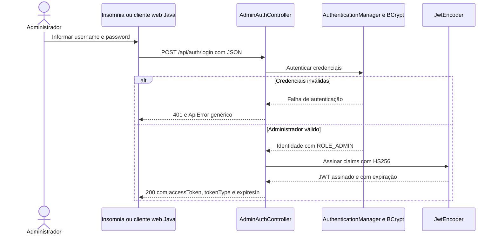
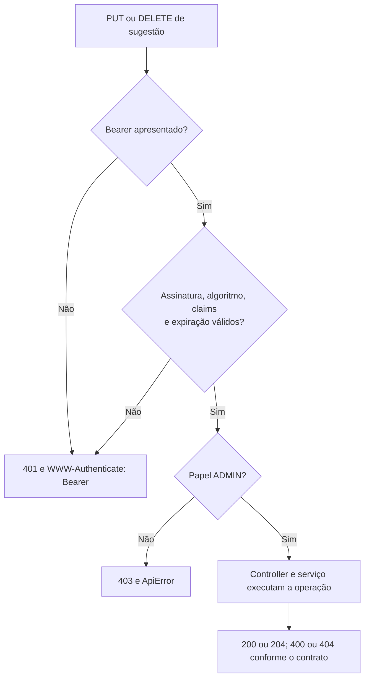
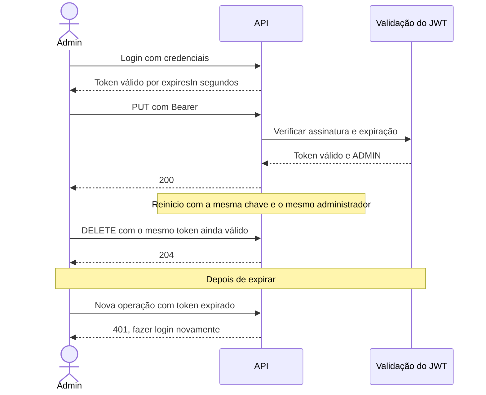

# 09 — Login administrativo, JWT e Bearer Token

[Roteiro](../README.md) · [Etapa anterior](08-spring-security.md) · [Contrato](00-modelo-dados.md)

## Missão

Continuar o módulo 08 e substituir Basic por um login que emite JWT somente para
o administrador. O checkpoint `09-jwt-bearer-token-impl` é a versão final protegida.
A etapa 07 permanece como API completa sem autenticação.

| Operação | Acesso final |
| --- | --- |
| GET sugestões, detalhe, cursos e categorias | Público |
| POST de sugestão, inclusive anônima | Público |
| POST `/api/auth/login` | Recebe credenciais e emite token somente para o administrador |
| PUT e DELETE de sugestão | JWT válido com papel ADMIN |

Não há cadastro público, refresh token nem rota de logout no servidor. O autor
informado na sugestão não é uma identidade autenticada e não recebe permissões.

## Entenda a credencial

**JWT** é o formato do token assinado. **Bearer** é como apresentá-lo na chamada:
`Authorization: Bearer <accessToken>`. Base64 não criptografa o conteúdo do JWT;
nenhuma senha ou hash deve estar nas claims. Quem possui o token pode usá-lo
até sua expiração, por isso ele não deve ser compartilhado ou versionado.



**Leitura:** a senha é verificada no login; as chamadas seguintes apresentam o
token. Uma senha incorreta e um username inexistente produzem a mesma mensagem.

## 1. Adicione Resource Server

Spring Security valida o Bearer por seu próprio filtro e `JwtDecoder`. Não crie
um filtro JWT manual. Continue usando o administrador BCrypt da etapa anterior.

### `build.gradle`

Crie ou substitua o arquivo completo.

<!-- arquivo: build.gradle -->
```groovy
plugins {
    id 'java'
    id 'org.springframework.boot' version '4.1.1'
    id 'io.spring.dependency-management' version '1.1.7'
}
group = 'br.com.etecalbertoferes'
version = '0.0.1-SNAPSHOT'
java { toolchain { languageVersion = JavaLanguageVersion.of(17) } }
repositories { mavenCentral() }
dependencies {
    implementation 'org.springframework.boot:spring-boot-starter-webmvc'
    implementation 'org.springframework.boot:spring-boot-starter-security'
    implementation 'org.springframework.boot:spring-boot-starter-oauth2-resource-server'
    implementation 'org.springdoc:springdoc-openapi-starter-webmvc-ui:3.1.1'
    implementation 'org.springframework.boot:spring-boot-starter-validation'
    implementation 'org.springframework.boot:spring-boot-starter-data-jpa'
    implementation 'org.springframework.boot:spring-boot-starter-flyway'
    implementation 'org.flywaydb:flyway-database-postgresql'
    runtimeOnly 'org.postgresql:postgresql'
    testImplementation 'org.springframework.boot:spring-boot-starter-webmvc-test'
    testImplementation 'org.testcontainers:testcontainers-junit-jupiter'
    testImplementation 'org.testcontainers:testcontainers-postgresql'
    testImplementation 'org.springframework.security:spring-security-test'
    testRuntimeOnly 'org.junit.platform:junit-platform-launcher'
}
tasks.named('test') { useJUnitPlatform() }
```

## 2. Emissão e validação das claims

A assinatura usa HS256 com chave aleatória de pelo menos 32 bytes, recebida em
Base64 pelo ambiente. A duração padrão é 900 segundos; `JWT_TTL_SECONDS` aceita
60 a 3600. A chave não é gerada automaticamente em cada boot: preservá-la permite
que tokens não expirados continuem válidos após reinício.

| Claim | Valor ou regra |
| --- | --- |
| iss | `caixa-de-sugestoes` |
| aud | Inclui `caixa-de-sugestoes-api` |
| sub | Username do administrador configurado |
| iat | Obrigatório; admite até 30 segundos no futuro para emissão |
| exp | Expiração obrigatória, sem tolerância após expirar |
| jti | Identificador aleatório do token emitido |
| roles | Emissão somente com `ADMIN` |

O decoder verifica algoritmo, assinatura, tempo, emissor, audiência e subject.
`roles` é convertido para authorities `ROLE_...`; um token válido sem ADMIN
recebe 403. A API não emite esse token de outro papel; o cenário existe no teste
para comprovar a autorização.

### `src/main/java/br/com/etecalbertoferes/CaixaDeSugestoes/application/AdminAuthenticationService.java`

Crie ou substitua o arquivo completo.

<!-- arquivo: src/main/java/br/com/etecalbertoferes/CaixaDeSugestoes/application/AdminAuthenticationService.java -->
```java
package br.com.etecalbertoferes.CaixaDeSugestoes.application;

import java.time.Instant;
import java.util.List;
import java.util.UUID;
import org.springframework.beans.factory.annotation.Value;
import org.springframework.stereotype.Service;
import org.springframework.security.authentication.*;
import org.springframework.security.oauth2.jwt.*;
import org.springframework.security.oauth2.jose.jws.MacAlgorithm;

@Service
public class AdminAuthenticationService {
    public static final String ISSUER = "caixa-de-sugestoes";
    public static final String AUDIENCE = "caixa-de-sugestoes-api";
    private final AuthenticationManager authenticationManager;
    private final JwtEncoder encoder;
    private final long ttl;
    public AdminAuthenticationService(AuthenticationManager authenticationManager, JwtEncoder encoder,
            @Value("${app.jwt.ttl-seconds:900}") long ttl) {
        if (ttl < 60 || ttl > 3600) throw new IllegalArgumentException("JWT_TTL_SECONDS deve estar entre 60 e 3600");
        this.authenticationManager = authenticationManager; this.encoder = encoder; this.ttl = ttl;
    }
    public AccessToken login(String username, String password) {
        if (password.getBytes(java.nio.charset.StandardCharsets.UTF_8).length > 72)
            throw new BadCredentialsException("Credenciais inválidas");
        var authentication = authenticationManager.authenticate(UsernamePasswordAuthenticationToken.unauthenticated(username, password));
        if (authentication.getAuthorities().stream().noneMatch(a -> a.getAuthority().equals("ROLE_ADMIN")))
            throw new BadCredentialsException("Credenciais inválidas");
        Instant now = Instant.now();
        JwtClaimsSet claims = JwtClaimsSet.builder().issuer(ISSUER).audience(List.of(AUDIENCE))
            .subject(authentication.getName()).issuedAt(now).expiresAt(now.plusSeconds(ttl))
            .id(UUID.randomUUID().toString()).claim("roles", List.of("ADMIN")).build();
        String token = encoder.encode(JwtEncoderParameters.from(JwsHeader.with(MacAlgorithm.HS256).build(), claims)).getTokenValue();
        return new AccessToken(token, "Bearer", ttl);
    }
    public record AccessToken(String accessToken, String tokenType, long expiresIn) {}
}
```

### `src/main/java/br/com/etecalbertoferes/CaixaDeSugestoes/infrastructure/security/JwtConfiguration.java`

Crie ou substitua o arquivo completo.

<!-- arquivo: src/main/java/br/com/etecalbertoferes/CaixaDeSugestoes/infrastructure/security/JwtConfiguration.java -->
```java
package br.com.etecalbertoferes.CaixaDeSugestoes.infrastructure.security;

import java.time.Duration;
import java.time.Instant;
import java.util.Base64;
import java.util.List;
import javax.crypto.SecretKey;
import javax.crypto.spec.SecretKeySpec;
import org.springframework.context.annotation.*;
import org.springframework.core.env.Environment;
import org.springframework.security.oauth2.core.*;
import org.springframework.security.oauth2.jose.jws.MacAlgorithm;
import org.springframework.security.oauth2.jwt.*;
import br.com.etecalbertoferes.CaixaDeSugestoes.application.AdminAuthenticationService;

@Configuration
public class JwtConfiguration {
    @Bean SecretKey jwtSigningKey(Environment env) {
        byte[] decoded;
        try { decoded = Base64.getDecoder().decode(env.getRequiredProperty("app.jwt.secret-base64")); }
        catch (IllegalArgumentException ex) { throw new IllegalStateException("Configure JWT_SECRET_BASE64 com uma chave Base64 válida"); }
        if (decoded.length < 32) throw new IllegalStateException("JWT_SECRET_BASE64 deve representar pelo menos 32 bytes aleatórios");
        return new SecretKeySpec(decoded, "HmacSHA256");
    }
    @Bean JwtEncoder jwtEncoder(SecretKey key) {
        return NimbusJwtEncoder.withSecretKey(key).algorithm(MacAlgorithm.HS256).build();
    }
    @Bean JwtDecoder jwtDecoder(SecretKey key, Environment env) {
        NimbusJwtDecoder decoder = NimbusJwtDecoder.withSecretKey(key).macAlgorithm(MacAlgorithm.HS256).build();
        OAuth2TokenValidator<Jwt> requiredTimes = jwt -> {
            if (jwt.getExpiresAt() == null || jwt.getIssuedAt() == null || jwt.getIssuedAt().isAfter(Instant.now().plusSeconds(30)))
                return OAuth2TokenValidatorResult.failure(new OAuth2Error("invalid_token", "Claims temporais inválidas", null));
            return OAuth2TokenValidatorResult.success();
        };
        decoder.setJwtValidator(new DelegatingOAuth2TokenValidator<>(
            new JwtTimestampValidator(Duration.ZERO),
            new JwtIssuerValidator(AdminAuthenticationService.ISSUER),
            new JwtClaimValidator<List<String>>(JwtClaimNames.AUD, aud -> aud != null && aud.contains(AdminAuthenticationService.AUDIENCE)),
            new JwtClaimValidator<String>(JwtClaimNames.SUB, env.getRequiredProperty("app.admin.username")::equals),
            requiredTimes));
        return decoder;
    }
}
```

## 3. Substitua Basic pela autorização Bearer

O filtro de recurso usa o decoder e os handlers de erro anteriores. A aplicação
não habilita Basic nem formulário de login, não cria sessão e não autentica por
cookies. Por usar exclusivamente Bearer explícito nas operações administrativas,
CSRF está desabilitado nesta API. Isso não é uma configuração para copiar no
futuro projeto Thymeleaf, cuja sessão de navegador precisará de proteção CSRF.



Sem token, a requisição é rejeitada antes de validar o corpo ou consultar o ID.
Com autenticação válida, o contrato de negócio continua igual. Enviar um Bearer
inválido mesmo em uma rota pública resulta em 401; chamadas públicas devem omitir
o header quando não precisam de autenticação.

### `src/main/java/br/com/etecalbertoferes/CaixaDeSugestoes/infrastructure/security/SecurityConfiguration.java`

Crie ou substitua o arquivo completo.

<!-- arquivo: src/main/java/br/com/etecalbertoferes/CaixaDeSugestoes/infrastructure/security/SecurityConfiguration.java -->
```java
package br.com.etecalbertoferes.CaixaDeSugestoes.infrastructure.security;

import jakarta.servlet.DispatcherType;
import org.springframework.context.annotation.*;
import org.springframework.http.HttpMethod;
import org.springframework.security.config.annotation.web.builders.HttpSecurity;
import org.springframework.security.config.http.SessionCreationPolicy;
import org.springframework.security.oauth2.server.resource.authentication.*;
import org.springframework.security.web.SecurityFilterChain;

@Configuration
public class SecurityConfiguration {
    @Bean SecurityFilterChain apiSecurity(HttpSecurity http, SecurityErrorWriter errors) throws Exception {
        JwtGrantedAuthoritiesConverter authorities = new JwtGrantedAuthoritiesConverter();
        authorities.setAuthoritiesClaimName("roles");
        authorities.setAuthorityPrefix("ROLE_");
        JwtAuthenticationConverter converter = new JwtAuthenticationConverter();
        converter.setJwtGrantedAuthoritiesConverter(authorities);
        var unauthorized = (org.springframework.security.web.AuthenticationEntryPoint) (req, res, cause) -> {
            res.setHeader("WWW-Authenticate", "Bearer");
            errors.write(req, res, 401, "Autenticação necessária ou token inválido");
        };
        var forbidden = (org.springframework.security.web.access.AccessDeniedHandler) (req, res, cause) ->
            errors.write(req, res, 403, "Acesso negado");
        return http
            .csrf(csrf -> csrf.disable())
            .sessionManagement(session -> session.sessionCreationPolicy(SessionCreationPolicy.STATELESS))
            .requestCache(cache -> cache.disable())
            .authorizeHttpRequests(auth -> auth
                .dispatcherTypeMatchers(DispatcherType.ERROR).permitAll()
                .requestMatchers(HttpMethod.PUT, "/api/suggestions/*").hasRole("ADMIN")
                .requestMatchers(HttpMethod.DELETE, "/api/suggestions/*").hasRole("ADMIN")
                .anyRequest().permitAll())
            .oauth2ResourceServer(resource -> resource
                .jwt(jwt -> jwt.jwtAuthenticationConverter(converter))
                .authenticationEntryPoint(unauthorized).accessDeniedHandler(forbidden))
            .exceptionHandling(ex -> ex.authenticationEntryPoint(unauthorized).accessDeniedHandler(forbidden))
            .build();
    }
}
```

## 4. Crie o endpoint de login

O DTO valida entrada, mas não registra credenciais no toString. O controller
devolve `Cache-Control: no-store` e `Pragma: no-cache`. O advice converte falha de
autenticação em 401 genérico, sem distingui-la por usuário existente/inexistente.

### `src/main/java/br/com/etecalbertoferes/CaixaDeSugestoes/interfaces/rest/AdminLoginRequest.java`

Crie ou substitua o arquivo completo.

<!-- arquivo: src/main/java/br/com/etecalbertoferes/CaixaDeSugestoes/interfaces/rest/AdminLoginRequest.java -->
```java
package br.com.etecalbertoferes.CaixaDeSugestoes.interfaces.rest;

import jakarta.validation.constraints.*;
import io.swagger.v3.oas.annotations.media.Schema;
public record AdminLoginRequest(
    @NotBlank(message = "Usuário é obrigatório") @Size(max = 100, message = "Usuário deve ter no máximo 100 caracteres")
    @Schema(example = "administrador") String username,
    @NotBlank(message = "Senha é obrigatória") @Size(max = 72, message = "Senha deve ter no máximo 72 caracteres")
    @Schema(format = "password", accessMode = Schema.AccessMode.WRITE_ONLY) String password) {
    @Override public String toString() { return "AdminLoginRequest[credenciais protegidas]"; }
}
```

### `src/main/java/br/com/etecalbertoferes/CaixaDeSugestoes/interfaces/rest/AdminAuthController.java`

Crie ou substitua o arquivo completo.

<!-- arquivo: src/main/java/br/com/etecalbertoferes/CaixaDeSugestoes/interfaces/rest/AdminAuthController.java -->
```java
package br.com.etecalbertoferes.CaixaDeSugestoes.interfaces.rest;

import jakarta.validation.Valid;
import org.springframework.http.*;
import org.springframework.web.bind.annotation.*;
import io.swagger.v3.oas.annotations.*;
import io.swagger.v3.oas.annotations.tags.Tag;
import io.swagger.v3.oas.annotations.responses.ApiResponse;
import io.swagger.v3.oas.annotations.media.*;
import br.com.etecalbertoferes.CaixaDeSugestoes.application.AdminAuthenticationService;

@RestController
@RequestMapping("/api/auth")
@Tag(name = "Administração", description = "Login exclusivo do administrador; sem cadastro público")
public class AdminAuthController {
    private final AdminAuthenticationService service;
    public AdminAuthController(AdminAuthenticationService service) { this.service = service; }
    @PostMapping(value = "/login", consumes = MediaType.APPLICATION_JSON_VALUE)
    @Operation(summary = "Autenticar administrador e emitir JWT", description = "Envie username e password. accessToken deve ser apresentado como Authorization: Bearer <token>. Expiração em segundos; não há refresh nem revogação individual nesta etapa.")
    @ApiResponse(responseCode = "200", description = "Token emitido")
    @ApiResponse(responseCode = "400", description = "Corpo inválido", content = @Content(schema = @Schema(implementation = ApiError.class)))
    @ApiResponse(responseCode = "401", description = "Credenciais inválidas", content = @Content(schema = @Schema(implementation = ApiError.class)))
    public ResponseEntity<AdminAuthenticationService.AccessToken> login(@Valid @RequestBody AdminLoginRequest request) {
        return ResponseEntity.ok().cacheControl(CacheControl.noStore()).header(HttpHeaders.PRAGMA, "no-cache")
            .body(service.login(request.username(), request.password()));
    }
}
```

### `src/main/java/br/com/etecalbertoferes/CaixaDeSugestoes/interfaces/rest/ApiExceptionHandler.java`

Crie ou substitua o arquivo completo.

<!-- arquivo: src/main/java/br/com/etecalbertoferes/CaixaDeSugestoes/interfaces/rest/ApiExceptionHandler.java -->
```java
package br.com.etecalbertoferes.CaixaDeSugestoes.interfaces.rest;

import java.time.Instant;
import java.util.LinkedHashMap;
import java.util.Map;
import jakarta.servlet.http.HttpServletRequest;
import org.slf4j.Logger;
import org.slf4j.LoggerFactory;
import org.springframework.http.*;
import org.springframework.web.ErrorResponse;
import org.springframework.web.bind.MethodArgumentNotValidException;
import org.springframework.web.bind.annotation.*;
import org.springframework.web.context.request.*;
import org.springframework.web.method.annotation.HandlerMethodValidationException;
import org.springframework.web.servlet.mvc.method.annotation.ResponseEntityExceptionHandler;
import br.com.etecalbertoferes.CaixaDeSugestoes.domain.ResourceNotFoundException;

@RestControllerAdvice
public class ApiExceptionHandler extends ResponseEntityExceptionHandler {
    private static final Logger log = LoggerFactory.getLogger(ApiExceptionHandler.class);
    @Override
    protected ResponseEntity<Object> handleMethodArgumentNotValid(MethodArgumentNotValidException ex,
            HttpHeaders headers, HttpStatusCode status, WebRequest request) {
        Map<String, String> fields = new LinkedHashMap<>();
        ex.getBindingResult().getFieldErrors().forEach(e -> fields.putIfAbsent(e.getField(), e.getDefaultMessage()));
        return respond(status, "Dados inválidos", fields, headers, request);
    }
    @Override
    protected ResponseEntity<Object> handleHandlerMethodValidationException(HandlerMethodValidationException ex,
            HttpHeaders headers, HttpStatusCode status, WebRequest request) {
        Map<String, String> fields = new LinkedHashMap<>();
        ex.getParameterValidationResults().forEach(result -> {
            String name = result.getMethodParameter().getParameterName();
            result.getResolvableErrors().forEach(error -> fields.putIfAbsent(name == null ? "id" : name, error.getDefaultMessage()));
        });
        return respond(status, "Dados inválidos", fields, headers, request);
    }
    @Override
    protected ResponseEntity<Object> handleExceptionInternal(Exception ex, Object body, HttpHeaders headers,
            HttpStatusCode status, WebRequest request) {
        String message = switch (status.value()) {
            case 400 -> "Requisição inválida";
            case 404 -> "Recurso não encontrado";
            case 405 -> "Método HTTP não permitido";
            case 406 -> "Formato de resposta não suportado";
            case 415 -> "Tipo de conteúdo não suportado";
            default -> status.is5xxServerError() ? "Erro interno do servidor" : "Requisição não permitida";
        };
        return respond(status, message, Map.of(), headers, request);
    }
    @ExceptionHandler(org.springframework.security.core.AuthenticationException.class)
    public ResponseEntity<Object> invalidCredentials(WebRequest request) {
        HttpHeaders headers = new HttpHeaders();
        headers.set(HttpHeaders.WWW_AUTHENTICATE, "Bearer");
        headers.setCacheControl("no-store");
        return respond(HttpStatus.UNAUTHORIZED, "Credenciais inválidas", Map.of(), headers, request);
    }
    @ExceptionHandler(ResourceNotFoundException.class)
    public ResponseEntity<Object> notFound(ResourceNotFoundException ex, WebRequest request) {
        return respond(HttpStatus.NOT_FOUND, ex.getMessage(), Map.of(), new HttpHeaders(), request);
    }
    @ExceptionHandler(Exception.class)
    public ResponseEntity<Object> unexpected(Exception ex, WebRequest request) {
        if (ex instanceof ErrorResponse error) {
            return respond(error.getStatusCode(), "Requisição inválida", Map.of(), error.getHeaders(), request);
        }
        log.error("Falha inesperada ao processar requisição", ex);
        return respond(HttpStatus.INTERNAL_SERVER_ERROR, "Erro interno do servidor", Map.of(), new HttpHeaders(), request);
    }
    private ResponseEntity<Object> respond(HttpStatusCode status, String message, Map<String, String> fields,
            HttpHeaders headers, WebRequest request) {
        HttpServletRequest servlet = ((ServletWebRequest) request).getRequest();
        return new ResponseEntity<>(new ApiError(Instant.now(), status.value(), message, servlet.getRequestURI(), fields), headers, status);
    }
}
```

Request de login, preenchido somente no cliente local:

```json
{
  "username": "administrador",
  "password": "SUA_SENHA_LOCAL"
}
```

Response: `accessToken` contém o JWT, `tokenType` é `Bearer` e `expiresIn` é a
validade em segundos. Não existe identidade autenticada para o público geral.

## 5. Prepare as variáveis e execute

Mantenha `ADMIN_USERNAME` e `ADMIN_PASSWORD_HASH` configurados conforme 08.
O modo auxiliar abaixo gera somente a chave, sem iniciar banco ou Spring.

### `src/main/java/br/com/etecalbertoferes/CaixaDeSugestoes/CaixaDeSugestoesApplication.java`

Crie ou substitua o arquivo completo.

<!-- arquivo: src/main/java/br/com/etecalbertoferes/CaixaDeSugestoes/CaixaDeSugestoesApplication.java -->
```java
package br.com.etecalbertoferes.CaixaDeSugestoes;

import org.springframework.boot.SpringApplication;
import org.springframework.boot.autoconfigure.SpringBootApplication;

@SpringBootApplication
public class CaixaDeSugestoesApplication {
    public static void main(String[] args) {
        if (args.length == 1 && "--generate-admin-password-hash".equals(args[0])) {
            br.com.etecalbertoferes.CaixaDeSugestoes.infrastructure.security.AdminPasswordHash.generate();
            return;
        }
        if (args.length == 1 && "--generate-jwt-secret".equals(args[0])) {
            byte[] key = new byte[32];
            new java.security.SecureRandom().nextBytes(key);
            System.out.println(java.util.Base64.getEncoder().encodeToString(key));
            return;
        }
        SpringApplication.run(CaixaDeSugestoesApplication.class, args);
    }
}
```

### `src/main/resources/application.yaml`

Crie ou substitua o arquivo completo.

<!-- arquivo: src/main/resources/application.yaml -->
```yaml
server:
  port: ${SERVER_PORT:8000}
spring:
  application:
    name: CaixaDeSugestoes
  datasource:
    url: ${DB_URL:jdbc:postgresql://localhost:5432/suggestions}
    username: ${DB_USERNAME:suggestions}
    password: ${DB_PASSWORD:suggestions}
  jpa:
    open-in-view: false
    hibernate:
      ddl-auto: validate
    properties:
      hibernate:
        jdbc:
          time_zone: UTC
  flyway:
    enabled: true
springdoc:
  swagger-ui:
    path: /swagger-ui.html
  api-docs:
    path: /v3/api-docs
app:
  admin:
    username: ${ADMIN_USERNAME}
    password-hash: ${ADMIN_PASSWORD_HASH}
  jwt:
    secret-base64: ${JWT_SECRET_BASE64}
    ttl-seconds: ${JWT_TTL_SECONDS:900}
```

```powershell
.\gradlew.bat bootJar
java -jar build/libs/CaixaDeSugestoes-0.0.1-SNAPSHOT.jar --generate-jwt-secret
```

Copie a chave gerada para o ambiente local que inicia a API:

```powershell
$env:ADMIN_USERNAME = 'administrador'
$env:ADMIN_PASSWORD_HASH = 'COLE_O_HASH_BCRYPT_GERADO_EM_08'
$env:JWT_SECRET_BASE64 = 'COLE_A_CHAVE_ALEATORIA_GERADA'
$env:JWT_TTL_SECONDS = '900'
docker compose up -d --wait
.\gradlew.bat bootRun
```

No Linux/macOS, use `export` para as variáveis e `./gradlew`. Não use os
placeholders literais acima: a aplicação exige valores válidos. Fora de localhost,
use HTTPS. `.env` é ignorado pelo Git e não é carregado automaticamente pelo Java.
O arquivo `.env.example` lista os nomes, sem credenciais reais.

## 6. Atualize Swagger

O botão **Authorize** agora recebe somente o JWT (sem escrever `Bearer` no campo;
a interface acrescenta o esquema). Ele se aplica ao PUT/DELETE, enquanto login e
operações públicas não recebem requisito de segurança global.

### `src/main/java/br/com/etecalbertoferes/CaixaDeSugestoes/interfaces/rest/OpenApiConfiguration.java`

Crie ou substitua o arquivo completo.

<!-- arquivo: src/main/java/br/com/etecalbertoferes/CaixaDeSugestoes/interfaces/rest/OpenApiConfiguration.java -->
```java
package br.com.etecalbertoferes.CaixaDeSugestoes.interfaces.rest;

import io.swagger.v3.oas.models.OpenAPI;
import io.swagger.v3.oas.models.info.Info;
import org.springframework.context.annotation.*;
@Configuration
public class OpenApiConfiguration {
    @Bean OpenAPI api() {
        return new OpenAPI().components(new io.swagger.v3.oas.models.Components().addSecuritySchemes("bearerAuth",
            new io.swagger.v3.oas.models.security.SecurityScheme().type(io.swagger.v3.oas.models.security.SecurityScheme.Type.HTTP).scheme("bearer").bearerFormat("JWT"))).info(new Info().title("Caixa de Sugestões — Etec Prefeito Alberto Feres")
            .version("2.0.0").description("API de sugestões para consumo pelo projeto web com Thymeleaf. Catálogos didáticos somente para consulta. Datas em UTC."));
    }
}
```

### `src/main/java/br/com/etecalbertoferes/CaixaDeSugestoes/interfaces/rest/SuggestionController.java`

Crie ou substitua o arquivo completo.

<!-- arquivo: src/main/java/br/com/etecalbertoferes/CaixaDeSugestoes/interfaces/rest/SuggestionController.java -->
```java
package br.com.etecalbertoferes.CaixaDeSugestoes.interfaces.rest;

import io.swagger.v3.oas.annotations.Operation;
import io.swagger.v3.oas.annotations.Parameter;
import io.swagger.v3.oas.annotations.tags.Tag;
import io.swagger.v3.oas.annotations.responses.*;
import io.swagger.v3.oas.annotations.media.*;
import java.net.URI;
import jakarta.validation.Valid;
import jakarta.validation.constraints.Positive;
import java.util.List;
import org.springframework.http.ResponseEntity;
import org.springframework.web.bind.annotation.*;
import br.com.etecalbertoferes.CaixaDeSugestoes.application.SuggestionService;

@Tag(name = "Sugestões", description = "Cadastro, consulta, substituição e exclusão de sugestões")
@RestController
@RequestMapping("/api/suggestions")
@ApiResponses({
    @ApiResponse(responseCode = "400", description = "Dados, ID ou filtro inválido", content = @Content(schema = @Schema(implementation = ApiError.class))),
    @ApiResponse(responseCode = "404", description = "Sugestão, curso ou categoria não encontrado", content = @Content(schema = @Schema(implementation = ApiError.class))),
    @ApiResponse(responseCode = "500", description = "Erro interno", content = @Content(schema = @Schema(implementation = ApiError.class)))
})
public class SuggestionController {
    private final SuggestionService service;
    public SuggestionController(SuggestionService service) { this.service = service; }
    @Operation(summary = "Listar sugestões", description = "Array sem paginação. Filtros combinados por AND; q busca título OU conteúdo sem distinguir maiúsculas. Espaços externos são removidos; vazio é ignorado. %, _ e ! são literais. Ordem: createdAt e id decrescentes. IDs positivos inexistentes retornam [].")
    @ApiResponse(responseCode = "200", description = "Lista de sugestões, inclusive vazia")
    @GetMapping
    public List<SuggestionResponse> list(@Parameter(description = "ID positivo do curso") @RequestParam(required = false) @Positive(message = "ID deve ser positivo") Long courseId,
            @Parameter(description = "ID positivo da categoria") @RequestParam(required = false) @Positive(message = "ID deve ser positivo") Long categoryId, @Parameter(description = "Trecho literal do título ou conteúdo") @RequestParam(required = false) String q) {
        return service.list(courseId, categoryId, q).stream().map(SuggestionResponse::from).toList();
    }
    @Operation(summary = "Consultar sugestão por ID")
    @ApiResponse(responseCode = "200", description = "Sugestão encontrada")
    @GetMapping("/{id}")
    public SuggestionResponse get(@PathVariable @Positive(message = "ID deve ser positivo") Long id) { return SuggestionResponse.from(service.get(id)); }
    @Operation(summary = "Criar sugestão", description = "O servidor gera id e createdAt. Autor ausente, nulo ou em branco é armazenado como null e devolvido como Anônimo. Consulte os IDs dos catálogos antes de enviar.")
    @ApiResponse(responseCode = "201", description = "Sugestão criada; Location contém /api/suggestions/{id}", content = @Content(schema = @Schema(implementation = SuggestionResponse.class)), headers = @io.swagger.v3.oas.annotations.headers.Header(name = "Location", schema = @Schema(type = "string")))
    @PostMapping
    public ResponseEntity<SuggestionResponse> create(@Valid @RequestBody SuggestionRequest request) {
        SuggestionResponse response = SuggestionResponse.from(service.create(request.command()));
        return ResponseEntity.created(URI.create("/api/suggestions/" + response.id())).body(response);
    }
    @Operation(summary = "Substituir campos editáveis", description = "Preserva id e createdAt. Omitir author remove o nome anterior. Curso e categoria são obrigatórios. Falhas não alteram o registro.")
    @ApiResponse(responseCode = "200", description = "Sugestão atualizada")
    @io.swagger.v3.oas.annotations.security.SecurityRequirement(name = "bearerAuth")
    @ApiResponse(responseCode = "401", description = "Autenticação necessária", content = @Content(schema = @Schema(implementation = ApiError.class)))
    @ApiResponse(responseCode = "403", description = "Acesso negado", content = @Content(schema = @Schema(implementation = ApiError.class)))
    @PutMapping("/{id}")
    public SuggestionResponse update(@PathVariable @Positive(message = "ID deve ser positivo") Long id, @Valid @RequestBody SuggestionRequest request) {
        return SuggestionResponse.from(service.update(id, request.command()));
    }
    @Operation(summary = "Excluir sugestão", description = "Exclusão física, preservando curso e categoria. Repetir a exclusão retorna 404.")
    @ApiResponse(responseCode = "204", description = "Excluída, sem corpo", content = @Content)
    @io.swagger.v3.oas.annotations.security.SecurityRequirement(name = "bearerAuth")
    @ApiResponse(responseCode = "401", description = "Autenticação necessária", content = @Content(schema = @Schema(implementation = ApiError.class)))
    @ApiResponse(responseCode = "403", description = "Acesso negado", content = @Content(schema = @Schema(implementation = ApiError.class)))
    @DeleteMapping("/{id}")
    public ResponseEntity<Void> delete(@PathVariable @Positive(message = "ID deve ser positivo") Long id) { service.delete(id); return ResponseEntity.noContent().build(); }
}
```

Execute `/api/auth/login` primeiro, copie `accessToken` e autorize. Expirou? Faça
login novamente. Não cole tokens reais em exemplos de documentação.

## 7. Substitua o teste Basic pelos testes JWT

**Exclua** `src/test/java/br/com/etecalbertoferes/CaixaDeSugestoes/BasicSecurityIntegrationTest.java`.
Não o mantenha: Basic deve parar de autenticar depois desta etapa.
Preserve os testes anteriores de negócio e de contexto. A chave abaixo existe
somente no perfil `test`; nunca a copie para o ambiente da aplicação.

### `src/test/resources/application-test.yaml`

Crie ou substitua o arquivo completo.

<!-- arquivo: src/test/resources/application-test.yaml -->
```yaml
app:
  admin:
    username: test-admin
  jwt:
    secret-base64: dGVzdC1vbmx5LXNlY3JldC1ub3QtZm9yLXByb2R1Y3Rpb24h
    ttl-seconds: 900
spring:
  datasource:
    hikari:
      connection-timeout: 3000
```

### `src/test/java/br/com/etecalbertoferes/CaixaDeSugestoes/JwtSecurityIntegrationTest.java`

Crie ou substitua o arquivo completo.

<!-- arquivo: src/test/java/br/com/etecalbertoferes/CaixaDeSugestoes/JwtSecurityIntegrationTest.java -->
```java
package br.com.etecalbertoferes.CaixaDeSugestoes;

import java.time.Instant;
import java.util.List;
import org.junit.jupiter.api.Test;
import org.springframework.beans.factory.annotation.Autowired;
import org.springframework.boot.webmvc.test.autoconfigure.AutoConfigureMockMvc;
import org.springframework.http.MediaType;
import org.springframework.security.oauth2.jwt.*;
import org.springframework.security.oauth2.jose.jws.MacAlgorithm;
import org.springframework.test.web.servlet.MockMvc;
import tools.jackson.databind.ObjectMapper;
import static org.assertj.core.api.Assertions.*;
import static org.springframework.security.test.web.servlet.request.SecurityMockMvcRequestPostProcessors.httpBasic;
import static org.springframework.test.web.servlet.request.MockMvcRequestBuilders.*;
import static org.springframework.test.web.servlet.result.MockMvcResultMatchers.*;
import br.com.etecalbertoferes.CaixaDeSugestoes.application.*;

@AutoConfigureMockMvc
class JwtSecurityIntegrationTest extends ContextTest {
    @Autowired MockMvc mvc;
    @Autowired ObjectMapper mapper;
    @Autowired JwtEncoder encoder;
    @Autowired JwtDecoder decoder;
    @Autowired CatalogService catalogs;
    @Autowired SuggestionService suggestions;
    String login(String username, String password) throws Exception {
        return mvc.perform(post("/api/auth/login").contentType(MediaType.APPLICATION_JSON)
            .content(mapper.writeValueAsString(java.util.Map.of("username", username, "password", password))))
            .andReturn().getResponse().getContentAsString();
    }
    String token() throws Exception { return mapper.readTree(login("test-admin", ADMIN_PASSWORD)).get("accessToken").asText(); }
    String signed(String issuer, String audience, String subject, Instant expiry, List<String> roles) {
        var claims = JwtClaimsSet.builder().issuer(issuer).audience(List.of(audience)).subject(subject)
            .issuedAt(Instant.now().minusSeconds(120)).claim("roles", roles);
        if (expiry != null) claims.expiresAt(expiry);
        return encoder.encode(JwtEncoderParameters.from(JwsHeader.with(MacAlgorithm.HS256).build(), claims.build())).getTokenValue();
    }
    @Test void loginIssuesAdminTokenAndDoesNotCreateSession() throws Exception {
        var result = mvc.perform(post("/api/auth/login").contentType(MediaType.APPLICATION_JSON)
            .content(mapper.writeValueAsString(java.util.Map.of("username", "test-admin", "password", ADMIN_PASSWORD))))
            .andExpect(status().isOk()).andExpect(header().string("Cache-Control", "no-store"))
            .andExpect(header().doesNotExist("Set-Cookie")).andExpect(jsonPath("$.tokenType").value("Bearer"))
            .andExpect(jsonPath("$.expiresIn").value(900)).andReturn();
        String value = mapper.readTree(result.getResponse().getContentAsString()).get("accessToken").asText();
        Jwt jwt = decoder.decode(value);
        assertThat(jwt.getSubject()).isEqualTo("test-admin");
        assertThat(jwt.getClaimAsStringList("roles")).containsExactly("ADMIN");
        assertThat(jwt.getAudience()).containsExactly(AdminAuthenticationService.AUDIENCE);
        assertThat(jwt.getClaims()).doesNotContainKeys("password", "passwordHash");
        assertThat(result.getRequest().getSession(false)).isNull();
    }
    @Test void wrongCredentialsAndUnknownAdminHaveSameFailure() throws Exception {
        for (String username : List.of("test-admin", "unknown")) {
            mvc.perform(post("/api/auth/login").contentType(MediaType.APPLICATION_JSON)
                .content(mapper.writeValueAsString(java.util.Map.of("username", username, "password", "wrong"))))
                .andExpect(status().isUnauthorized()).andExpect(jsonPath("$.message").value("Credenciais inválidas"))
                .andExpect(jsonPath("$.status").value(401)).andExpect(header().string("WWW-Authenticate", "Bearer"));
        }
    }
    @Test void invalidLoginBodyAndUtf8PasswordAreHandled() throws Exception {
        for (String body : List.of("{}", "null", "{", "{\"username\":\" \",\"password\":\"\"}"))
            mvc.perform(post("/api/auth/login").contentType(MediaType.APPLICATION_JSON).content(body))
                .andExpect(status().isBadRequest());
        mvc.perform(post("/api/auth/login").contentType(MediaType.APPLICATION_JSON)
            .content(mapper.writeValueAsString(java.util.Map.of("username", "test-admin", "password", "ç".repeat(50)))))
            .andExpect(status().isUnauthorized());
        mvc.perform(post("/api/auth/register").contentType(MediaType.APPLICATION_JSON).content("{}"))
            .andExpect(status().isNotFound());
    }
    @Test void publicReadAndAnonymousCreateNeedNoToken() throws Exception {
        for (String path : List.of("/api/suggestions", "/api/courses", "/api/categories", "/v3/api-docs"))
            mvc.perform(get(path)).andExpect(status().isOk());
        Long course = catalogs.courses().get(0).id(), category = catalogs.categories().get(0).id();
        var result = mvc.perform(post("/api/suggestions").contentType(MediaType.APPLICATION_JSON)
            .content(mapper.writeValueAsString(java.util.Map.of("title", "Público", "content", "Sem login", "courseId", course, "categoryId", category))))
            .andExpect(status().isCreated()).andExpect(jsonPath("$.author").value("Anônimo")).andReturn();
        Long id = mapper.readTree(result.getResponse().getContentAsString()).get("id").asLong();
        suggestions.delete(id);
    }
    @Test void missingMalformedAndBasicCredentialsCannotMutate() throws Exception {
        mvc.perform(delete("/api/suggestions/999999")).andExpect(status().isUnauthorized())
            .andExpect(header().string("WWW-Authenticate", "Bearer")).andExpect(jsonPath("$.fieldErrors").isEmpty());
        mvc.perform(put("/api/suggestions/999999")).andExpect(status().isUnauthorized());
        mvc.perform(delete("/api/suggestions/999999").header("Authorization", "Bearer invalid"))
            .andExpect(status().isUnauthorized());
        mvc.perform(delete("/api/suggestions/999999").with(httpBasic("test-admin", ADMIN_PASSWORD)))
            .andExpect(status().isUnauthorized());
    }
    @Test void genuineAdminJwtCanMutateAndNoSessionCarriesAuthentication() throws Exception {
        String jwt = token();
        Long course = catalogs.courses().get(0).id(), category = catalogs.categories().get(0).id();
        var item = suggestions.create(new SuggestionCommand("Original", "Conteúdo", null, course, category));
        String body = mapper.writeValueAsString(java.util.Map.of("title", "Alterado", "content", "Atualizado", "courseId", course, "categoryId", category));
        mvc.perform(put("/api/suggestions/"+item.id()).header("Authorization", "Bearer "+jwt)
            .contentType(MediaType.APPLICATION_JSON).content(body)).andExpect(status().isOk())
            .andExpect(jsonPath("$.title").value("Alterado"));
        mvc.perform(delete("/api/suggestions/"+item.id())).andExpect(status().isUnauthorized());
        assertThat(suggestions.get(item.id()).title()).isEqualTo("Alterado");
        mvc.perform(delete("/api/suggestions/"+item.id()).header("Authorization", "Bearer "+jwt))
            .andExpect(status().isNoContent());
        mvc.perform(get("/api/suggestions/"+item.id())).andExpect(status().isNotFound());
    }
    @Test void expiredTamperedWrongIssuerAudienceSubjectAndMissingExpiryAreRejected() throws Exception {
        String valid = token();
        int dot = valid.lastIndexOf('.')+1;
        String tampered = valid.substring(0,dot)+(valid.charAt(dot)=='A'?'B':'A')+valid.substring(dot+1);
        String issuer=AdminAuthenticationService.ISSUER, aud=AdminAuthenticationService.AUDIENCE;
        for (String invalid : List.of(tampered,
            signed(issuer,aud,"test-admin",Instant.now().minusSeconds(1),List.of("ADMIN")),
            signed("wrong",aud,"test-admin",Instant.now().plusSeconds(60),List.of("ADMIN")),
            signed(issuer,"wrong","test-admin",Instant.now().plusSeconds(60),List.of("ADMIN")),
            signed(issuer,aud,"someone-else",Instant.now().plusSeconds(60),List.of("ADMIN")),
            signed(issuer,aud,"test-admin",null,List.of("ADMIN")))) {
            mvc.perform(delete("/api/suggestions/999999").header("Authorization", "Bearer "+invalid))
                .andExpect(status().isUnauthorized()).andExpect(jsonPath("$.status").value(401));
        }
    }
    @Test void signedTokenWithoutAdminRoleIsForbidden() throws Exception {
        String jwt = signed(AdminAuthenticationService.ISSUER,AdminAuthenticationService.AUDIENCE,"test-admin",Instant.now().plusSeconds(60),List.of("READER"));
        mvc.perform(delete("/api/suggestions/999999").header("Authorization", "Bearer "+jwt))
            .andExpect(status().isForbidden()).andExpect(jsonPath("$.status").value(403));
    }
    @Test void swaggerMarksOnlyMutationsWithBearerSecurity() throws Exception {
        mvc.perform(get("/v3/api-docs")).andExpect(status().isOk())
            .andExpect(jsonPath("$.components.securitySchemes.bearerAuth.scheme").value("bearer"))
            .andExpect(jsonPath("$.paths['/api/auth/login'].post.security").doesNotExist())
            .andExpect(jsonPath("$.paths['/api/suggestions'].post.security").doesNotExist())
            .andExpect(jsonPath("$.paths['/api/suggestions/{id}'].put.security[0].bearerAuth").isArray())
            .andExpect(jsonPath("$.paths['/api/suggestions/{id}'].delete.security[0].bearerAuth").isArray());
    }
}
```

### `src/test/java/br/com/etecalbertoferes/CaixaDeSugestoes/infrastructure/security/SecurityConfigurationTest.java`

Crie ou substitua o arquivo completo.

<!-- arquivo: src/test/java/br/com/etecalbertoferes/CaixaDeSugestoes/infrastructure/security/SecurityConfigurationTest.java -->
```java
package br.com.etecalbertoferes.CaixaDeSugestoes.infrastructure.security;

import org.junit.jupiter.api.Test;
import org.springframework.mock.env.MockEnvironment;
import static org.assertj.core.api.Assertions.*;

class SecurityConfigurationTest {
    @Test void missingInvalidAndWeakSigningKeysFailClosed() {
        JwtConfiguration config = new JwtConfiguration();
        assertThatThrownBy(() -> config.jwtSigningKey(new MockEnvironment())).isInstanceOf(IllegalStateException.class);
        for (String secret : new String[]{"not base64!", "", "c2hvcnQ="})
            assertThatThrownBy(() -> config.jwtSigningKey(new MockEnvironment().withProperty("app.jwt.secret-base64", secret)))
                .isInstanceOf(IllegalStateException.class);
    }
    @Test void missingOrPlaintextAdminPasswordIsRejected() {
        AdminConfiguration config = new AdminConfiguration();
        assertThatThrownBy(() -> config.adminUsers(new MockEnvironment())).isInstanceOf(IllegalStateException.class);
        assertThatThrownBy(() -> config.adminUsers(new MockEnvironment().withProperty("app.admin.username", "admin")
            .withProperty("app.admin.password-hash", "plaintext"))).isInstanceOf(IllegalStateException.class);
    }
}
```

Com Docker disponível:

```powershell
.\gradlew.bat test bootJar
```

A suíte final tem **32 testes**, sem ignorar integração. Ela verifica login real,
JWT real em PUT/DELETE, chamadas públicas, 401, 403, expiração, assinatura
adulterada, issuer/audience/subject incorretos, ausência de exp, ausência de sessão,
rejeição de Basic e configuração insegura. O teste sem ADMIN usa um token assinado
de propósito no ambiente de teste; a API não oferece uma rota para emiti-lo.

## 8. Execute as collections atualizadas

Importe os arquivos de `collections/` da branch `09-jwt-bearer-token-impl`.
São **29 requisições por cliente**. Preencha `adminUsername` e `adminPassword`
somente localmente. O pré-script serializa o JSON de login corretamente mesmo
quando a senha contém aspas ou barras; não monte JSON concatenando credenciais.

| Ordem | Verificação |
| --- | --- |
| 01–02 | Catálogos públicos e captura dos IDs |
| 03 | Login válido e captura automática de accessToken |
| 04–05 | Senha incorreta e login vazio |
| 06 | Criação pública, sem token |
| 07–09 | PUT/DELETE sem token e token inválido |
| 10–15 | Consultas e filtros públicos |
| 16 | PUT com Bearer e preservação de createdAt |
| 17–24 | Erros de negócio e protocolo |
| 25–28 | DELETE com Bearer e confirmação da exclusão |
| 29 | OpenAPI |

Os IDs e o token são capturados pelos scripts. `accessToken` é enviado somente
nas operações protegidas. As falhas previstas são testes bem-sucedidos quando
retornam seus códigos. Não compartilhe exports depois de preencher credenciais
ou executar login sem antes remover senha, loginBody, token e respostas salvas.

O verificador opcional `node scripts/verify-collections.mjs` aceita a URL como
argumento e lê `ADMIN_USERNAME` e `ADMIN_PASSWORD` do ambiente do próprio cliente.
`ADMIN_PASSWORD` não configura o servidor: a API recebe somente o hash.
A senha em texto puro é necessária apenas no cliente que autentica.

## 9. Entenda a expiração e o reinício



Reiniciar com a mesma chave não revoga o token. Trocar a chave invalida todos os
tokens anteriores. Alterar a senha não revoga tokens já emitidos; eles expiram
normalmente. Apagar o token do cliente encerra seu uso local, sem revogação
individual no servidor. Preserve a chave de forma segura e mantenha o relógio
correto. Refresh, revogação e limitação de tentativas podem ser evoluções futuras.

## Confira antes de avançar

- Login emite token somente para o administrador provisionado.
- Consultas e envio anônimo não dependem de autenticação.
- PUT/DELETE exigem JWT válido e ADMIN; Basic não autentica mais.
- Claims e expiração são verificadas, e as respostas 401/403 seguem ApiError.
- Collections e Swagger permitem reproduzir o fluxo sem valores reais versionados.
- A suíte completa passa com PostgreSQL real.

Faça um commit desta etapa no seu projeto. Explique a diferença entre autenticar,
autorizar, assinar e criptografar antes do [planejamento web](10-continuacao-web.md).

Referências: [Resource Server JWT](https://docs.spring.io/spring-security/reference/servlet/oauth2/resource-server/jwt.html)
e [autenticação por senha](https://docs.spring.io/spring-security/reference/servlet/authentication/passwords/index.html).
