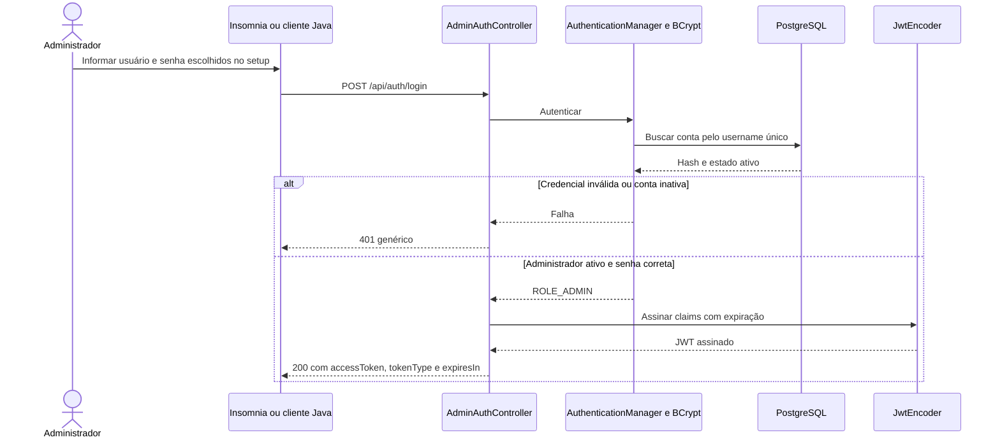
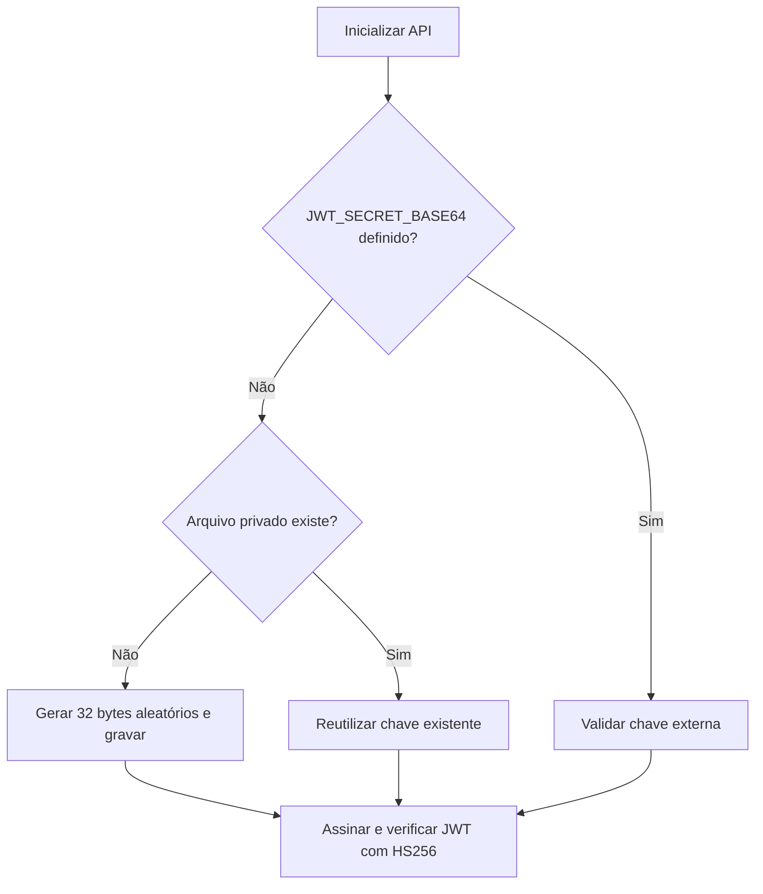
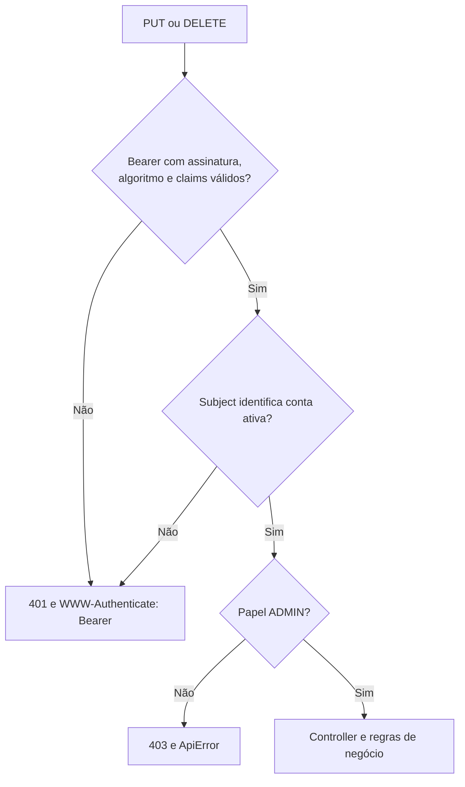

# 09 — Login administrativo, JWT e Bearer Token

[Roteiro](../README.md) · [Etapa anterior](08-spring-security.md) · [Contrato](00-modelo-dados.md)

## Missão

Continue o módulo 08 com a conta já cadastrada no PostgreSQL. Substitua Basic
por POST `/api/auth/login` e Bearer JWT. A versão final é
`09-jwt-bearer-token-impl`; a 07 preserva a API sem autenticação.

| Operação | Acesso |
| --- | --- |
| GET sugestões, detalhe, cursos e categorias | Público |
| POST sugestão, inclusive anônima | Público |
| POST auth/login | Emite token somente para administrador ativo cadastrado |
| PUT/DELETE sugestão | JWT válido, papel ADMIN e conta ainda ativa |

JWT é o formato da credencial assinada. Bearer é o esquema de apresentação no
header `Authorization: Bearer <accessToken>`. As claims não são criptografadas;
nenhuma senha ou hash deve ser incluído. Não há cadastro público, refresh token
ou revogação individual nesta etapa.



## 1. Chave automática e persistente

A aplicação cria uma chave aleatória de 32 bytes em `.local/jwt-signing.key` na
primeira inicialização e reutiliza esse arquivo nos próximos boots. Ele não contém
senha de administrador e fica fora do Git. Em sistemas POSIX, o arquivo nasce com
permissão 600; a pasta nova, 700. Um bloqueio de arquivo serializa inicializações
concorrentes. Uma chave existente inválida causa erro, sem sobrescrita silenciosa.

Se já usava JWT_SECRET_BASE64, essa configuração continua tendo prioridade. Para
implantação, configure JWT_KEY_FILE em armazenamento privado e persistente ou
forneça uma chave pelo gestor de segredos. Réplicas precisam compartilhar a mesma
chave; não use o arquivo local de um container descartável sem volume persistente.



Não é necessário executar os auxiliares de geração de hash/chave para iniciar.
A conta vem do banco; a chave é mantida separadamente no arquivo privado.

## 2. Arquivos alterados desde o checkpoint 08

Adicione Resource Server e aplique os arquivos completos abaixo. O decoder do
Spring Security valida o token; não crie um filtro JWT manual.

Claims: iss=`caixa-de-sugestoes`, aud inclui `caixa-de-sugestoes-api`, sub é o
username de uma conta existente e ativa, iat/exp são obrigatórios e roles contém
ADMIN nos tokens emitidos. A validade padrão é 900 segundos; JWT_TTL_SECONDS
aceita 60–3600. A emissão admite iat até 30 segundos no futuro; exp não tem
carência após expirar. A validação consulta a conta por seu índice único e rejeita
uma conta removida ou desativada, inclusive para token emitido anteriormente.

**Exclua os arquivos abaixo**, que pertenciam ao mecanismo Basic:

- `src/test/java/br/com/etecalbertoferes/CaixaDeSugestoes/BasicSecurityIntegrationTest.java`

Não mantenha seus testes de Basic habilitados como se ele continuasse autenticando.

### `build.gradle`

Crie o arquivo ou substitua seu conteúdo inteiro. Preserve os demais arquivos.

<!-- arquivo: build.gradle -->
```groovy
plugins {
    id 'java'
    id 'org.springframework.boot' version '4.1.1'
    id 'io.spring.dependency-management' version '1.1.7'
}
group = 'br.com.etecalbertoferes'
version = '0.0.1-SNAPSHOT'
java { toolchain { languageVersion = JavaLanguageVersion.of(17) } }
repositories { mavenCentral() }
dependencies {
    implementation 'org.springframework.boot:spring-boot-starter-webmvc'
    implementation 'org.springframework.boot:spring-boot-starter-security'
    implementation 'org.springframework.boot:spring-boot-starter-oauth2-resource-server'
    implementation 'org.springdoc:springdoc-openapi-starter-webmvc-ui:3.1.1'
    implementation 'org.springframework.boot:spring-boot-starter-validation'
    implementation 'org.springframework.boot:spring-boot-starter-data-jpa'
    implementation 'org.springframework.boot:spring-boot-starter-flyway'
    implementation 'org.flywaydb:flyway-database-postgresql'
    runtimeOnly 'org.postgresql:postgresql'
    testImplementation 'org.springframework.boot:spring-boot-starter-webmvc-test'
    testImplementation 'org.testcontainers:testcontainers-junit-jupiter'
    testImplementation 'org.testcontainers:testcontainers-postgresql'
    testImplementation 'org.springframework.security:spring-security-test'
    testRuntimeOnly 'org.junit.platform:junit-platform-launcher'
}
tasks.named('test') { useJUnitPlatform() }
```

### `src/main/java/br/com/etecalbertoferes/CaixaDeSugestoes/CaixaDeSugestoesApplication.java`

Crie o arquivo ou substitua seu conteúdo inteiro. Preserve os demais arquivos.

<!-- arquivo: src/main/java/br/com/etecalbertoferes/CaixaDeSugestoes/CaixaDeSugestoesApplication.java -->
```java
package br.com.etecalbertoferes.CaixaDeSugestoes;

import org.springframework.boot.SpringApplication;
import org.springframework.boot.autoconfigure.SpringBootApplication;

@SpringBootApplication
public class CaixaDeSugestoesApplication {
    public static void main(String[] args) {
        if (args.length == 1 && "--setup-admin".equals(args[0])) {
            br.com.etecalbertoferes.CaixaDeSugestoes.infrastructure.security.AdminSetupCommand.run();
            return;
        }
        if (args.length == 1 && "--generate-admin-password-hash".equals(args[0])) {
            br.com.etecalbertoferes.CaixaDeSugestoes.infrastructure.security.AdminPasswordHash.generate();
            return;
        }
        if (args.length == 1 && "--generate-jwt-secret".equals(args[0])) {
            byte[] key = new byte[32];
            new java.security.SecureRandom().nextBytes(key);
            System.out.println(java.util.Base64.getEncoder().encodeToString(key));
            return;
        }
        SpringApplication.run(CaixaDeSugestoesApplication.class, args);
    }
}
```

### `src/main/java/br/com/etecalbertoferes/CaixaDeSugestoes/application/AdminAuthenticationService.java`

Crie o arquivo ou substitua seu conteúdo inteiro. Preserve os demais arquivos.

<!-- arquivo: src/main/java/br/com/etecalbertoferes/CaixaDeSugestoes/application/AdminAuthenticationService.java -->
```java
package br.com.etecalbertoferes.CaixaDeSugestoes.application;

import java.time.Instant;
import java.util.List;
import java.util.UUID;
import org.springframework.beans.factory.annotation.Value;
import org.springframework.stereotype.Service;
import org.springframework.security.authentication.*;
import org.springframework.security.oauth2.jwt.*;
import org.springframework.security.oauth2.jose.jws.MacAlgorithm;

@Service
public class AdminAuthenticationService {
    public static final String ISSUER = "caixa-de-sugestoes";
    public static final String AUDIENCE = "caixa-de-sugestoes-api";
    private final AuthenticationManager authenticationManager;
    private final JwtEncoder encoder;
    private final long ttl;
    public AdminAuthenticationService(AuthenticationManager authenticationManager, JwtEncoder encoder,
            @Value("${app.jwt.ttl-seconds:900}") long ttl) {
        if (ttl < 60 || ttl > 3600) throw new IllegalArgumentException("JWT_TTL_SECONDS deve estar entre 60 e 3600");
        this.authenticationManager = authenticationManager; this.encoder = encoder; this.ttl = ttl;
    }
    public AccessToken login(String username, String password) {
        if (password.getBytes(java.nio.charset.StandardCharsets.UTF_8).length > 72)
            throw new BadCredentialsException("Credenciais inválidas");
        var authentication = authenticationManager.authenticate(UsernamePasswordAuthenticationToken.unauthenticated(username, password));
        if (authentication.getAuthorities().stream().noneMatch(a -> a.getAuthority().equals("ROLE_ADMIN")))
            throw new BadCredentialsException("Credenciais inválidas");
        Instant now = Instant.now();
        JwtClaimsSet claims = JwtClaimsSet.builder().issuer(ISSUER).audience(List.of(AUDIENCE))
            .subject(authentication.getName()).issuedAt(now).expiresAt(now.plusSeconds(ttl))
            .id(UUID.randomUUID().toString()).claim("roles", List.of("ADMIN")).build();
        String token = encoder.encode(JwtEncoderParameters.from(JwsHeader.with(MacAlgorithm.HS256).build(), claims)).getTokenValue();
        return new AccessToken(token, "Bearer", ttl);
    }
    public record AccessToken(String accessToken, String tokenType, long expiresIn) {}
}
```

### `src/main/java/br/com/etecalbertoferes/CaixaDeSugestoes/infrastructure/security/AdminPasswordHash.java`

Crie o arquivo ou substitua seu conteúdo inteiro. Preserve os demais arquivos.

<!-- arquivo: src/main/java/br/com/etecalbertoferes/CaixaDeSugestoes/infrastructure/security/AdminPasswordHash.java -->
```java
package br.com.etecalbertoferes.CaixaDeSugestoes.infrastructure.security;

import java.io.Console;
import java.nio.charset.StandardCharsets;
import java.util.Arrays;
import org.springframework.security.crypto.bcrypt.BCryptPasswordEncoder;

public final class AdminPasswordHash {
    private AdminPasswordHash() {
    }

    public static void generate() {
        Console console = System.console();
        if (console == null)
            throw new IllegalStateException(
                    "Execute em terminal interativo: java -jar ... --generate-admin-password-hash");
        char[] password = console.readPassword("Senha administrativa (mínimo 12 caracteres): ");
        if (password == null)
            throw new IllegalStateException("Leitura cancelada");
        try {
            String value = new String(password);
            if (password.length < 12 || value.getBytes(StandardCharsets.UTF_8).length > 72)
                throw new IllegalArgumentException("Use ao menos 12 caracteres e no máximo 72 bytes UTF-8");
            console.printf("%s%n", new BCryptPasswordEncoder(12).encode(value));
        } finally {
            Arrays.fill(password, '\0');
        }
    }
}
```

### `src/main/java/br/com/etecalbertoferes/CaixaDeSugestoes/infrastructure/security/JwtConfiguration.java`

Crie o arquivo ou substitua seu conteúdo inteiro. Preserve os demais arquivos.

<!-- arquivo: src/main/java/br/com/etecalbertoferes/CaixaDeSugestoes/infrastructure/security/JwtConfiguration.java -->
```java
package br.com.etecalbertoferes.CaixaDeSugestoes.infrastructure.security;

import java.time.Duration;
import java.time.Instant;
import java.util.Base64;
import java.util.List;
import javax.crypto.SecretKey;
import javax.crypto.spec.SecretKeySpec;
import org.springframework.context.annotation.*;
import org.springframework.core.env.Environment;
import java.nio.file.Path;
import br.com.etecalbertoferes.CaixaDeSugestoes.domain.AdminAccountRepository;
import org.springframework.security.oauth2.core.*;
import org.springframework.security.oauth2.jose.jws.MacAlgorithm;
import org.springframework.security.oauth2.jwt.*;
import br.com.etecalbertoferes.CaixaDeSugestoes.application.AdminAuthenticationService;

@Configuration
public class JwtConfiguration {
    @Bean
    SecretKey jwtSigningKey(Environment env) {
        byte[] decoded;
        try {
            String configured = env.getProperty("app.jwt.secret-base64", "");
            String secret = configured.isBlank()
                ? JwtKeyStore.loadOrCreate(Path.of(env.getProperty("app.jwt.key-file", ".local/jwt-signing.key")))
                : configured;
            decoded = Base64.getDecoder().decode(secret);
        } catch (IllegalArgumentException ex) {
            throw new IllegalStateException("Configure JWT_SECRET_BASE64 com uma chave Base64 válida");
        }
        if (decoded.length < 32)
            throw new IllegalStateException("JWT_SECRET_BASE64 deve representar pelo menos 32 bytes aleatórios");
        return new SecretKeySpec(decoded, "HmacSHA256");
    }

    @Bean
    JwtEncoder jwtEncoder(SecretKey key) {
        return NimbusJwtEncoder.withSecretKey(key).algorithm(MacAlgorithm.HS256).build();
    }

    @Bean
    JwtDecoder jwtDecoder(SecretKey key, AdminAccountRepository accounts) {
        NimbusJwtDecoder decoder = NimbusJwtDecoder.withSecretKey(key).macAlgorithm(MacAlgorithm.HS256).build();
        OAuth2TokenValidator<Jwt> requiredTimes = jwt -> {
            if (jwt.getExpiresAt() == null || jwt.getIssuedAt() == null
                    || jwt.getIssuedAt().isAfter(Instant.now().plusSeconds(30)))
                return OAuth2TokenValidatorResult
                        .failure(new OAuth2Error("invalid_token", "Claims temporais inválidas", null));
            return OAuth2TokenValidatorResult.success();
        };
        decoder.setJwtValidator(new DelegatingOAuth2TokenValidator<>(
                new JwtTimestampValidator(Duration.ZERO),
                new JwtIssuerValidator(AdminAuthenticationService.ISSUER),
                new JwtClaimValidator<List<String>>(JwtClaimNames.AUD,
                        aud -> aud != null && aud.contains(AdminAuthenticationService.AUDIENCE)),
                new JwtClaimValidator<String>(JwtClaimNames.SUB, subject -> subject != null &&
                    accounts.findByUsername(subject).filter(account -> account.active()).isPresent()),
                requiredTimes));
        return decoder;
    }
}
```

### `src/main/java/br/com/etecalbertoferes/CaixaDeSugestoes/infrastructure/security/JwtKeyStore.java`

Crie o arquivo ou substitua seu conteúdo inteiro. Preserve os demais arquivos.

<!-- arquivo: src/main/java/br/com/etecalbertoferes/CaixaDeSugestoes/infrastructure/security/JwtKeyStore.java -->
```java
package br.com.etecalbertoferes.CaixaDeSugestoes.infrastructure.security;

import java.io.IOException;
import java.nio.ByteBuffer;
import java.nio.channels.FileChannel;
import java.nio.charset.StandardCharsets;
import java.nio.file.*;
import java.nio.file.attribute.PosixFilePermissions;
import java.security.SecureRandom;
import java.util.Base64;
import java.util.Set;

public final class JwtKeyStore {
    private JwtKeyStore() {}
    public static synchronized String loadOrCreate(Path path) {
        try {
            Path absolute = path.toAbsolutePath();
            boolean posix = absolute.getFileSystem().supportedFileAttributeViews().contains("posix");
            if (posix) Files.createDirectories(absolute.getParent(), PosixFilePermissions.asFileAttribute(PosixFilePermissions.fromString("rwx------")));
            else Files.createDirectories(absolute.getParent());
            var options = Set.of(StandardOpenOption.CREATE, StandardOpenOption.READ, StandardOpenOption.WRITE);
            try (FileChannel channel = posix
                    ? FileChannel.open(absolute, options, PosixFilePermissions.asFileAttribute(PosixFilePermissions.fromString("rw-------")))
                    : FileChannel.open(absolute, options);
                 var lock = channel.lock()) {
                if (channel.size() == 0) {
                    byte[] bytes = new byte[32]; new SecureRandom().nextBytes(bytes);
                    byte[] text = Base64.getEncoder().encode(bytes);
                    ByteBuffer buffer = ByteBuffer.wrap(text);
                    while (buffer.hasRemaining()) channel.write(buffer);
                    channel.force(true);
                }
                if (channel.size() > 8192) throw new IllegalStateException("Arquivo de chave JWT inválido");
                channel.position(0);
                ByteBuffer buffer = ByteBuffer.allocate((int) channel.size());
                while (buffer.hasRemaining() && channel.read(buffer) != -1) { }
                return new String(buffer.array(), StandardCharsets.US_ASCII).strip();
            }
        } catch (IOException ex) {
            throw new IllegalStateException("Não foi possível ler ou gravar a chave JWT; configure JWT_KEY_FILE em uma pasta gravável", ex);
        }
    }
}
```

### `src/main/java/br/com/etecalbertoferes/CaixaDeSugestoes/infrastructure/security/SecurityConfiguration.java`

Crie o arquivo ou substitua seu conteúdo inteiro. Preserve os demais arquivos.

<!-- arquivo: src/main/java/br/com/etecalbertoferes/CaixaDeSugestoes/infrastructure/security/SecurityConfiguration.java -->
```java
package br.com.etecalbertoferes.CaixaDeSugestoes.infrastructure.security;

import jakarta.servlet.DispatcherType;
import org.springframework.context.annotation.*;
import org.springframework.http.HttpMethod;
import org.springframework.security.config.annotation.web.builders.HttpSecurity;
import org.springframework.security.config.http.SessionCreationPolicy;
import org.springframework.security.oauth2.server.resource.authentication.*;
import org.springframework.security.web.SecurityFilterChain;

@org.springframework.boot.autoconfigure.condition.ConditionalOnWebApplication
@Configuration
public class SecurityConfiguration {
    @Bean
    SecurityFilterChain apiSecurity(HttpSecurity http, SecurityErrorWriter errors) throws Exception {
        JwtGrantedAuthoritiesConverter authorities = new JwtGrantedAuthoritiesConverter();
        authorities.setAuthoritiesClaimName("roles");
        authorities.setAuthorityPrefix("ROLE_");
        JwtAuthenticationConverter converter = new JwtAuthenticationConverter();
        converter.setJwtGrantedAuthoritiesConverter(authorities);
        var unauthorized = (org.springframework.security.web.AuthenticationEntryPoint) (req, res, cause) -> {
            res.setHeader("WWW-Authenticate", "Bearer");
            errors.write(req, res, 401, "Autenticação necessária ou token inválido");
        };
        var forbidden = (org.springframework.security.web.access.AccessDeniedHandler) (req, res, cause) -> errors
                .write(req, res, 403, "Acesso negado");
        return http
                .csrf(csrf -> csrf.disable())
                .sessionManagement(session -> session.sessionCreationPolicy(SessionCreationPolicy.STATELESS))
                .requestCache(cache -> cache.disable())
                .authorizeHttpRequests(auth -> auth
                        .dispatcherTypeMatchers(DispatcherType.ERROR).permitAll()
                        .requestMatchers(HttpMethod.PUT, "/api/suggestions/*").hasRole("ADMIN")
                        .requestMatchers(HttpMethod.DELETE, "/api/suggestions/*").hasRole("ADMIN")
                        .anyRequest().permitAll())
                .oauth2ResourceServer(resource -> resource
                        .jwt(jwt -> jwt.jwtAuthenticationConverter(converter))
                        .authenticationEntryPoint(unauthorized).accessDeniedHandler(forbidden))
                .exceptionHandling(ex -> ex.authenticationEntryPoint(unauthorized).accessDeniedHandler(forbidden))
                .build();
    }
}
```

### `src/main/java/br/com/etecalbertoferes/CaixaDeSugestoes/infrastructure/security/SecurityErrorWriter.java`

Crie o arquivo ou substitua seu conteúdo inteiro. Preserve os demais arquivos.

<!-- arquivo: src/main/java/br/com/etecalbertoferes/CaixaDeSugestoes/infrastructure/security/SecurityErrorWriter.java -->
```java
package br.com.etecalbertoferes.CaixaDeSugestoes.infrastructure.security;

import java.io.IOException;
import java.time.Instant;
import java.util.Map;
import jakarta.servlet.http.*;
import org.springframework.http.MediaType;
import org.springframework.stereotype.Component;
import tools.jackson.databind.ObjectMapper;
import br.com.etecalbertoferes.CaixaDeSugestoes.interfaces.rest.ApiError;

@Component
public class SecurityErrorWriter {
    private final ObjectMapper mapper;

    public SecurityErrorWriter(ObjectMapper mapper) {
        this.mapper = mapper;
    }

    public void write(HttpServletRequest request, HttpServletResponse response, int status, String message)
            throws IOException {
        response.setStatus(status);
        response.setContentType(MediaType.APPLICATION_JSON_VALUE);
        response.setCharacterEncoding("UTF-8");
        mapper.writeValue(response.getOutputStream(),
                new ApiError(Instant.now(), status, message, request.getRequestURI(), Map.of()));
    }
}
```

### `src/main/java/br/com/etecalbertoferes/CaixaDeSugestoes/interfaces/rest/AdminAuthController.java`

Crie o arquivo ou substitua seu conteúdo inteiro. Preserve os demais arquivos.

<!-- arquivo: src/main/java/br/com/etecalbertoferes/CaixaDeSugestoes/interfaces/rest/AdminAuthController.java -->
```java
package br.com.etecalbertoferes.CaixaDeSugestoes.interfaces.rest;

import jakarta.validation.Valid;
import org.springframework.http.*;
import org.springframework.web.bind.annotation.*;
import io.swagger.v3.oas.annotations.*;
import io.swagger.v3.oas.annotations.tags.Tag;
import io.swagger.v3.oas.annotations.responses.ApiResponse;
import io.swagger.v3.oas.annotations.media.*;
import br.com.etecalbertoferes.CaixaDeSugestoes.application.AdminAuthenticationService;

@RestController
@RequestMapping("/api/auth")
@Tag(name = "Administração", description = "Login exclusivo do administrador; sem cadastro público")
public class AdminAuthController {
    private final AdminAuthenticationService service;

    public AdminAuthController(AdminAuthenticationService service) {
        this.service = service;
    }

    @PostMapping(value = "/login", consumes = MediaType.APPLICATION_JSON_VALUE)
    @Operation(summary = "Autenticar administrador e emitir JWT", description = "Envie username e password. accessToken deve ser apresentado como Authorization: Bearer <token>. Expiração em segundos; não há refresh nem revogação individual nesta etapa.")
    @ApiResponse(responseCode = "200", description = "Token emitido")
    @ApiResponse(responseCode = "400", description = "Corpo inválido", content = @Content(schema = @Schema(implementation = ApiError.class)))
    @ApiResponse(responseCode = "401", description = "Credenciais inválidas", content = @Content(schema = @Schema(implementation = ApiError.class)))
    public ResponseEntity<AdminAuthenticationService.AccessToken> login(@Valid @RequestBody AdminLoginRequest request) {
        return ResponseEntity.ok().cacheControl(CacheControl.noStore()).header(HttpHeaders.PRAGMA, "no-cache")
                .body(service.login(request.username(), request.password()));
    }
}
```

### `src/main/java/br/com/etecalbertoferes/CaixaDeSugestoes/interfaces/rest/AdminLoginRequest.java`

Crie o arquivo ou substitua seu conteúdo inteiro. Preserve os demais arquivos.

<!-- arquivo: src/main/java/br/com/etecalbertoferes/CaixaDeSugestoes/interfaces/rest/AdminLoginRequest.java -->
```java
package br.com.etecalbertoferes.CaixaDeSugestoes.interfaces.rest;

import jakarta.validation.constraints.*;
import io.swagger.v3.oas.annotations.media.Schema;
public record AdminLoginRequest(
    @NotBlank(message = "Usuário é obrigatório") @Size(max = 100, message = "Usuário deve ter no máximo 100 caracteres")
    @Schema(example = "administrador") String username,
    @NotBlank(message = "Senha é obrigatória") @Size(max = 72, message = "Senha deve ter no máximo 72 caracteres")
    @Schema(format = "password", accessMode = Schema.AccessMode.WRITE_ONLY) String password) {
    @Override public String toString() { return "AdminLoginRequest[credenciais protegidas]"; }
}
```

### `src/main/java/br/com/etecalbertoferes/CaixaDeSugestoes/interfaces/rest/ApiExceptionHandler.java`

Crie o arquivo ou substitua seu conteúdo inteiro. Preserve os demais arquivos.

<!-- arquivo: src/main/java/br/com/etecalbertoferes/CaixaDeSugestoes/interfaces/rest/ApiExceptionHandler.java -->
```java
package br.com.etecalbertoferes.CaixaDeSugestoes.interfaces.rest;

import java.time.Instant;
import java.util.LinkedHashMap;
import java.util.Map;
import jakarta.servlet.http.HttpServletRequest;
import org.slf4j.Logger;
import org.slf4j.LoggerFactory;
import org.springframework.http.*;
import org.springframework.web.ErrorResponse;
import org.springframework.web.bind.MethodArgumentNotValidException;
import org.springframework.web.bind.annotation.*;
import org.springframework.web.context.request.*;
import org.springframework.web.method.annotation.HandlerMethodValidationException;
import org.springframework.web.servlet.mvc.method.annotation.ResponseEntityExceptionHandler;
import br.com.etecalbertoferes.CaixaDeSugestoes.domain.ResourceNotFoundException;

@RestControllerAdvice
public class ApiExceptionHandler extends ResponseEntityExceptionHandler {
    private static final Logger log = LoggerFactory.getLogger(ApiExceptionHandler.class);

    @Override
    protected ResponseEntity<Object> handleMethodArgumentNotValid(MethodArgumentNotValidException ex,
            HttpHeaders headers, HttpStatusCode status, WebRequest request) {
        Map<String, String> fields = new LinkedHashMap<>();
        ex.getBindingResult().getFieldErrors().forEach(e -> fields.putIfAbsent(e.getField(), e.getDefaultMessage()));
        return respond(status, "Dados inválidos", fields, headers, request);
    }

    @Override
    protected ResponseEntity<Object> handleHandlerMethodValidationException(HandlerMethodValidationException ex,
            HttpHeaders headers, HttpStatusCode status, WebRequest request) {
        Map<String, String> fields = new LinkedHashMap<>();
        ex.getParameterValidationResults().forEach(result -> {
            String name = result.getMethodParameter().getParameterName();
            result.getResolvableErrors()
                    .forEach(error -> fields.putIfAbsent(name == null ? "id" : name, error.getDefaultMessage()));
        });
        return respond(status, "Dados inválidos", fields, headers, request);
    }

    @Override
    protected ResponseEntity<Object> handleExceptionInternal(Exception ex, Object body, HttpHeaders headers,
            HttpStatusCode status, WebRequest request) {
        String message = switch (status.value()) {
            case 400 -> "Requisição inválida";
            case 404 -> "Recurso não encontrado";
            case 405 -> "Método HTTP não permitido";
            case 406 -> "Formato de resposta não suportado";
            case 415 -> "Tipo de conteúdo não suportado";
            default -> status.is5xxServerError() ? "Erro interno do servidor" : "Requisição não permitida";
        };
        return respond(status, message, Map.of(), headers, request);
    }

    @ExceptionHandler(org.springframework.security.core.AuthenticationException.class)
    public ResponseEntity<Object> invalidCredentials(WebRequest request) {
        HttpHeaders headers = new HttpHeaders();
        headers.set(HttpHeaders.WWW_AUTHENTICATE, "Bearer");
        headers.setCacheControl("no-store");
        return respond(HttpStatus.UNAUTHORIZED, "Credenciais inválidas", Map.of(), headers, request);
    }

    @ExceptionHandler(ResourceNotFoundException.class)
    public ResponseEntity<Object> notFound(ResourceNotFoundException ex, WebRequest request) {
        return respond(HttpStatus.NOT_FOUND, ex.getMessage(), Map.of(), new HttpHeaders(), request);
    }

    @ExceptionHandler(Exception.class)
    public ResponseEntity<Object> unexpected(Exception ex, WebRequest request) {
        if (ex instanceof ErrorResponse error) {
            return respond(error.getStatusCode(), "Requisição inválida", Map.of(), error.getHeaders(), request);
        }
        log.error("Falha inesperada ao processar requisição", ex);
        return respond(HttpStatus.INTERNAL_SERVER_ERROR, "Erro interno do servidor", Map.of(), new HttpHeaders(),
                request);
    }

    private ResponseEntity<Object> respond(HttpStatusCode status, String message, Map<String, String> fields,
            HttpHeaders headers, WebRequest request) {
        HttpServletRequest servlet = ((ServletWebRequest) request).getRequest();
        return new ResponseEntity<>(
                new ApiError(Instant.now(), status.value(), message, servlet.getRequestURI(), fields), headers, status);
    }
}
```

### `src/main/java/br/com/etecalbertoferes/CaixaDeSugestoes/interfaces/rest/CatalogController.java`

Crie o arquivo ou substitua seu conteúdo inteiro. Preserve os demais arquivos.

<!-- arquivo: src/main/java/br/com/etecalbertoferes/CaixaDeSugestoes/interfaces/rest/CatalogController.java -->
```java
package br.com.etecalbertoferes.CaixaDeSugestoes.interfaces.rest;

import io.swagger.v3.oas.annotations.Operation;
import io.swagger.v3.oas.annotations.tags.Tag;
import java.util.List;
import org.springframework.web.bind.annotation.*;
import br.com.etecalbertoferes.CaixaDeSugestoes.application.CatalogService;
import br.com.etecalbertoferes.CaixaDeSugestoes.domain.*;

@Tag(name = "Catálogos", description = "Cursos e categorias didáticos, ordenados por nome; somente consulta")
@RestController
@RequestMapping("/api")
public class CatalogController {
    private final CatalogService service;

    public CatalogController(CatalogService service) {
        this.service = service;
    }

    @Operation(summary = "Listar cursos", description = "Array de id/name ordenado por name crescente")
    @GetMapping("/courses")
    public List<Course> courses() {
        return service.courses();
    }

    @Operation(summary = "Listar categorias", description = "Array de id/name ordenado por name crescente")
    @GetMapping("/categories")
    public List<Category> categories() {
        return service.categories();
    }
}
```

### `src/main/java/br/com/etecalbertoferes/CaixaDeSugestoes/interfaces/rest/OpenApiConfiguration.java`

Crie o arquivo ou substitua seu conteúdo inteiro. Preserve os demais arquivos.

<!-- arquivo: src/main/java/br/com/etecalbertoferes/CaixaDeSugestoes/interfaces/rest/OpenApiConfiguration.java -->
```java
package br.com.etecalbertoferes.CaixaDeSugestoes.interfaces.rest;

import io.swagger.v3.oas.models.OpenAPI;
import io.swagger.v3.oas.models.info.Info;
import org.springframework.context.annotation.*;

@Configuration
public class OpenApiConfiguration {
    @Bean
    OpenAPI api() {
        return new OpenAPI().components(new io.swagger.v3.oas.models.Components().addSecuritySchemes("bearerAuth",
                new io.swagger.v3.oas.models.security.SecurityScheme()
                        .type(io.swagger.v3.oas.models.security.SecurityScheme.Type.HTTP).scheme(
                                "bearer")
                        .bearerFormat("JWT")))
                .info(new Info().title("Caixa de Sugestões — Etec Prefeito Alberto Feres")
                        .version("2.0.0").description(
                                "API de sugestões para consumo pelo projeto web com Thymeleaf. Catálogos didáticos somente para consulta. Datas em UTC."));
    }
}
```

### `src/main/java/br/com/etecalbertoferes/CaixaDeSugestoes/interfaces/rest/SuggestionController.java`

Crie o arquivo ou substitua seu conteúdo inteiro. Preserve os demais arquivos.

<!-- arquivo: src/main/java/br/com/etecalbertoferes/CaixaDeSugestoes/interfaces/rest/SuggestionController.java -->
```java
package br.com.etecalbertoferes.CaixaDeSugestoes.interfaces.rest;

import io.swagger.v3.oas.annotations.Operation;
import io.swagger.v3.oas.annotations.Parameter;
import io.swagger.v3.oas.annotations.tags.Tag;
import io.swagger.v3.oas.annotations.responses.*;
import io.swagger.v3.oas.annotations.media.*;
import java.net.URI;
import jakarta.validation.Valid;
import jakarta.validation.constraints.Positive;
import java.util.List;
import org.springframework.http.ResponseEntity;
import org.springframework.web.bind.annotation.*;
import br.com.etecalbertoferes.CaixaDeSugestoes.application.SuggestionService;

@Tag(name = "Sugestões", description = "Cadastro, consulta, substituição e exclusão de sugestões")
@RestController
@RequestMapping("/api/suggestions")
@ApiResponses({
        @ApiResponse(responseCode = "400", description = "Dados, ID ou filtro inválido", content = @Content(schema = @Schema(implementation = ApiError.class))),
        @ApiResponse(responseCode = "404", description = "Sugestão, curso ou categoria não encontrado", content = @Content(schema = @Schema(implementation = ApiError.class))),
        @ApiResponse(responseCode = "500", description = "Erro interno", content = @Content(schema = @Schema(implementation = ApiError.class)))
})
public class SuggestionController {
    private final SuggestionService service;

    public SuggestionController(SuggestionService service) {
        this.service = service;
    }

    @Operation(summary = "Listar sugestões", description = "Array sem paginação. Filtros combinados por AND; q busca título OU conteúdo sem distinguir maiúsculas. Espaços externos são removidos; vazio é ignorado. %, _ e ! são literais. Ordem: createdAt e id decrescentes. IDs positivos inexistentes retornam [].")
    @ApiResponse(responseCode = "200", description = "Lista de sugestões, inclusive vazia")
    @GetMapping
    public List<SuggestionResponse> list(
            @Parameter(description = "ID positivo do curso") @RequestParam(required = false) @Positive(message = "ID deve ser positivo") Long courseId,
            @Parameter(description = "ID positivo da categoria") @RequestParam(required = false) @Positive(message = "ID deve ser positivo") Long categoryId,
            @Parameter(description = "Trecho literal do título ou conteúdo") @RequestParam(required = false) String q) {
        return service.list(courseId, categoryId, q).stream().map(SuggestionResponse::from).toList();
    }

    @Operation(summary = "Consultar sugestão por ID")
    @ApiResponse(responseCode = "200", description = "Sugestão encontrada")
    @GetMapping("/{id}")
    public SuggestionResponse get(@PathVariable @Positive(message = "ID deve ser positivo") Long id) {
        return SuggestionResponse.from(service.get(id));
    }

    @Operation(summary = "Criar sugestão", description = "O servidor gera id e createdAt. Autor ausente, nulo ou em branco é armazenado como null e devolvido como Anônimo. Consulte os IDs dos catálogos antes de enviar.")
    @ApiResponse(responseCode = "201", description = "Sugestão criada; Location contém /api/suggestions/{id}", content = @Content(schema = @Schema(implementation = SuggestionResponse.class)), headers = @io.swagger.v3.oas.annotations.headers.Header(name = "Location", schema = @Schema(type = "string")))
    @PostMapping
    public ResponseEntity<SuggestionResponse> create(@Valid @RequestBody SuggestionRequest request) {
        SuggestionResponse response = SuggestionResponse.from(service.create(request.command()));
        return ResponseEntity.created(URI.create("/api/suggestions/" + response.id())).body(response);
    }

    @Operation(summary = "Substituir campos editáveis", description = "Preserva id e createdAt. Omitir author remove o nome anterior. Curso e categoria são obrigatórios. Falhas não alteram o registro.")
    @ApiResponse(responseCode = "200", description = "Sugestão atualizada")
    @io.swagger.v3.oas.annotations.security.SecurityRequirement(name = "bearerAuth")
    @ApiResponse(responseCode = "401", description = "Autenticação necessária", content = @Content(schema = @Schema(implementation = ApiError.class)))
    @ApiResponse(responseCode = "403", description = "Acesso negado", content = @Content(schema = @Schema(implementation = ApiError.class)))
    @PutMapping("/{id}")
    public SuggestionResponse update(@PathVariable @Positive(message = "ID deve ser positivo") Long id,
            @Valid @RequestBody SuggestionRequest request) {
        return SuggestionResponse.from(service.update(id, request.command()));
    }

    @Operation(summary = "Excluir sugestão", description = "Exclusão física, preservando curso e categoria. Repetir a exclusão retorna 404.")
    @ApiResponse(responseCode = "204", description = "Excluída, sem corpo", content = @Content)
    @io.swagger.v3.oas.annotations.security.SecurityRequirement(name = "bearerAuth")
    @ApiResponse(responseCode = "401", description = "Autenticação necessária", content = @Content(schema = @Schema(implementation = ApiError.class)))
    @ApiResponse(responseCode = "403", description = "Acesso negado", content = @Content(schema = @Schema(implementation = ApiError.class)))
    @DeleteMapping("/{id}")
    public ResponseEntity<Void> delete(@PathVariable @Positive(message = "ID deve ser positivo") Long id) {
        service.delete(id);
        return ResponseEntity.noContent().build();
    }
}
```

### `src/main/java/br/com/etecalbertoferes/CaixaDeSugestoes/interfaces/rest/SuggestionRequest.java`

Crie o arquivo ou substitua seu conteúdo inteiro. Preserve os demais arquivos.

<!-- arquivo: src/main/java/br/com/etecalbertoferes/CaixaDeSugestoes/interfaces/rest/SuggestionRequest.java -->
```java
package br.com.etecalbertoferes.CaixaDeSugestoes.interfaces.rest;

import jakarta.validation.constraints.*;
import io.swagger.v3.oas.annotations.media.Schema;
import br.com.etecalbertoferes.CaixaDeSugestoes.application.SuggestionCommand;

public record SuggestionRequest(
        @NotBlank(message = "Título é obrigatório") @Schema(description = "Título obrigatório; texto preservado", example = "Mais tomadas na biblioteca") String title,
        @NotBlank(message = "Conteúdo é obrigatório") @Schema(description = "Conteúdo obrigatório; texto preservado", example = "Instalar tomadas nas mesas de estudo.") String content,
        @Schema(description = "Nome opcional; espaços externos removidos. Ausente, nulo ou em branco torna a sugestão anônima", example = "Pessoa Exemplo") String author,
        @NotNull(message = "Curso é obrigatório") @Positive(message = "Curso deve ser positivo") @Schema(description = "ID de curso existente", example = "1") Long courseId,
        @NotNull(message = "Categoria é obrigatória") @Positive(message = "Categoria deve ser positiva") @Schema(description = "ID de categoria existente", example = "1") Long categoryId) {
    public SuggestionCommand command() {
        return new SuggestionCommand(title, content, author, courseId, categoryId);
    }
}
```

### `src/main/resources/application.yaml`

Crie o arquivo ou substitua seu conteúdo inteiro. Preserve os demais arquivos.

<!-- arquivo: src/main/resources/application.yaml -->
```yaml
server:
  port: ${SERVER_PORT:8000}
spring:
  application:
    name: CaixaDeSugestoes
  datasource:
    url: ${DB_URL:jdbc:postgresql://localhost:5432/suggestions}
    username: ${DB_USERNAME:suggestions}
    password: ${DB_PASSWORD:suggestions}
  jpa:
    open-in-view: false
    hibernate:
      ddl-auto: validate
    properties:
      hibernate:
        jdbc:
          time_zone: UTC
  flyway:
    enabled: true
springdoc:
  swagger-ui:
    path: /swagger-ui.html
  api-docs:
    path: /v3/api-docs
app:
  jwt:
    secret-base64: ${JWT_SECRET_BASE64:}
    key-file: ${JWT_KEY_FILE:.local/jwt-signing.key}
    ttl-seconds: ${JWT_TTL_SECONDS:900}
```

### `src/test/java/br/com/etecalbertoferes/CaixaDeSugestoes/ApiIntegrationTest.java`

Crie o arquivo ou substitua seu conteúdo inteiro. Preserve os demais arquivos.

<!-- arquivo: src/test/java/br/com/etecalbertoferes/CaixaDeSugestoes/ApiIntegrationTest.java -->
```java
package br.com.etecalbertoferes.CaixaDeSugestoes;

import java.time.Instant;
import br.com.etecalbertoferes.CaixaDeSugestoes.application.*;
import br.com.etecalbertoferes.CaixaDeSugestoes.domain.*;
import org.junit.jupiter.api.Test;
import org.springframework.beans.factory.annotation.Autowired;
import org.springframework.boot.webmvc.test.autoconfigure.AutoConfigureMockMvc;
import org.springframework.http.MediaType;
import org.springframework.test.web.servlet.MockMvc;
import org.springframework.transaction.annotation.Transactional;
import static org.assertj.core.api.Assertions.*;
import static org.springframework.security.test.web.servlet.request.SecurityMockMvcRequestPostProcessors.user;
import static org.springframework.test.web.servlet.request.MockMvcRequestBuilders.*;
import static org.springframework.test.web.servlet.result.MockMvcResultMatchers.*;

@AutoConfigureMockMvc
@Transactional
class ApiIntegrationTest extends ContextTest {
    @Autowired MockMvc mvc;
    @Autowired jakarta.persistence.EntityManager em;
    @Autowired SuggestionService service;
    @Autowired SuggestionRepository repository;
    @Autowired CatalogService catalogs;
    Long course() { return catalogs.courses().get(0).id(); }
    Long category() { return catalogs.categories().get(0).id(); }
    Suggestion create(String title, String content, String author, Long courseId, Long categoryId) {
        return service.create(new SuggestionCommand(title, content, author, courseId, categoryId));
    }
    @Test void catalogAndHttpLifecycle() throws Exception {
        mvc.perform(get("/api/courses")).andExpect(status().isOk()).andExpect(jsonPath("$.length()").value(4));
        mvc.perform(get("/api/categories")).andExpect(status().isOk()).andExpect(jsonPath("$.length()").value(3));
        String body = "{\"title\":\"Tomadas\",\"content\":\"Biblioteca\",\"author\":\"  Pessoa  \",\"courseId\":"+course()+",\"categoryId\":"+category()+"}";
        String location = mvc.perform(post("/api/suggestions").contentType(MediaType.APPLICATION_JSON).content(body))
            .andExpect(status().isCreated()).andExpect(jsonPath("$.author").value("Pessoa"))
            .andReturn().getResponse().getHeader("Location");
        Long id = Long.valueOf(location.substring(location.lastIndexOf('/')+1));
        Instant time = service.get(id).createdAt();
        mvc.perform(get(location)).andExpect(status().isOk()).andExpect(jsonPath("$.title").value("Tomadas"));
        mvc.perform(put(location).with(user("test-admin").roles("ADMIN")).contentType(MediaType.APPLICATION_JSON).content(body.replace("  Pessoa  ", "  ")))
            .andExpect(status().isOk()).andExpect(jsonPath("$.author").value("Anônimo"));
        assertThat(service.get(id).createdAt()).isEqualTo(time);
        em.flush();
        assertThat(jdbc.queryForObject("select author from suggestions where id=?", String.class, id)).isNull();
        mvc.perform(delete(location).with(user("test-admin").roles("ADMIN"))).andExpect(status().isNoContent()).andExpect(content().string(""));
        mvc.perform(get(location)).andExpect(status().isNotFound());
        mvc.perform(delete(location).with(user("test-admin").roles("ADMIN"))).andExpect(status().isNotFound());
        mvc.perform(put(location).with(user("test-admin").roles("ADMIN")).contentType(MediaType.APPLICATION_JSON).content(body)).andExpect(status().isNotFound());
        assertThat(catalogs.courses()).hasSize(4);
        assertThat(catalogs.categories()).hasSize(3);
    }
    @Test void filtersLiteralCharactersAndOrdering() {
        Long c1 = course(), c2 = catalogs.courses().get(1).id();
        Long t1 = category(), t2 = catalogs.categories().get(1).id();
        Suggestion a = create("Tomadas 100%_!", "biblioteca", null, c1, t1);
        Suggestion b = create("outro", "TOMADAS 100xyz", "", c2, t1);
        Suggestion c = create("Tomadas", "terceiro", "Pessoa", c1, t2);
        assertThat(service.list(null,null,"tomadas")).extracting(Suggestion::id).containsExactly(c.id(), b.id(), a.id());
        assertThat(service.list(c1,null,null)).extracting(Suggestion::id).containsExactly(c.id(), a.id());
        assertThat(service.list(null,t1,null)).extracting(Suggestion::id).containsExactly(b.id(), a.id());
        assertThat(service.list(c1,t1," TOMADAS ")).extracting(Suggestion::id).containsExactly(a.id());
        for (String literal : new String[]{"%", "_", "!", "100%_!"})
            assertThat(service.list(null,null,literal)).extracting(Suggestion::id).containsExactly(a.id());
        assertThat(service.list(999999L,null,null)).isEmpty();
        assertThat(service.list(null,999999L,null)).isEmpty();
        assertThat(service.list(null,null,"inexistente")).isEmpty();
        assertThat(service.list(null,null,"  ")).hasSize(3);
        Instant same = Instant.parse("2026-01-01T00:00:00Z");
        jdbc.update("update suggestions set created_at=?", java.sql.Timestamp.from(same));
        assertThat(service.list(null,null,null)).extracting(Suggestion::id).containsExactly(c.id(), b.id(), a.id());
    }
    @Test void rejectedUpdatesPreserveStoredDataAndTextHasNo255Limit() throws Exception {
        Suggestion item = create("x".repeat(500), "y".repeat(1000), null, course(), category());
        String invalid = "{\"title\":\"change\",\"content\":\"change\",\"courseId\":"+course()+",\"categoryId\":999999}";
        mvc.perform(put("/api/suggestions/"+item.id()).with(user("test-admin").roles("ADMIN")).contentType(MediaType.APPLICATION_JSON).content(invalid)).andExpect(status().isNotFound());
        assertThat(service.get(item.id()).title()).hasSize(500);
        assertThat(service.get(item.id()).content()).hasSize(1000);
        mvc.perform(post("/api/suggestions").contentType(MediaType.APPLICATION_JSON).content(invalid)).andExpect(status().isNotFound());
        assertThat(service.list(null,null,null)).hasSize(1);
    }
    @Test void openApiDocumentsAllOperations() throws Exception {
        mvc.perform(get("/v3/api-docs")).andExpect(status().isOk())
            .andExpect(jsonPath("$.paths['/api/suggestions'].get").exists())
            .andExpect(jsonPath("$.paths['/api/suggestions'].post.responses['201']").exists())
            .andExpect(jsonPath("$.paths['/api/suggestions/{id}'].get").exists())
            .andExpect(jsonPath("$.paths['/api/suggestions/{id}'].put").exists())
            .andExpect(jsonPath("$.paths['/api/suggestions/{id}'].delete.responses['204']").exists())
            .andExpect(jsonPath("$.paths['/api/courses'].get").exists())
            .andExpect(jsonPath("$.paths['/api/categories'].get").exists());
        mvc.perform(get("/swagger-ui.html")).andExpect(status().is3xxRedirection());
    }
}
```

### `src/test/java/br/com/etecalbertoferes/CaixaDeSugestoes/JwtSecurityIntegrationTest.java`

Crie o arquivo ou substitua seu conteúdo inteiro. Preserve os demais arquivos.

<!-- arquivo: src/test/java/br/com/etecalbertoferes/CaixaDeSugestoes/JwtSecurityIntegrationTest.java -->
```java
package br.com.etecalbertoferes.CaixaDeSugestoes;

import java.time.Instant;
import java.util.List;
import org.junit.jupiter.api.Test;
import org.springframework.beans.factory.annotation.Autowired;
import org.springframework.boot.webmvc.test.autoconfigure.AutoConfigureMockMvc;
import org.springframework.http.MediaType;
import org.springframework.security.oauth2.jwt.*;
import org.springframework.security.oauth2.jose.jws.MacAlgorithm;
import org.springframework.test.web.servlet.MockMvc;
import tools.jackson.databind.ObjectMapper;
import static org.assertj.core.api.Assertions.*;
import static org.springframework.security.test.web.servlet.request.SecurityMockMvcRequestPostProcessors.httpBasic;
import static org.springframework.test.web.servlet.request.MockMvcRequestBuilders.*;
import static org.springframework.test.web.servlet.result.MockMvcResultMatchers.*;
import br.com.etecalbertoferes.CaixaDeSugestoes.application.*;

@AutoConfigureMockMvc
class JwtSecurityIntegrationTest extends ContextTest {
    @Autowired MockMvc mvc;
    @Autowired ObjectMapper mapper;
    @Autowired JwtEncoder encoder;
    @Autowired JwtDecoder decoder;
    @Autowired CatalogService catalogs;
    @Autowired SuggestionService suggestions;
    String login(String username, String password) throws Exception {
        return mvc.perform(post("/api/auth/login").contentType(MediaType.APPLICATION_JSON)
            .content(mapper.writeValueAsString(java.util.Map.of("username", username, "password", password))))
            .andReturn().getResponse().getContentAsString();
    }
    String token() throws Exception { return mapper.readTree(login("test-admin", ADMIN_PASSWORD)).get("accessToken").asText(); }
    String signed(String issuer, String audience, String subject, Instant expiry, List<String> roles) {
        var claims = JwtClaimsSet.builder().issuer(issuer).audience(List.of(audience)).subject(subject)
            .issuedAt(Instant.now().minusSeconds(120)).claim("roles", roles);
        if (expiry != null) claims.expiresAt(expiry);
        return encoder.encode(JwtEncoderParameters.from(JwsHeader.with(MacAlgorithm.HS256).build(), claims.build())).getTokenValue();
    }
    @Test void loginIssuesAdminTokenAndDoesNotCreateSession() throws Exception {
        var result = mvc.perform(post("/api/auth/login").contentType(MediaType.APPLICATION_JSON)
            .content(mapper.writeValueAsString(java.util.Map.of("username", "test-admin", "password", ADMIN_PASSWORD))))
            .andExpect(status().isOk()).andExpect(header().string("Cache-Control", "no-store"))
            .andExpect(header().doesNotExist("Set-Cookie")).andExpect(jsonPath("$.tokenType").value("Bearer"))
            .andExpect(jsonPath("$.expiresIn").value(900)).andReturn();
        String value = mapper.readTree(result.getResponse().getContentAsString()).get("accessToken").asText();
        Jwt jwt = decoder.decode(value);
        assertThat(jwt.getSubject()).isEqualTo("test-admin");
        assertThat(jwt.getClaimAsStringList("roles")).containsExactly("ADMIN");
        assertThat(jwt.getAudience()).containsExactly(AdminAuthenticationService.AUDIENCE);
        assertThat(jwt.getClaims()).doesNotContainKeys("password", "passwordHash");
        assertThat(result.getRequest().getSession(false)).isNull();
    }
    @Test void wrongCredentialsAndUnknownAdminHaveSameFailure() throws Exception {
        for (String username : List.of("test-admin", "unknown")) {
            mvc.perform(post("/api/auth/login").contentType(MediaType.APPLICATION_JSON)
                .content(mapper.writeValueAsString(java.util.Map.of("username", username, "password", "wrong"))))
                .andExpect(status().isUnauthorized()).andExpect(jsonPath("$.message").value("Credenciais inválidas"))
                .andExpect(jsonPath("$.status").value(401)).andExpect(header().string("WWW-Authenticate", "Bearer"));
        }
    }
    @Test void invalidLoginBodyAndUtf8PasswordAreHandled() throws Exception {
        for (String body : List.of("{}", "null", "{", "{\"username\":\" \",\"password\":\"\"}"))
            mvc.perform(post("/api/auth/login").contentType(MediaType.APPLICATION_JSON).content(body))
                .andExpect(status().isBadRequest());
        mvc.perform(post("/api/auth/login").contentType(MediaType.APPLICATION_JSON)
            .content(mapper.writeValueAsString(java.util.Map.of("username", "test-admin", "password", "ç".repeat(50)))))
            .andExpect(status().isUnauthorized());
        mvc.perform(post("/api/auth/register").contentType(MediaType.APPLICATION_JSON).content("{}"))
            .andExpect(status().isNotFound());
    }
    @Test void publicReadAndAnonymousCreateNeedNoToken() throws Exception {
        for (String path : List.of("/api/suggestions", "/api/courses", "/api/categories", "/v3/api-docs"))
            mvc.perform(get(path)).andExpect(status().isOk());
        Long course = catalogs.courses().get(0).id(), category = catalogs.categories().get(0).id();
        var result = mvc.perform(post("/api/suggestions").contentType(MediaType.APPLICATION_JSON)
            .content(mapper.writeValueAsString(java.util.Map.of("title", "Público", "content", "Sem login", "courseId", course, "categoryId", category))))
            .andExpect(status().isCreated()).andExpect(jsonPath("$.author").value("Anônimo")).andReturn();
        Long id = mapper.readTree(result.getResponse().getContentAsString()).get("id").asLong();
        suggestions.delete(id);
    }
    @Test void missingMalformedAndBasicCredentialsCannotMutate() throws Exception {
        mvc.perform(delete("/api/suggestions/999999")).andExpect(status().isUnauthorized())
            .andExpect(header().string("WWW-Authenticate", "Bearer")).andExpect(jsonPath("$.fieldErrors").isEmpty());
        mvc.perform(put("/api/suggestions/999999")).andExpect(status().isUnauthorized());
        mvc.perform(delete("/api/suggestions/999999").header("Authorization", "Bearer invalid"))
            .andExpect(status().isUnauthorized());
        mvc.perform(delete("/api/suggestions/999999").with(httpBasic("test-admin", ADMIN_PASSWORD)))
            .andExpect(status().isUnauthorized());
    }
    @Test void genuineAdminJwtCanMutateAndNoSessionCarriesAuthentication() throws Exception {
        String jwt = token();
        Long course = catalogs.courses().get(0).id(), category = catalogs.categories().get(0).id();
        var item = suggestions.create(new SuggestionCommand("Original", "Conteúdo", null, course, category));
        String body = mapper.writeValueAsString(java.util.Map.of("title", "Alterado", "content", "Atualizado", "courseId", course, "categoryId", category));
        mvc.perform(put("/api/suggestions/"+item.id()).header("Authorization", "Bearer "+jwt)
            .contentType(MediaType.APPLICATION_JSON).content(body)).andExpect(status().isOk())
            .andExpect(jsonPath("$.title").value("Alterado"));
        mvc.perform(delete("/api/suggestions/"+item.id())).andExpect(status().isUnauthorized());
        assertThat(suggestions.get(item.id()).title()).isEqualTo("Alterado");
        mvc.perform(delete("/api/suggestions/"+item.id()).header("Authorization", "Bearer "+jwt))
            .andExpect(status().isNoContent());
        mvc.perform(get("/api/suggestions/"+item.id())).andExpect(status().isNotFound());
    }
    @Test void expiredTamperedWrongIssuerAudienceSubjectAndMissingExpiryAreRejected() throws Exception {
        String valid = token();
        int dot = valid.lastIndexOf('.')+1;
        String tampered = valid.substring(0,dot)+(valid.charAt(dot)=='A'?'B':'A')+valid.substring(dot+1);
        String issuer=AdminAuthenticationService.ISSUER, aud=AdminAuthenticationService.AUDIENCE;
        for (String invalid : List.of(tampered,
            signed(issuer,aud,"test-admin",Instant.now().minusSeconds(1),List.of("ADMIN")),
            signed("wrong",aud,"test-admin",Instant.now().plusSeconds(60),List.of("ADMIN")),
            signed(issuer,"wrong","test-admin",Instant.now().plusSeconds(60),List.of("ADMIN")),
            signed(issuer,aud,"someone-else",Instant.now().plusSeconds(60),List.of("ADMIN")),
            signed(issuer,aud,"test-admin",null,List.of("ADMIN")))) {
            mvc.perform(delete("/api/suggestions/999999").header("Authorization", "Bearer "+invalid))
                .andExpect(status().isUnauthorized()).andExpect(jsonPath("$.status").value(401));
        }
    }
    @Test void signedTokenWithoutAdminRoleIsForbidden() throws Exception {
        String jwt = signed(AdminAuthenticationService.ISSUER,AdminAuthenticationService.AUDIENCE,"test-admin",Instant.now().plusSeconds(60),List.of("READER"));
        mvc.perform(delete("/api/suggestions/999999").header("Authorization", "Bearer "+jwt))
            .andExpect(status().isForbidden()).andExpect(jsonPath("$.status").value(403));
    }
    @Test void disablingAdminRejectsBothLoginAndPreviouslyIssuedJwt() throws Exception {
        String jwt = token();
        jdbc.update("update administrators set active=false where username=?", "test-admin");
        try {
            mvc.perform(post("/api/auth/login").contentType(MediaType.APPLICATION_JSON)
                .content(mapper.writeValueAsString(java.util.Map.of("username", "test-admin", "password", ADMIN_PASSWORD))))
                .andExpect(status().isUnauthorized()).andExpect(jsonPath("$.message").value("Credenciais inválidas"));
            mvc.perform(delete("/api/suggestions/999999").header("Authorization", "Bearer " + jwt))
                .andExpect(status().isUnauthorized());
        } finally { jdbc.update("update administrators set active=true where username=?", "test-admin"); }
    }
    @Test void swaggerMarksOnlyMutationsWithBearerSecurity() throws Exception {
        mvc.perform(get("/v3/api-docs")).andExpect(status().isOk())
            .andExpect(jsonPath("$.components.securitySchemes.bearerAuth.scheme").value("bearer"))
            .andExpect(jsonPath("$.paths['/api/auth/login'].post.security").doesNotExist())
            .andExpect(jsonPath("$.paths['/api/suggestions'].post.security").doesNotExist())
            .andExpect(jsonPath("$.paths['/api/suggestions/{id}'].put.security[0].bearerAuth").isArray())
            .andExpect(jsonPath("$.paths['/api/suggestions/{id}'].delete.security[0].bearerAuth").isArray());
    }
}
```

### `src/test/java/br/com/etecalbertoferes/CaixaDeSugestoes/infrastructure/security/SecurityConfigurationTest.java`

Crie o arquivo ou substitua seu conteúdo inteiro. Preserve os demais arquivos.

<!-- arquivo: src/test/java/br/com/etecalbertoferes/CaixaDeSugestoes/infrastructure/security/SecurityConfigurationTest.java -->
```java
package br.com.etecalbertoferes.CaixaDeSugestoes.infrastructure.security;

import java.nio.file.*;
import java.util.Base64;
import org.junit.jupiter.api.Test;
import org.junit.jupiter.api.io.TempDir;
import org.springframework.mock.env.MockEnvironment;
import org.springframework.security.core.userdetails.UsernameNotFoundException;
import br.com.etecalbertoferes.CaixaDeSugestoes.domain.*;
import static org.assertj.core.api.Assertions.*;
import static org.mockito.Mockito.*;

class SecurityConfigurationTest {
    @TempDir Path temp;
    @Test void missingSecretCreatesAndReusesPrivateKeyFile() throws Exception {
        Path file = temp.resolve("private/jwt.key");
        var env = new MockEnvironment().withProperty("app.jwt.key-file", file.toString());
        var config = new JwtConfiguration();
        byte[] first = config.jwtSigningKey(env).getEncoded();
        assertThat(first).hasSize(32);
        assertThat(config.jwtSigningKey(env).getEncoded()).isEqualTo(first);
        assertThat(Base64.getDecoder().decode(Files.readString(file))).isEqualTo(first);
        if (file.getFileSystem().supportedFileAttributeViews().contains("posix"))
            assertThat(Files.getPosixFilePermissions(file)).isEqualTo(java.nio.file.attribute.PosixFilePermissions.fromString("rw-------"));
    }
    @Test void invalidOrWeakExplicitKeysFailClosed() {
        var config = new JwtConfiguration();
        for (String secret : new String[]{"not base64!", "c2hvcnQ="})
            assertThatThrownBy(() -> config.jwtSigningKey(new MockEnvironment().withProperty("app.jwt.secret-base64", secret)))
                .isInstanceOf(IllegalStateException.class);
    }
    @Test void invalidExistingKeyIsNotOverwritten() throws Exception {
        Path file = temp.resolve("jwt.key"); Files.writeString(file, "broken key");
        assertThatThrownBy(() -> new JwtConfiguration().jwtSigningKey(new MockEnvironment().withProperty("app.jwt.key-file", file.toString())))
            .isInstanceOf(IllegalStateException.class);
        assertThat(Files.readString(file)).isEqualTo("broken key");
    }
    @Test void explicitKeyDoesNotCreateLocalFile() {
        Path file = temp.resolve("jwt.key");
        var env = new MockEnvironment().withProperty("app.jwt.key-file", file.toString())
            .withProperty("app.jwt.secret-base64", Base64.getEncoder().encodeToString(new byte[32]));
        assertThat(new JwtConfiguration().jwtSigningKey(env).getEncoded()).hasSize(32);
        assertThat(file).doesNotExist();
    }
    @Test void userDetailsComeFromDatabaseAndHonorActiveFlag() {
        AdminAccountRepository accounts = mock(AdminAccountRepository.class);
        when(accounts.findByUsername("missing")).thenReturn(java.util.Optional.empty());
        when(accounts.findByUsername("disabled")).thenReturn(java.util.Optional.of(new AdminAccount(1L,"disabled","hash",false)));
        var users = new AdminConfiguration().adminUsers(accounts);
        assertThatThrownBy(() -> users.loadUserByUsername("missing")).isInstanceOf(UsernameNotFoundException.class);
        assertThat(users.loadUserByUsername("disabled").isEnabled()).isFalse();
    }
}
```

### `src/test/resources/application-test.yaml`

Crie o arquivo ou substitua seu conteúdo inteiro. Preserve os demais arquivos.

<!-- arquivo: src/test/resources/application-test.yaml -->
```yaml
app:
  jwt:
    secret-base64: dGVzdC1vbmx5LXNlY3JldC1ub3QtZm9yLXByb2R1Y3Rpb24h
    ttl-seconds: 900
spring:
  datasource:
    hikari:
      connection-timeout: 3000
```

Acrescente ao `.gitignore` do seu projeto:

```gitignore
.local/
config/application.properties
```

## 3. Execute e autentique

Se o administrador ainda não foi cadastrado, use o setup do módulo 08. Depois,
a execução normal não precisa de username/hash em variáveis de ambiente:

```bash
docker compose up -d --wait
./gradlew bootRun
```

A porta padrão do material é 8000. Use SERVER_PORT para mudá-la e ajuste baseUrl.
Para um banco novo, o fluxo completo é:

```bash
./gradlew bootJar
java -jar build/libs/CaixaDeSugestoes-0.0.1-SNAPSHOT.jar --setup-admin
./gradlew bootRun
```

No Windows, use `.\gradlew.bat`. Execute o JAR de setup em terminal interativo.
A partir da segunda execução, banco e arquivo de chave preservam o estado.
O diretório de trabalho deve ser o mesmo; para outros diretórios, fixe JWT_KEY_FILE.
As variáveis antigas ADMIN_USERNAME/ADMIN_PASSWORD_HASH não configuram mais a API.

No login, envie JSON com username e password escolhidos no setup. A resposta tem
accessToken, tokenType=`Bearer` e expiresIn em segundos, com Cache-Control no-store.
Usuário inexistente, senha incorreta e conta inativa retornam 401 genérico.
No Authorize do Swagger, cole somente o JWT. Basic não autentica nesta versão.

## 4. Autorização e expiração



O 403 é testado com token assinado de outro papel somente no ambiente de teste;
a API emite apenas ADMIN. Uma chamada pública deve omitir o header: se enviar
Bearer inválido, o filtro rejeita a credencial antes do controller.
A API não cria sessão e não autentica por cookies. CSRF está desabilitado por
usar Bearer explícito; não copie isso para sessão de navegador do projeto web.

Reiniciar com a mesma chave preserva tokens não expirados. Trocar/apagar a chave
invalida todos os tokens anteriores. Desativar a conta bloqueia login e uso do JWT
enquanto estiver inativa; reativá-la não constitui uma revogação permanente dos
tokens antigos. Alterar apenas o hash da senha não revoga tokens já emitidos.
Logout local significa remover a credencial do cliente. Use HTTPS fora de localhost.

## 5. Collections e testes

Importe as collections da branch final. São **29 requisições por cliente**.
Preencha adminUsername/adminPassword com a conta cadastrada, somente no cliente
local. O pré-script serializa o JSON, inclusive para senhas com aspas e barras.
O login captura accessToken; somente PUT/DELETE enviam Bearer automaticamente.

| Ordem | Conferência |
| --- | --- |
| 01–02 | Catálogos públicos |
| 03 | Login com a conta do banco e captura do token |
| 04–05 | Login incorreto e vazio |
| 06 | Criação pública |
| 07–09 | Ausência de token e token inválido |
| 10–15 | Consultas e filtros |
| 16 | PUT com Bearer |
| 17–24 | Erros de negócio e protocolo |
| 25–28 | DELETE e confirmação de ausência |
| 29 | OpenAPI |

Não exporte senha, loginBody, token ou respostas reais. As collections versionadas
não contêm esses valores. A importação visual deve ser conferida no aplicativo.

```bash
./gradlew build
```

Espere **39 testes** aprovados com PostgreSQL real. A suíte inclui cadastro inicial,
BCrypt, recusa de sobrescrita, conta inativa, JWT real, claims, assinatura adulterada,
expiração, 401/403, arquivo privado persistente e rejeição de chave inválida.

O verificador opcional `node scripts/verify-collections.mjs URL` recebe
ADMIN_USERNAME e ADMIN_PASSWORD no ambiente **do cliente**. Esses valores servem
para fazer login no banco, não para cadastrar/configurar a conta do servidor.

## Pronto quando

- A API inicia sem credenciais administrativas exportadas.
- A primeira conta é provisionada interativamente no PostgreSQL.
- O arquivo privado de chave é preservado e ignorado pelo Git.
- Login e operações protegidas funcionam; desativar a conta bloqueia acesso.
- Os 39 testes e o fluxo das collections passam.

Faça um commit. Continue em [10 — Planejamento web](10-continuacao-web.md).

Referências: [Resource Server JWT](https://docs.spring.io/spring-security/reference/servlet/oauth2/resource-server/jwt.html)
e [aplicações sem servidor web](https://docs.spring.io/spring-boot/how-to/application.html).
