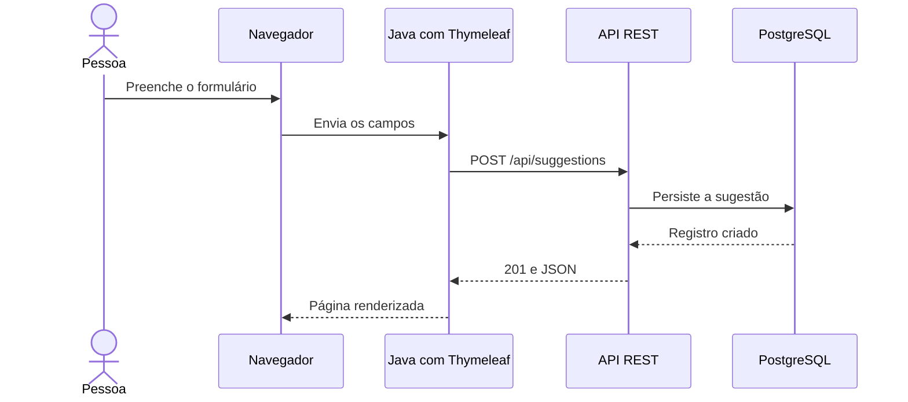
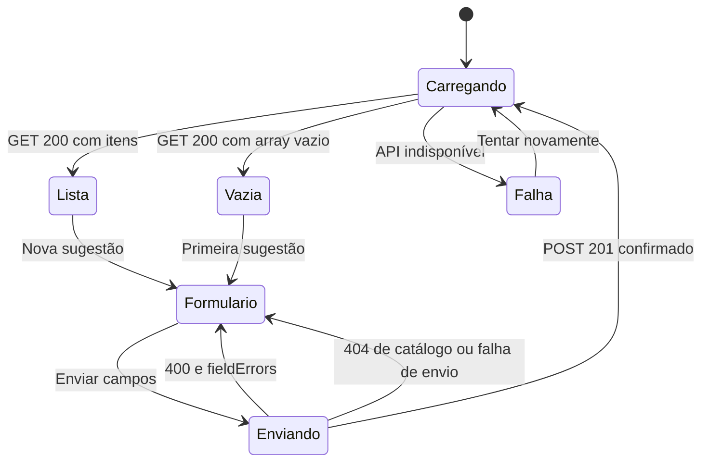

# 10 — Continuação web Java com Thymeleaf

[Roteiro](../README.md) · [Contrato da API](00-modelo-dados.md)

Esta é uma proposta para a próxima entrega; não acrescenta implementação web à
API nem um módulo executável nesta trilha.

## Missão

Criar, em um projeto separado, uma aplicação Spring Boot com Thymeleaf que
consuma a API validada para listar, filtrar, consultar, cadastrar, alterar e
excluir sugestões.

## Pré-requisitos

API protegida concluída em 09, testes aprovados, coleção Insomnia validada pelo professor
e domínio do contrato HTTP. Consulte a solução final em `09-jwt-bearer-token-impl`.
Mantenha a API e o projeto web em pastas e portas diferentes.

## Como as aplicações vão conversar

O navegador recebe HTML renderizado pelo projeto web. O servidor Java faz as
chamadas à API por um cliente HTTP. Nesse fluxo, não é necessário CORS para as
chamadas entre os dois servidores.

## Planejamento da próxima trilha

1. Definir o projeto web, sua porta e a URL base configurável da API.
2. Criar cliente HTTP e DTOs do consumidor, sem acesso direto ao banco da API.
3. Exibir cursos e categorias reais no formulário e nos filtros.
4. Renderizar lista, detalhe e estados de lista vazia ou falha de comunicação.
5. Implementar criação, edição e exclusão, respeitando 201/200/204.
6. Exibir `fieldErrors` junto aos campos e mensagens de ausência ou falha de rede.
7. Tratar autor opcional, datas e navegação após cada operação.
8. Criar a área administrativa: login no servidor web, armazenamento do token no servidor e envio de Bearer em edição/exclusão.
9. Testar o fluxo entre navegador, projeto web e API, incluindo token expirado e novo login.

## Estados que a interface precisa representar

A resposta HTTP orienta a próxima tela: uma lista vazia continua sendo sucesso;
400 devolve os campos para correção, enquanto uma falha de rede permite tentar
novamente. Esses estados pertencem à interface, não à tabela de sugestões.

**Exercício:** desenhe onde aparecem os erros de campo e como manter os dados
digitados quando o envio falhar. Um retorno 500 deve exibir mensagem de falha e
permitir uma ação de recuperação, sem anunciar sucesso.

## Pronto para começar quando

- A API é reproduzível a partir dos capítulos e continua funcionando após reinício.
- As collections comprovam sucessos e falhas previstas.
- As responsabilidades do cliente web e da API estão claras.
- O professor aprovou o contrato e definiu o escopo da próxima entrega.

O público continua sem login. O servidor web deve manter o JWT administrativo
fora do JavaScript e usar sessão com cookie protegido e CSRF no navegador.
Novos usuários, triagem e revogação de tokens exigem planejamento adicional.
