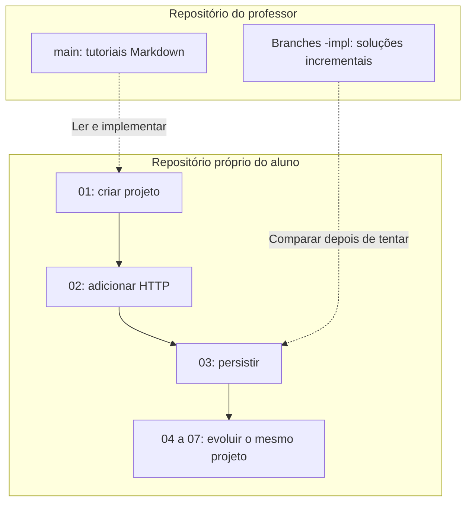

# Como estudar e usar as branches

[Roteiro](../README.md) · [Modelo de dados](00-modelo-dados.md)

## Duas pastas com funções diferentes

Use uma pasta para consultar este material e outra para construir seu projeto.
O clone da `main` contém instruções. O seu projeto terá Java, Gradle, SQL e suas
próprias alterações. A cada módulo, continue o projeto anterior.

```text
C:\dev\projetos\
├── CaixaDeSugestoes-material\   ← clone da documentação
├── CaixaDeSugestoes\           ← projeto que você escreve
└── CaixaDeSugestoes-consulta\   ← solução opcional, em outra pasta
```

Os tutoriais apresentam arquivos completos. **Crie** significa adicionar um
arquivo; **substitua** significa trocar seu conteúdo inteiro, preservando o
caminho. Arquivos que não aparecem no módulo continuam como estavam.
Não acumule controllers duplicados nem versões antigas de um mesmo teste.

Os caminhos começam na raiz do projeto. Um arquivo em
`src/main/java/br/com/etecalbertoferes/CaixaDeSugestoes/domain/Course.java`,
por exemplo, pertence ao pacote
`br.com.etecalbertoferes.CaixaDeSugestoes.domain`.

## A progressão do código

| Etapa | O que deve funcionar ao terminar | Banco para executar? |
| --- | --- | --- |
| 01 | Spring Boot inicia; teste de contexto | Não |
| 02 | GET demonstrativo de sugestões, retornando `[]` | Não |
| 03 | PostgreSQL, migrations e catálogos reais | Sim |
| 04 | CRUD e filtros com entradas válidas | Sim |
| 05 | Validação e erros HTTP uniformes | Sim |
| 06 | Swagger e OpenAPI | Sim |
| 07 | Suíte completa, JAR e validação com collections | Sim |

Antes de 05, os erros ainda não seguem o contrato final. Antes de 04, o GET de
sugestões é demonstrativo. Não é uma falha de uma etapa anterior não conter os
recursos que ainda serão construídos.

## Visualize os repositórios separados

O material orienta sua implementação. No seu repositório, cada branch nova parte
da etapa anterior; a cópia de consulta serve para comparar, sem substituir seu projeto.



**Leia o diagrama:** setas contínuas representam evolução do seu código; setas
pontilhadas representam consulta ao material, sem merge entre os repositórios.

## Git no seu projeto

Depois de gerar o projeto no módulo 01, inicialize um repositório próprio, se
não existir. Na raiz dele:

```bash
git init -b main
git switch -c 01-projeto-spring-boot
```

Implemente 01, confira os critérios e faça o commit indicado ao final do capítulo.
Crie a branch seguinte **a partir da etapa que você acabou de concluir**:

```bash
git switch -c 02-api-rest
```

Depois do commit de 02, crie `03-postgresql-flyway-jpa` e continue, até
`07-testes-entrega`. Você não precisa usar branches se ainda estiver aprendendo
Git; commits por etapa no mesmo projeto também preservam sua evolução.

As branches do **seu projeto** contêm seu código cumulativo. As branches de
exercício do **repositório do professor** contêm documentação. São repositórios
diferentes, com funções diferentes. Não faça merge da solução no seu projeto
para avançar de módulo.

## Como consultar um gabarito

O repositório do professor possui pares de branches:

| Nome | Conteúdo |
| --- | --- |
| `01-projeto-spring-boot` até `07-testes-entrega` | Material de estudo, sem aplicação executável |
| Mesmo nome com `-impl` | Código acumulado até a etapa indicada |
| `07-testes-entrega-impl` | API completa, testes, collections e instruções de execução |

Depois que o professor publicar as branches, abra um **novo terminal na pasta
que contém os projetos**, fora do projeto do aluno, e faça:

```bash
git clone --branch 03-postgresql-flyway-jpa-impl https://github.com/e24Dev/CaixaDeSugestoes.git CaixaDeSugestoes-consulta
```

Para consultar outra etapa nessa cópia:

```bash
cd CaixaDeSugestoes-consulta
git fetch origin
git switch --track origin/04-casos-de-uso-crud-impl
```

Se a branch local já existir, basta `git switch 04-casos-de-uso-crud-impl`.
Não troque de branch com alterações pendentes nessa cópia. Compare nomes de
pacotes, dependências, responsabilidades e respostas HTTP. O objetivo é entender
as diferenças, não substituir o que você escreveu.

Enquanto as branches estiverem somente no computador do professor, os comandos
remotos não estarão disponíveis. O professor pode fornecer uma cópia local do
checkpoint ou publicar o material depois de revisá-lo.

## Comandos e portas

Os comandos de execução dos capítulos usam PowerShell no Windows:

| Windows PowerShell | Linux/macOS |
| --- | --- |
| `.\gradlew.bat test` | `./gradlew test` |
| `.\gradlew.bat bootRun` | `./gradlew bootRun` |
| `curl.exe -i URL` | `curl -i URL` |
| `$env:SERVER_PORT = "8080"` | `export SERVER_PORT=8080` |
| `Remove-Item Env:SERVER_PORT` | `unset SERVER_PORT` |

A trilha usa **8000** para a API e **5432** para PostgreSQL. A partir de 03, o YAML
aceita `SERVER_PORT` como override. Para usar 8080, defina a variável antes de
iniciar a aplicação e atualize `baseUrl` no cliente e a URL do Swagger.
Em 01–02, altere `server.port` no YAML se precisar de outra porta.

Pare a aplicação anterior com `Ctrl+C` antes de iniciar `bootRun` ou o JAR.
Se aparecer `Port ... was already in use`, encontre a cópia já executando ou use
outra porta. Não é necessário mudar o contrato HTTP para isso.

## Como trabalhar com um capítulo

1. Leia a missão e o comportamento esperado antes de copiar qualquer arquivo.
2. Crie ou substitua os arquivos na ordem indicada, com os pacotes corretos.
3. Execute os comandos; confira status, corpo e logs.
4. Resolva o desafio e explique as responsabilidades com suas palavras.
5. Faça um commit apenas depois de conferir os critérios de conclusão.
6. Compare com o checkpoint de apoio e registre o que precisou corrigir.

A preparação do Windows está em [ambiente-windows.md](ambiente-windows.md).
Dúvidas sobre nomes, regras ou respostas devem ser resolvidas pelo
[contrato](00-modelo-dados.md), e não pelo rascunho histórico arquivado.
