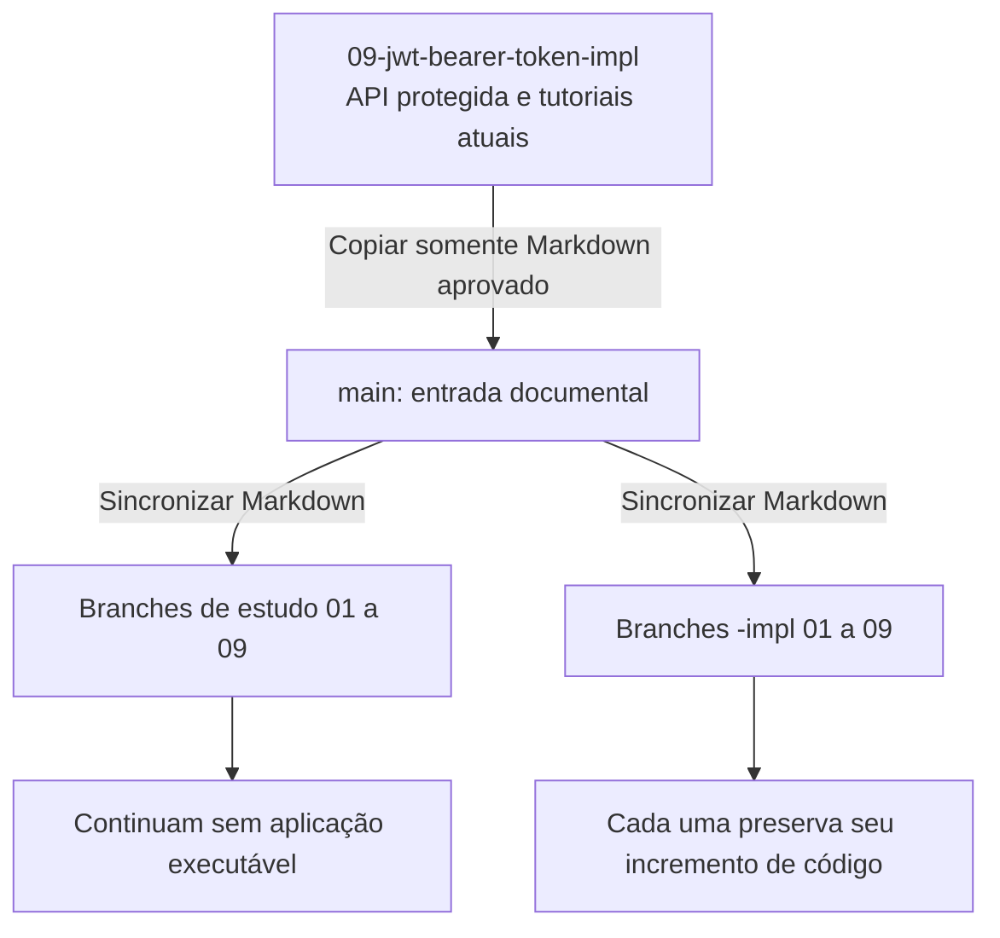

# Guia do professor

[Roteiro](../README.md) · [Como estudar](como-estudar.md)

## Organização da trilha

A `main` já contém somente documentação e arquivos auxiliares de Git. Não é
necessário remover Java dela. A revisão dos tutoriais foi preparada na branch
`tutoriais-api-incremental`, criada a partir da implementação final para
permitir comparar os exemplos com o código. Essa branch de revisão também
contém a aplicação. A revisão atual com segurança está em `09-jwt-bearer-token-impl`;
leve somente os Markdown para a `main` ao aprovar o material.

| Referência | Função |
| --- | --- |
| `main` | Entrada documental e roteiro completo |
| Branches 01–09 sem sufixo | Documentação dos exercícios |
| Branches 01–09 com `-impl` | Código cumulativo de apoio até cada etapa |
| `07-testes-entrega-impl` | API completa sem autenticação |
| `08-spring-security-impl` | Administrador BCrypt e Basic intermediário |
| `09-jwt-bearer-token-impl` | API final protegida e collections JWT |
| `tutoriais-api-incremental` | Revisão dos capítulos, ainda separada da main |

A etapa 09 é a branch final protegida; a 07 preserva a entrega sem autenticação.
As branches 08 e 09 sem sufixo contêm somente documentação.
Mantenha uma referência principal para evitar duas soluções finais divergentes.
A revisão documental não reescreve o histórico dos checkpoints.

## Método de aula

Os alunos criam um projeto separado e o evoluem em ordem. Os tutoriais agora
incluem os arquivos completos necessários, com indicação explícita de criação
ou substituição. O gabarito é material de apoio, não um pré-requisito para
obter código ausente do capítulo. O Wrapper binário vem do projeto gerado no
Initializr; não pode ser recriado por um bloco de texto Markdown.

Peça que o aluno explique o caminho request → controller → serviço → adapter →
banco e registre um commit após cada missão. No projeto do aluno, branches
sucessivas derivam da etapa anterior. No repositório do professor, as branches
sem sufixo permanecem documentais; isso é explicado em `como-estudar.md`.

Todos os capítulos podem estar disponíveis desde o início. O número da branch
indica até onde vai o código executável, e não uma barreira para ler o material.

## O que esperar em cada checkpoint

| Etapa | Comportamento | Testes existentes |
| --- | --- | --- |
| 01 | Contexto e inicialização sem banco | 1 contexto |
| 02 | GET demonstrativo `[]` | 1 contexto; HTTP conferido manualmente |
| 03 | PostgreSQL, migrations e catálogos | 1 PostgreSQL/contexto |
| 04 | CRUD e filtros com entradas válidas | 1 PostgreSQL/contexto; CRUD manual |
| 05 | Validação e erros uniformes | 9, sendo 8 HTTP isolados |
| 06 | Swagger e OpenAPI | Os mesmos 9 |
| 07 | Precisão de datas, suíte completa e entrega | 20, incluindo integração |
| 08 | Administrador BCrypt, Basic e permissões | 26 |
| 09 | Login, JWT, Bearer e validação de claims | 32 |

Os testes de serviço e integração CRUD entram em 07. Não prometa que existem
nos checkpoints anteriores. Antes de 05, erros de aplicação ainda não têm
mapeamento uniforme; confira entradas válidas em 04 e introduza falhas em 05.

De 03 em diante, os testes de integração precisam de Docker. Executar a API
precisa de PostgreSQL local ou Compose. O PostgreSQL temporário de Testcontainers
não é o banco da aplicação. A suíte completa falha quando Docker está indisponível;
não deve ignorar silenciosamente a integração.

## Revisar os tutoriais antes da distribuição

1. Use a preparação Windows e crie um projeto novo conforme 01.
2. Aplique os arquivos dos capítulos 01–09, preservando o que não for substituído.
3. Confira os critérios por etapa e execute os comandos apresentados.
4. Em 07, espere 20 testes; em 08, 26; em 09, 32. Valide as collections da respectiva versão.
5. Em 09, configure credenciais e chave locais, valide 401/403 e reinício com token não expirado.
6. Peça a uma dupla para repetir sem ajuda e registre as dúvidas de reprodução.

O registro em [validacao.md](validacao.md) diferencia comparação automática,
execução real e conferências manuais que ainda cabem à turma.

## Levar somente os Markdown para main

Esta é a etapa de distribuição **após revisar a branch de tutoriais**. Ela não
foi executada automaticamente. Execute com árvore limpa; preserve alterações
locais antes de trocar de branch. Não faça merge da branch de revisão inteira,
pois ela deriva da API e acrescentaria a aplicação à main.

```bash
git switch main
git restore --source=09-jwt-bearer-token-impl -- README.md docs
git add README.md docs
git diff --cached --name-only
git commit -m "docs: publica trilha reproduzivel da API"
```

O diff deve conter somente arquivos `.md`. Esses caminhos não incluem `src`,
`build.gradle`, Wrapper, Compose ou collections. Não apague arquivos nem reescreva
o histórico para manter a separação.

### Visualize a distribuição documental

As setas abaixo representam cópia somente de `README.md` e `docs/`. Essa operação
não leva o Java da branch de revisão para main nem o código final para etapas
anteriores.



**Conferência do professor:** antes de cada commit de sincronização, o diff
staged deve listar somente `.md`; o número da etapa continua delimitando o código.

## Sincronizar a documentação nos checkpoints

Depois de integrar a documentação aprovada em `main`, para cada branch de
estudo e cada `-impl`, aplique somente os mesmos caminhos. Exemplo:

```bash
git switch 03-postgresql-flyway-jpa-impl
git restore --source=main -- README.md docs
git add README.md docs
git diff --cached --name-only
git commit -m "docs: sincroniza tutorial aprovado"
```

Repita nas demais branches. O código de cada checkpoint fica preservado; não
faça merge da API final em etapas anteriores. Se não houver diferença documental,
não há commit a criar. Retorne à branch de trabalho ao terminar.

## Publicar após revisão

As branches podem existir somente na cópia local até a publicação. Confira
`git remote -v` e `git branch --list`. Publique `main`, os pares de módulos e,
se necessário, a branch de revisão. Um exemplo para um par:

```bash
git push origin main
git push origin 01-projeto-spring-boot 01-projeto-spring-boot-impl
```

Repita para os demais pares; não use force push. Depois, confira os links do
README no GitHub. Se o remoto recusar por ter commits novos, busque e revise as
diferenças antes de integrar; não sobrescreva o histórico remoto.

## Dados, diagramas e próxima etapa

O projeto é da Etec Prefeito Alberto Feres. Os quatro cursos são o conjunto
didático acordado, sem afirmar que compõem a oferta oficial da escola.
Os diagramas do modelo explicam relações, criação e identificação opcional;
seus estados são conceituais e não pedem uma coluna de triagem no banco.

O projeto web será Java com Thymeleaf, em aplicação separada, consumindo HTTP.
Valide a API no Insomnia antes de iniciar essa etapa. O login é exclusivo do
administrador. O projeto web deve manter o JWT no servidor e proteger sua sessão
de navegador com CSRF. Não há cadastro público nem controle de propriedade.
